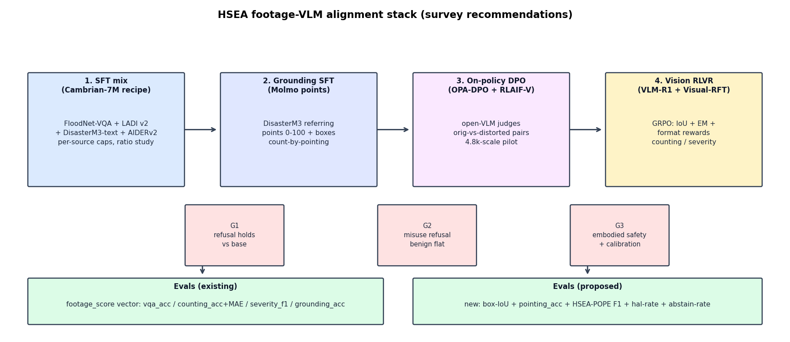
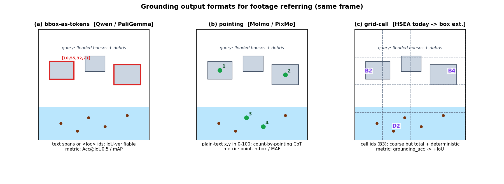
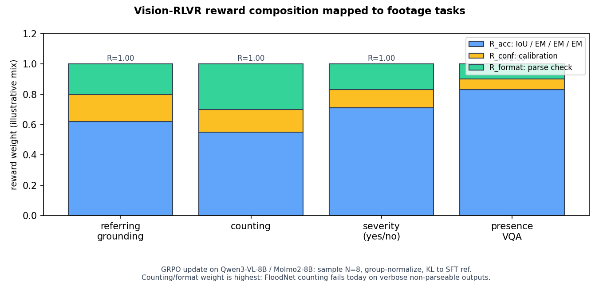

# VLM alignment methods for HSEA footage agents (survey, Nov 2026)

Current (2024-2026) vision-language alignment and finetuning methods,
surveyed for footage-grounded disaster-response agents. Every paper
below was read in full text (arXiv HTML); arXiv search was used for
discovery only. Verdicts map strictly to #24-cleared, non-skipped
corpora.

## 0. Grounding: what HSEA has today

Footage corpora (all pins and terms per `docs/datasets.md`,
`docs/license-clearance-24.md`, `docs/footage-evals.md`):

| Corpus | Role | License / clearance |
|---|---|---|
| FloodNet-VQA (`ljx620/FloodNet-VQA` @ `ec9277af`) | only native UAV VQA; counting + VQA | base CDLA-Permissive; QA text + refs only, gated research-only (#7) |
| LADI v2 (`MITLL/LADI-v2-dataset` @ `5f2dbfe8`) | expert multi-labels as 12 yes/no Qs | CC-BY-4.0, cleared |
| DisasterM3 (`Kingdrone-Junjue/DisasterM3`) | VLM format template; 6 tasks incl. referring seg | CC-BY-NC-SA-4.0, research-only |
| D-Fire | fire/smoke YOLO bboxes, 21.5k imgs | CC0 collection + per-provider terms, research |
| FLAME 2 | fire/smoke frame labels, 53k pairs | CC-BY-4.0 |
| AIDERv2 | 4-class aerial classification, 16.7k | CC-BY-4.0 |
| NOMAD / WiSARD | victim bboxes (RGB / RGB+thermal) | CC-BY-4.0 / MIT-style |
| MEDIC / CrisisMMD / HumAID | ground-view incident semantics | CC-BY-NC-SA-4.0, research-only |
| DMD | 6 damage classes, 5.9k captioned | CC-BY-4.0, cleared (#24) |

Out of scope for training: RescueNet (ND, eval-only), SARD / FLAME 3 /
HERIDAL / TREC-IS / DAD-standalone / CrisisHelpOffer / Sen1Floods11
(skipped, signup), VIDI (blocked, no license + YouTube ToS).

Scorer: `footage_score` (`hsea/scorers/footage.py`) routes per-sample
`kind` to `vqa_accuracy` (normalized EM), `counting_acc` + `counting_mae`
(first-integer match), `severity_f1` (yes/no EM, mean = micro-F1),
`grounding_acc` (grid-cell match, scored but no corpus task yet).
Grounding lane: Molmo2-8B/4B (pointing/tracking); workhorses Qwen3.8-27B
and Qwen3-VL-8B/32B; edge floor SmolVLM-256M (`docs/models.md`).

## 1. Visual instruction-tuning data mixes

### 1.1 Cambrian-1: curate by per-source caps + ratio study [C1]

Mechanism. Vision-centric MLLM study over 20+ encoders; introduces the
Spatial Vision Aggregator (SVA) connector and CV-Bench. For data, it
pools ~9.8M instruction samples (Cambrian-10M) from public sources,
then curates to Cambrian-7M with two controls: a per-source cap
threshold t (elbow at 250k-350k samples per source) and an explicit
mixture-ratio study at fixed 1.35M scale. Curated 7M beats raw 10M on
every category (general, knowledge, OCR/chart, vision-centric).

Data needs. Public instruction sources only; no proprietary-VLM
distillation required. Needs the ratio ablation loop (several 1.35M
pilots).

HSEA fit: ADAPT. The recipe transfers directly at our scale: pool
FloodNet-VQA + LADI-v2 questions + DisasterM3 text tasks +
AIDERv2/FLAME-2/D-Fire-derived QA, cap dominant sources (DisasterM3 is
123k pairs and would drown 4.5k FloodNet pairs), and run a small ratio
study before the full SFT. SVA itself is pretraining architecture: skip
the module, adopt the curation method.

Concrete experiment. Build `footage-mix-v1` (3 ratio variants at ~50k
samples: uniform-cap vs FloodNet-upweighted vs DisasterM3-downweighted),
SFT Qwen3-VL-8B LoRA per `docs/process.md` §2, and compare
`footage_composite` on held-out FloodNet-VQA + LADI-v2.

### 1.2 LLaVA-OneVision: staged single -> multi-image -> video transfer [O1]

Mechanism. One model for single-image, multi-image, and video via staged
data: 3.2M single-image instructions first, then 1.6M mixed OneVision
data (560K multi-image, 350K video, 800K resampled single-image), with a
3-stage schedule (align -> high-quality knowledge -> instruction
tuning). Key finding: image-task training transfers to video and
multi-image (emergent cross-scenario abilities).

Data needs. Large single-image base + smaller multi-image/video mixes;
3.5M re-captioned descriptions were self-generated by LLaVA-NeXT-34B
(open-model self-improvement, no proprietary API).

HSEA fit: ADAPT the staging, SKIP the video stage for now. Our cleared
corpora are all single-image/frame; there is no cleared video corpus
(VIDI blocked). Run stage 1 on the footage mix, stage 2 on a
multi-image mix (bi-temporal DisasterM3 pairs + FloodNet before/after
style pairs), and defer video until a cleared drone-video source lands.
The self-re-captioning trick is adoptable with our own served lane
(Qwen3-VL) instead of GPT-4V.

Concrete experiment. After the §1.1 SFT, continue-tune on multi-image
DisasterM3 bi-temporal pairs reformatted as change-VQA; eval
FloodNet-VQA single-image delta (must not regress) + a new change-QA
probe set.

### 1.3 Molmo/PixMo curation: no-distillation open data [M1]

Mechanism. State-of-the-art open VLM built with zero distillation from
proprietary VLMs: PixMo-Cap (dense captions), PixMo-AskModelAnything
(annotator-edited free-form Q&A, 162k on 73k images), PixMo-Points
(§2.1), plus Docs/Clocks/Count. Quality comes from annotation pipelines
(annotators editing LLM drafts, exhaustive pointing) rather than scale.

Data needs. Annotator time + a language-only LLM for draft editing;
image rights must be clean per source.

HSEA fit: ADOPT as policy. HSEA already lives this way (cleared corpora
+ in-repo curation in `hsea/data/curate_v2.py`); the survey adopts
Molmo's rule explicitly: no GPT-4V/Claude-generated training targets
anywhere in the loop (cost, ToS, and license cleanliness). Prefer our
served open lane for any synthetic augmentation.

Concrete experiment. None standalone; this is a constraint on all
experiments below (judges = Molmo2-8B / Qwen3-VL-8B served on Modal).

*Figure 1 (original): the recommended four-stage stack. SFT mix (§1)
feeds grounding SFT (§2), on-policy DPO (§3), and vision RLVR (§4),
each gated by the safety stack and graded by footage_score plus the
proposed §9 metrics. Rendered by `scripts/plot_alignment_vlm.py`.*

## 2. Region-level and grounding objectives

### 2.1 Molmo pointing: 2D points as plain text [M1]

Mechanism. PixMo-Points collects 2.3M question-points pairs over 223k
images by asking annotators to point at every instance (exhaustive
coverage) plus "not present" negatives. The model emits points as
plain-text coordinates normalized to 0-100, ordered top-down /
left-to-right and numbered; sequences of points double as a
count-by-pointing chain-of-thought and as visual explanations attached
to answers (79k point-explanation annotations). Points are far cheaper
to annotate than boxes or masks, which is what buys the 2.3M scale.

Data needs. Point annotations + referring expressions; positives and
negatives. No boxes required.

HSEA fit: ADOPT. This is the grounding format for issue #9 (Molmo2-8B
SFT): DisasterM3's referring subset converts to point supervision
(mask centroid + sampled interior points), and FloodNet counting
converts to count-by-pointing traces. The "not present" split maps to
abstention training (say none / abstain instead of hallucinating a
victim).

Concrete experiment. Derive `disasterm3-points-train` (referring
expression -> point list, 0-100 space) and `floodnet-count-points`
(count question -> ordered points); SFT Molmo2-8B; eval pointing_acc
(§9) on held-out DisasterM3 referring + `counting_acc` on FloodNet-VQA.

### 2.2 Qwen2.5-VL: boxes-or-points with absolute coordinates [Q25]

Mechanism. Flagship Qwen VLM that localizes with bounding boxes or
points; pretraining mixes grounding data with absolute (non-normalized)
position coordinates, dynamic-resolution ViT with window attention, and
absolute-time video encoding. Pointing data explicitly includes PixMo
plus detection/segmentation-derived grounding plus an automated
precise-pointing synthesis pipeline (copy-paste augmentation, Grounding
DINO + SAM proposals). Post-training adds rejection sampling for
reasoning.

Data needs. Box + point + referring-expression triples at scale; partly
synthesizable from detectors (DINO/SAM) with filtering.

HSEA fit: ADAPT. Take the dual format (boxes where we have them:
D-Fire, NOMAD; points elsewhere) and the absolute-coordinate lesson for
fixed-GSD aerial frames, where normalized 0-1000 hides true scale.
Absolute pixel coords + GSD in the prompt is a better HSEA convention.
Skip full-scale pretraining; finetune only.

Concrete experiment. Convert D-Fire YOLO boxes + NOMAD person boxes to
`[x1,y1,x2,y2]`-in-pixels SFT rows with GSD side info; measure box-IoU
(§9) before/after on a held-out split; compare normalized vs absolute
coordinate prompts.

### 2.3 PaliGemma: location and mask tokens [PG1]

Mechanism. SigLIP-So400m + Gemma-2B with 1024 dedicated location tokens
(`<loc0000>`-`<loc1023>`, binned normalized coords) for detection /
referring / grounded captioning, plus 128 VQVAE mask tokens for
referring segmentation. A broad pretraining task mixture (incl.
remote-sensing) makes it a transfer-efficient 3B base; the paper shows
image-drawn boxes work as well as `<loc>` prompts.

Data needs. Box/segmentation annotations across many tasks; vocab
extension + pretraining to learn the new tokens.

HSEA fit: SKIP for the finetune track, WATCH for edge. Adding 1k+ fresh
tokens to Qwen/Molmo/Gemma bases mid-finetune is poor value (tokens
start untrained; our box corpora are small). Revisit if we train an
edge detector head from a PaliGemma-class base. The "red box in image =
prompt" finding is a free eval trick we can use today (overlay
candidate boxes, ask the VLM to pick).

Concrete experiment (eval-only, no training). Overlay-probe: draw
numbered candidate boxes on FloodNet frames, ask "which box contains
<flooded house>?"; score pick accuracy. Evals cost only.

### 2.4 Griffon v2: high-resolution referring without tiling [G2]

Mechanism. Generalist LVLM for detection, counting, referring (REC/REG,
phrase grounding) at 1K+ resolution via a lightweight strided-convolution
down-sampling projector (no image tiling, full context preserved) plus
a plug-and-play visual tokenizer for visual-language co-referring
(refer with text, coords, screenshots, or cross-image). Beats
task-specific experts on detection/counting; SOTA on REC benchmarks.

Data needs. High-res images + detection/counting/grounding annotations;
encoder interpolation + projector training.

HSEA fit: ADAPT the insight, SKIP the model. FloodNet frames are
3000x4000 and LADI is low-altitude detail; the paper confirms
resolution is the binding constraint for small-object counting, which
argues for keeping HSEA eval images at high resolution (§0 currently
downsamples to 1024px) and for projector-style compression over tiling
in any future encoder work. No HSEA finetune on Griffon itself (heavy,
single-vendor recipe).

Concrete experiment. Resolution ablation on the eval harness: run
FloodNet-VQA counting at 1024 vs 2048px long-edge through Qwen3-VL-8B;
report `counting_acc`/`counting_mae` delta per extra token/$ (uses
`png_bytes(max_side)` in `hsea/data/footage.py`).

*Figure 2 (original): the three grounding output formats on one
stylized flood frame: (a) bbox-as-tokens (Qwen/PaliGemma style),
(b) Molmo-style numbered pointing with count-by-pointing, (c) HSEA's
current grid-cell format with the proposed box-IoU extension.*

## 3. Multimodal DPO and RLHF

### 3.1 RLAIF-V: open-source divide-and-conquer feedback [R1]

Mechanism. Fully open-source RLHF for MLLMs: (1) deconfounded candidate
generation (multiple decodes under identical conditions, so style stops
confounding preference), (2) divide-and-conquer labeling (split
responses into atomic claims; an open MLLM judges each claim against the
image), (3) DPO on the resulting pairs, (4) self-feedback inference-time
scaling using the DPO model's own reward with length debiasing.
LLaVA-1.5-7B + RLAIF-V cuts object hallucination 80.7% and overall
hallucination 33.7%; the 12B self-aligned run beats GPT-4V on
trustworthiness.

Data needs. Diverse instructions (MSCOCO, ShareGPT-4V, VQA-v2, OKVQA,
TextVQA, ...) + an open labeler MLLM. No human labels, no proprietary
judge.

HSEA fit: ADOPT. This is the template for footage preference data:
instructions from FloodNet-VQA + LADI questions + DisasterM3 text tasks,
claims judged by our served open lane (Molmo2-8B / Qwen3-VL-8B). It fits
the Lexsi chain (AlignTune DPO) and the no-distillation policy (§1.3).
Self-feedback decoding is a free inference upgrade for the
navigator/orchestrator once a DPO checkpoint exists.

Concrete experiment. Build 5k footage preference pairs (deconfounded
sampling from the §1.1 SFT checkpoint, claim-judged by Qwen3-VL-8B);
DPO-tune; eval `footage_composite` + HSEA-POPE F1 (§9) before/after.

### 3.2 POVID: AI-generated dispreferences, GT preferred [P1]

Mechanism. Frames hallucination as modality misalignment and fixes it
with DPO where preferred = ground-truth instruction response and
dispreferred comes from two automatic corruptions: (1) GPT-4V injects
plausible hallucinations into the correct answer; (2) distorted images
trigger the VLLM's own inherent hallucinations. No human data, no
perfect expert; reduces hallucination and lifts standard benchmarks.

Data needs. GT instruction pairs + a hallucination injector + image
distortions (noise/blur/crop pipelines).

HSEA fit: ADAPT (swap the injector). Keep GT-preferred from cleared QA
and both corruption channels, but replace GPT-4V with an open model
(served Qwen3-VL or template-based corruptions: entity swaps from LADI
label sets, count +/-1, severity flips). Distorted-image negatives are
free and suit aerial footage (haze/blur/downsample mimic real drone
degradation).

Concrete experiment. From LADI-v2 train: preferred = gold yes/no +
templated rationale; dispreferred = (a) label-flipped answers,
(b) answers generated on blurred/downsampled frames; DPO on 3k pairs;
report `severity_f1` + HSEA-POPE Yes-bias (§9).

### 3.3 OPA-DPO: on-policy is what makes DPO work [O2]

Mechanism. Diagnoses why VLM-DPO results vary: off-policy pairs fight
the KL-to-reference term, so learning stalls. Fix: generate the
model's own (hallucinated) responses, have an expert revise them, and
align both original and revised responses on-policy. Three losses:
language correction, image-focus (prefer the response under the true
image over a distorted image, weighted by GPT-4V sentence
categorization), and anchored preference. With only 4.8k pairs it beats
a 16k-sample SOTA (-13.26% AMBER, -5.39% Object-Hal on LLaVA-1.5-7B).

Data needs. Small (thousands of pairs); on-policy samples from the
reference checkpoint + expert revisions + distorted images.

HSEA fit: ADOPT the on-policy discipline. Whatever DPO we run (§3.1,
§3.2), pairs must come from the checkpoint being aligned, not from a
stronger teacher or a stale model. Adopt image-focus with open-model
sentence weights. The 4.8k-data regime matches our cleared-corpus scale.

Concrete experiment. Re-run the §3.1 pilot twice: on-policy pairs (from
the SFT checkpoint) vs off-policy pairs (from the base model); the
on-policy arm must win on HSEA-POPE F1 for the method to ship.

## 4. Vision RLVR: verifiable rewards for counting, VQA, grounding

### 4.1 VLM-R1: GRPO with IoU + format rewards [V1]

Mechanism. R1-style RL for VLMs on Qwen2.5-VL-3B/7B/32B: GRPO (N=8,
temp 0.9, KL beta 0.04 for REC, 0 for OVD; lr 1e-6, 2 epochs).
REC accuracy reward = IoU(pred box, gold box); OVD reward = mAP with a
length penalty min(1, L_gold/L_pred) that punishes box spamming; format
reward checks `<think>/<answer>` JSON compliance. Finds: RL beats SFT
on generalization; reward hacking is real in detection (hence the
length penalty); data quality dominates quantity.

Data needs. Gold boxes/labels for REC/OVD; a parseable output schema.

HSEA fit: ADOPT. Our scorer is already verifiable-first
(`counting_acc`, EM, grid match), so RLVR ports cleanly: counting
reward = EM + MAE-shaped term, severity/VQA reward = EM, grounding
reward = IoU once DisasterM3 boxes land. Adopt the length penalty for
counting (punish enumerated-garbage lists) and the format reward
directly: today's FloodNet counting failures are verbose non-parseable
outputs (`docs/footage-evals.md`).

Concrete experiment. GRPO pilot on Qwen3-VL-8B (SFT checkpoint from
§1.1): rewards = counting EM + format on FloodNet counting + severity
EM on LADI; N=8, 1 epoch; report `counting_acc`/`counting_mae` +
`severity_f1` vs the SFT-only arm. This is the training follow-up
issue's core experiment (see `docs/reports/alignment-vlm-survey.md`).

### 4.2 Visual-RFT: IoU + confidence + format, few-shot [V2]

Mechanism. GRPO on Qwen2-VL-2B/7B with task-specific verifiable
rewards: detection R = mean-IoU + confidence-calibration + format
(confidence rewarded high on matched boxes, low on unmatched);
classification R = accuracy + format. Evaluated few-shot: fine-grained
classification, few-shot detection, reasoning grounding (LISA),
open-vocabulary detection (COCO-65-base -> 15 novel + 13 LVIS rare).
Beats SFT on generalization throughout.

Data needs. Small labeled sets (few-shot regime); boxes + confidences +
classes.

HSEA fit: ADOPT, especially the confidence term. Few-shot RLVR fits our
small cleared corpora, and the confidence-calibration reward is the
bridge to HSEA's abstention/escalation axis: a model trained to emit
honest confidences can be thresholded into defer-to-human. Pair with
the abstention evals (`evals/abstention.py`) from day one.

Concrete experiment. Add a scalar confidence head-convention to the
counting/severity prompts ("answer + confidence 0-1"); RLVR with
accuracy + calibration + format rewards on FloodNet+LADI; report ECE
on severity alongside `severity_f1`.

*Figure 3 (original): how the RLVR reward budget splits per footage
task family. Format/confidence weight is deliberately high for
counting, where verbose outputs are the current failure mode.*

## 5. Video-temporal alignment

### 5.1 Qwen2-VL: unified image/video with M-RoPE [Q2]

Mechanism. Naive Dynamic Resolution (images -> variable token counts)
+ Multimodal RoPE (temporal/height/width position split) + one paradigm
for images and video (video = multi-frame with 3D positions). 2B/8B/72B
scale study; grounding format in §2 context: boxes as
`(x1,y1),(x2,y2)` text in [0,1000) with box/object-ref delimiters.

Data needs. Image + video instruction data at scale; pretraining.

HSEA fit: ADAPT for multi-frame eval, SKIP for video training. No
cleared video corpus exists, but the unified paradigm blesses what we
can do today: feed sampled frames as multi-image (Molmo2 tracking
covers frame-to-frame grounding). Adopt the Qwen box-text format as the
HSEA box convention (it is parseable, delimited, and already supported
by our Qwen lane).

Concrete experiment. Multi-frame probe: 3-frame sequences from NOMAD
(same actor across frames) as multi-image input to Molmo2-8B; ask for
per-frame points; score track consistency (same-actor point distance
across frames).

### 5.2 LLaVA-Video: synthetic video-instruction data at scale [LV1]

Mechanism. LLaVA-Video-178K: 178,510 clips (0-3 min) annotated by
GPT-4o + humans with detailed captions, open-ended QA, and multiple-choice
QA; training on synthetic + existing visual-instruction data yields a
strong video LMM. The contribution is the synthesis pipeline, not
architecture.

Data needs. Raw video + a strong captioner/QA-writer + human filtering.

HSEA fit: SKIP for training, ADAPT the pipeline later. Blocked on raw
video rights (VIDI has no license). When a cleared drone-video source
appears, this is the recipe (with an open captioner). Nothing to run
today.

Concrete experiment. None until clearance; pipeline design stays in the
note as the plan of record.

### 5.3 InternVideo2: progressive video-foundation training [IV2]

Mechanism. Three-stage progressive training unifying masked video
modeling -> video-audio-speech-text contrastive alignment ->
next-token video dialogue; video encoder scaled to 6B; SOTA on 60+
video/audio tasks incl. long-video dialogue.

Data needs. Massive video + audio/speech + text; foundation-training
compute.

HSEA fit: SKIP. Pretraining-scale work, far outside the finetune loop;
also inherits the no-cleared-video blocker. The only portable lesson
(spatiotemporal consistency in annotation) is already covered by §5.1
multi-frame practice.

Concrete experiment. None.

## 6. Hallucination reduction

### 6.1 POPE: polling-based object probing [PO1] (background, 2023)

Mechanism. Turns hallucination eval into stable yes/no polling: "Is
there a <object> in the image?" over 500 COCO images x 6 questions,
with negatives sampled under three regimes (random / popular /
adversarial co-occurring). Metrics: Accuracy, Precision, Recall, F1
(major), plus Yes-rate to expose bias. Found InstructBLIP best and
several models answering Yes ~99%.

Data needs. Object presence annotations; a negative-sampling scheme.

HSEA fit: ADAPT into HSEA-POPE. LADI-v2's 12 binary labels are a native
POPE substrate: probe each label with yes/no questions, sample
negatives by Rare (random), Frequent (popular: water/trees), and
Co-occurring (adversarial: flooding_structures given flooding_any).
This becomes the hallucination axis of `footage_score` (see §9).

Concrete experiment. Build `hsea_pope_ladi` (test split; 3 negative
regimes x presence questions); run Qwen3-VL-8B + Molmo2-8B; report F1
+ Yes-rate per regime. Part of the eval follow-up issue.

### 6.2 HSA-DPO: severity-aware preference optimization [H1]

Mechanism. Three-part pipeline: (1) proprietary model writes
sentence-level annotations (hallucination type / severity / rationale);
(2) train an open detection model on them (SOTA on MHaluBench, beating
GPT-4V/Gemini); (3) detect-then-rewrite builds preference pairs
automatically, and severity-weighted DPO prioritizes critical
hallucinations. -36.1% AMBER, -76.3% Object HalBench vs base.

Data needs. Small seed annotation set + unlabeled responses to rewrite.

HSEA fit: ADAPT (open the seed step, map severity to damage). Replace
the proprietary annotator with our open lane + templates; define
severity by operational cost: missed damage / invented victim (critical)
> wrong count (major) > verbose style (minor). The detector becomes a
reusable footage factuality judge for RLAIF-V-style loops (§3.1).

Concrete experiment. Seed 500 sentence-level annotations on FloodNet
answers (open-model + template assist, human spot-check); train a LoRA
detector on Qwen3-VL-8B; detect-then-rewrite 3k pairs; severity-DPO;
report hal-rate + `severity_f1`.

### 6.3 HaloQuest: triggers + synthetic images + Auto-Eval [HQ1]

Mechanism. 7.7K hallucination-trigger VQA items across false premises,
insufficient context, and visually challenging cases; mixes synthetic
and real images (benchmark correlation r=0.97, so synthetic eval
transfers); fine-tuning on it cuts hallucination without hurting VQA;
Auto-Eval LLM-judge protocol correlates r=0.99 with humans.

Data needs. Trigger-style questions + real/synthetic images + judge
prompts.

HSEA fit: ADAPT all three ideas. (1) False-premise probes ("how many
survivors on the intact roof?" on a no-victim frame) directly extend
the abstention evals: correct behavior is abstain/escalate, not answer.
(2) The r=0.97 synthetic-transfer finding supports rendered-frame eval
(`HSEA_RENDER_FRAMES_DIR` + SAM survey frames) as a legit proxy. (3)
Auto-Eval with an open judge is acceptable for ablations, but ship
gates stay deterministic (footage_score), never judge-gated.

Concrete experiment. Write 120 HaloQuest-style probes over FloodNet+LADI
frames (40 false-premise, 40 insufficient-context, 40 visually hard);
score abstain-rate + wrong-answer-rate on two served VLMs; add the
abstain slice to `evals/abstention.py` coverage.

(§3 methods RLAIF-V, POVID, OPA-DPO double as hallucination mitigations
and are not repeated here.)

## 7. Small-VLM and edge alignment

### 7.1 SmolVLM: recipe for sub-2B multimodal models [S1]

Mechanism. Systematic tiny-LMM study on SigLIP + SmolLM2: small LMs
want small vision encoders (SigLIP-B/16 93M beats SO400M under a 135M
LM); pixel-shuffle token compression; image splitting + token
compression for hi-res/video; long-context trick for resolution.
SmolVLM-256M runs in <1GB VRAM and beats 300x-larger Idefics-80B; the
2.2B rivals models using 2x memory, with video support.

Data needs. Standard instruction mixes, compressed-token training.

HSEA fit: ADAPT for the edge lane. SmolVLM-256M is already our edge
floor (`docs/models.md`); the recipe tells us how to footage-tune it
(small encoder, aggressive token compression, short answers) without
breaking the memory budget. Pixel-shuffle is also the cheapest answer
to §2.4's resolution problem at the edge.

Concrete experiment. SFT SmolVLM-256M-Instruct (LoRA) on LADI yes/no +
FloodNet short-answer subsets; report `footage_composite` vs VRAM/latency;
must clear an edge bar (e.g. composite within 15 pts of Qwen3-VL-8B on
LADI) to justify further edge tuning.

### 7.2 Bunny: data-centric lightweight MLLMs [B1]

Mechanism. Shows a smaller-but-better MLLM comes from data, not scale:
condenses LAION-2B to a 2M coreset in three CLIP-embedding steps
(SemDeDup @0.86 -> 952M; pair-similarity 40-60% -> 190M; centroid
15-35% -> 2M) for pretraining, plus curated Bunny-695K for SFT.
Bunny-4B/8B beat larger SOTA on several benchmarks.

Data needs. A large noisy pool to condense + curation compute (CLIP
embeddings + k-means at scale).

HSEA fit: ADAPT the discipline, SKIP the pipeline. Our pools are
thousands, not billions: the 3-step condense is overkill, but the
lesson (dedup + quality-band filtering + coverage balancing) applies to
every HSEA mix (§1.1 caps are the small-scale version). Revisit if we
ever pool web-scale aerial imagery.

Concrete experiment. Apply Bunny-lite to the §1.1 pool: embedding
dedup + quality-band keep + cap; ablate SFT with/without it (expect
small but free gains).

### 7.3 FastVLM: efficient hi-res encoding [F1]

Mechanism. FastViTHD hybrid vision encoder co-designed with the LLM
for the resolution-latency-token frontier: scales input resolution
without extra token pruning; 3.2x time-to-first-token win in a
LLaVA-1.5 setup at equal quality; beats LLaVA-OneVision-1152 on
SeedBench/MMMU/DocVQA.

Data needs. Encoder pretraining + VLM training; architecture work.

HSEA fit: SKIP for training, WATCH for serving. Encoder pretraining is
out of scope, but FastVLM-class models are candidates the next time the
serving lane re-bids on latency (drone-side TTFT matters). No HSEA
experiment today.

Concrete experiment. None; revisit at the next models.md refresh.

### 7.4 FastV: train-free visual-token pruning [F2]

Mechanism. Observation: deep LLM layers barely attend to most visual
tokens. FastV ranks visual tokens by early-layer attention and drops
50% after layer 2: -45% FLOPs on LLaVA-1.5-13B with no average
benchmark loss; plug-and-play, no retraining; Pareto-customizable drop
rate.

Data needs. None (inference-time).

HSEA fit: ADOPT for eval/serving, with a grounding guardrail. Free
latency/cost cut for every footage eval and for edge serving. Risk:
pruning could drop the small/distant objects grounding needs, so ship
only after a no-regression check on counting + grounding slices.

Concrete experiment. Implement attention-rank pruning in the Modal vLLM
serve path (or post-hoc token-drop study if vLLM internals resist);
sweep drop rates {0, 30%, 50%} on FloodNet counting + LADI severity;
ship 50% only if `counting_acc` and `severity_f1` stay within noise.

## 8. Comparison and recommendations

| Method | Category | Verdict | HSEA experiment (corpus) |
|---|---|---|---|
| Cambrian-7M curation [C1] | data mix | ADAPT | ratio study on footage-mix-v1 (FloodNet+LADI+DisasterM3) |
| OneVision staging [O1] | data mix | ADAPT | single->multi-image cont. tune (DisasterM3 bi-temporal) |
| PixMo no-distillation [M1] | data mix | ADOPT (policy) | constraint on all runs (open judges only) |
| Molmo pointing [M1] | grounding | ADOPT | DisasterM3-points + FloodNet-count-points SFT (#9) |
| Qwen2.5-VL boxes/points [Q25] | grounding | ADAPT | absolute-coord box SFT (D-Fire+NOMAD) |
| PaliGemma loc tokens [PG1] | grounding | SKIP (watch edge) | overlay-probe eval only (FloodNet) |
| Griffon v2 hi-res [G2] | grounding | ADAPT insight | 1024-vs-2048 eval ablation (FloodNet) |
| RLAIF-V feedback [R1] | DPO | ADOPT | 5k open-judge pairs -> DPO (footage mix) |
| POVID dispreferences [P1] | DPO | ADAPT | template+distortion pairs (LADI) |
| OPA-DPO on-policy [O2] | DPO | ADOPT | on-vs-off-policy arm (footage mix) |
| VLM-R1 GRPO [V1] | RLVR | ADOPT | counting+severity GRPO pilot (FloodNet+LADI) |
| Visual-RFT conf [V2] | RLVR | ADOPT | calibration-reward RLVR + ECE (FloodNet+LADI) |
| Qwen2-VL unified [Q2] | video | ADAPT (multi-frame) | 3-frame track probe (NOMAD) |
| LLaVA-Video synth [LV1] | video | SKIP (blocked) | none until cleared video |
| InternVideo2 prog [IV2] | video | SKIP | none |
| POPE polling [PO1] | hal | ADAPT | HSEA-POPE on LADI (3 regimes) |
| HSA-DPO severity [H1] | hal | ADAPT | LoRA detector + severity-DPO (FloodNet) |
| HaloQuest triggers [HQ1] | hal | ADAPT | 120 abstain probes (FloodNet+LADI) |
| SmolVLM recipe [S1] | edge | ADAPT | edge SFT + VRAM bar (LADI+FloodNet) |
| Bunny coreset [B1] | edge | ADAPT-lite | Bunny-lite dedup ablation (footage mix) |
| FastVLM encoder [F1] | edge | SKIP (watch) | none; serving re-bid input |
| FastV pruning [F2] | edge | ADOPT (guarded) | drop-rate sweep (FloodNet+LADI) |

Ranked recommendations:

1. Stand up the grounding + hallucination eval axis first (DisasterM3
   referring task, box-IoU/pointing metrics, HSEA-POPE, HaloQuest
   abstain probes). No training method can be graded without it.
2. Run the vision-RLVR pilot (VLM-R1/Visual-RFT rewards) on FloodNet
   counting + LADI severity: smallest compute, most verifiable signal,
   fixes a known failure (verbose counting).
3. Run on-policy footage DPO (RLAIF-V pipeline + OPA-DPO discipline +
   POVID negatives) once (1) can grade it.
4. Keep SFT disciplined (Cambrian caps + ratio study, OneVision
   staging, no-distillation rule) as the base every later stage builds on.
5. Push edge only after the workhorse loop works (SmolVLM SFT, FastV
   pruning with guardrails); keep video training blocked until a
   cleared corpus lands.

## 9. Metrics

### 9.1 Native VLM metrics inventoried

| Metric | Source | Definition |
|---|---|---|
| REC Acc@IoU0.5 | VLM-R1, Griffon v2 | fraction of referring expressions with pred-box IoU >= 0.5 |
| mAP / detection mAP | Visual-RFT, Griffon v2 | mean AP over classes at IoU thresholds |
| OVD recall (novel) | Visual-RFT | mAP/recall on held-out novel classes |
| Pointing accuracy | Molmo | predicted point in gold box / within distance |
| Counting acc / MAE | Molmo, HSEA | exact-int match; mean abs error |
| POPE F1 + Yes-rate | POPE | F1 over yes/no polls; Yes-rate exposes bias |
| CHAIR / AMBER / HalBench | HSA-DPO, OPA-DPO | caption/benchmark hallucination rates |
| MHaluBench det. | HSA-DPO | sentence-level detection accuracy |
| HaloQuest acc | HaloQuest | VQA accuracy on trigger items |
| TTFT / FLOPs | FastVLM, FastV | latency and compute cost |
| ECE / calibration | Visual-RFT (conf) | expected calibration error of confidences |

### 9.2 Proposed HSEA derivations (formal)

All extend `footage_score` conventions: total functions (malformed
output scores 0, never raises), routed value + full vector in metadata.

`grounding_box_acc` (DisasterM3 referring). Let B* be the gold box
(normalized 0-1000 space), B the parsed pred box (Qwen text format;
unparseable -> score 0). Score = 1[IoU(B, B*) >= 0.5]. Corpus mean =
REC accuracy. Implementation: new `kind="grounding_box"` route.

`pointing_acc`. Let P = {p1..pn} be parsed points (0-100 space),
B* the gold box (or mask). Score = 1 if n >= 1 and at least one pi
falls inside B* (point-in-box), else 0. Distance variant:
`pointing_dist` = min_i ||pi - c*||_2 / diag, where c* is the gold
centroid and diag the image diagonal (lower better; null when
unparseable). Corpus means reported separately.

`hsea_pope_f1` + `pope_yes_rate`. Over LADI presence probes with
negatives from regimes R/L/F/C (random/popular/co-occurring): per-regime
F1 over balanced yes/no items; Yes-rate = fraction of "yes" answers
(bias diagnostic, not a gate). Gate proposal: F1 >= 0.80 on all
regimes, Yes-rate within [0.35, 0.65] on balanced probes.

`counting_mae_norm`. Normalized absolute error: |pred - gold| /
max(1, gold); null when unparseable. Fixes raw MAE's scale problem
(off-by-one on 2 vs on 40). Report mean + worst-decile mean.

`severity_ece`. Expected calibration error over LADI severity yes/no
items with model confidences: partition into 10 bins, sum |acc - conf|
x bin-mass. Pairs with the Visual-RFT confidence reward (§4.2); gate
proposal ECE <= 0.10 (matches `docs/safety-gates.md` calibration bar).

`hal_trigger_abstain_rate`. Over HaloQuest-style false-premise /
insufficient-context probes: fraction where the model abstains or
escalates (per `abstention_score` conventions) instead of answering.
Wrong-answer rate on the same items is the paired harm metric.

## 10. Figures

Original (this survey, CC0-grade scratch work rendered from repo data
and stylized frames; committed under `docs/alignment-vlm/`):

- Fig. 1 `fig1_alignment_stack.png`: four-stage stack (§1-§4) with
  gates and eval outputs. Script: `scripts/plot_alignment_vlm.py`.
- Fig. 2 `fig2_grounding_formats.png`: bbox vs pointing vs grid-cell
  on one stylized flood frame. Same script.
- Fig. 3 `fig3_rlvr_rewards.png`: RLVR reward mix per footage task.
  Same script.

Published figures (link-with-citation only; nothing vendored):

- Cambrian-1 data-mixture pies and SVA diagram: see [C1] Figs. 9-11.
- Molmo pointing/counting examples: see [M1] Fig. 2.
- Qwen2.5-VL grounding examples: see [Q25] §2.2.1 figures.
- Griffon v2 co-referring overview: see [G2] Fig. 2.
- RLAIF-V divide-and-conquer pipeline: see [R1] Fig. 2.
- OPA-DPO on/off-policy analysis: see [O2] §3 figures.
- VLM-R1 reward-hacking / "OD aha moment": see [V1] §5.3 figures.
- POPE pipeline (Fig. 3): see [PO1].
- FastV attention-inefficiency plots: see [F2] §3 figures.

## 11. Full citations

- [C1] Shengbang Tong, Ellis Brown, Penghao Wu, Sanghyun Woo, Manoj
  Middepogu, Sai Charitha Akula, et al. Cambrian-1: A Fully Open,
  Vision-Centric Exploration of Multimodal LLMs. NeurIPS 2024.
  https://arxiv.org/abs/2406.16860
- [O1] Bo Li, Yuanhan Zhang, Dong Guo, Renrui Zhang, Feng Li, Hao Zhang,
  et al. LLaVA-OneVision: Easy Visual Task Transfer. arXiv preprint
  arXiv:2408.03326, 2024. https://arxiv.org/abs/2408.03326
- [M1] Matt Deitke, Christopher Clark, Sangho Lee, Rohun Tripathi, Yue
  Yang, Jae Sung Park, et al. Molmo and PixMo: Open Weights and Open
  Data for State-of-the-Art Vision-Language Models. arXiv preprint
  arXiv:2409.17146, 2024. https://arxiv.org/abs/2409.17146
- [Q2] Peng Wang, Shuai Bai, Sinan Tan, Shijie Wang, Zhihao Fan, Jinze
  Bai, et al. Qwen2-VL: Enhancing Vision-Language Model's Perception of
  the World at Any Resolution. arXiv preprint arXiv:2409.12191, 2024.
  https://arxiv.org/abs/2409.12191
- [Q25] Shuai Bai, Keqin Chen, Xuejing Liu, Jialin Wang, Wenbin Ge, Sibo
  Song, et al. Qwen2.5-VL Technical Report. arXiv preprint
  arXiv:2502.13923, 2025. https://arxiv.org/abs/2502.13923
- [PG1] Lucas Beyer, Andreas Steiner, Andre Susano Pinto, Alexander
  Kolesnikov, Xiao Wang, Daniel Salz, et al. PaliGemma: A versatile 3B
  VLM for transfer. arXiv preprint arXiv:2407.07726, 2024.
  https://arxiv.org/abs/2407.07726
- [G2] Yufei Zhan, Shurong Zheng, Yousong Zhu, Hongyin Zhao, Fan Yang,
  Ming Tang, et al. Griffon v2: Advancing Multimodal Perception with
  High-Resolution Scaling and Visual-Language Co-Referring. ICCV 2025.
  https://arxiv.org/abs/2403.09333
- [R1] Tianyu Yu, Haoye Zhang, Qiming Li, Qixin Xu, Yuan Yao, Da Chen,
  et al. RLAIF-V: Open-Source AI Feedback Leads to Super GPT-4V
  Trustworthiness. arXiv preprint arXiv:2405.17220, 2024.
  https://arxiv.org/abs/2405.17220
- [P1] Yiyang Zhou, Chenhang Cui, Rafael Rafailov, Chelsea Finn, Huaxiu
  Yao. Aligning Modalities in Vision Large Language Models via
  Preference Fine-tuning (POVID). arXiv preprint arXiv:2402.11411,
  2024. https://arxiv.org/abs/2402.11411
- [O2] Zhihe Yang, Xufang Luo, Dongqi Han, Yunjian Xu, Dongsheng Li.
  Mitigating Hallucinations in Large Vision-Language Models via DPO:
  On-Policy Data Hold the Key (OPA-DPO). CVPR 2025 (Oral).
  https://arxiv.org/abs/2501.09695
- [H1] Wenyi Xiao, Ziwei Huang, Leilei Gan, Wanggui He, Haoyuan Li,
  Zhelun Yu, et al. Detecting and Mitigating Hallucination in Large
  Vision Language Models via Fine-Grained AI Feedback (HSA-DPO). arXiv
  preprint arXiv:2404.14233, 2024. https://arxiv.org/abs/2404.14233
- [V1] Haozhan Shen, Peng Liu, Jingcheng Li, Chunxin Fang, Yibo Ma,
  Jiajia Liao, et al. VLM-R1: A Stable and Generalizable R1-style Large
  Vision-Language Model. arXiv preprint arXiv:2504.07615, 2025.
  https://arxiv.org/abs/2504.07615
- [V2] Ziyu Liu, Zeyi Sun, Yuhang Zang, Xiaoyi Dong, Yuhang Cao, Haodong
  Duan, et al. Visual-RFT: Visual Reinforcement Fine-Tuning. arXiv
  preprint arXiv:2503.01785, 2025. https://arxiv.org/abs/2503.01785
- [LV1] Yuanhan Zhang, Jinming Wu, Wei Li, Bo Li, Zejun Ma, Ziwei Liu,
  et al. LLaVA-Video: Video Instruction Tuning With Synthetic Data.
  TMLR 2025. https://arxiv.org/abs/2410.02713
- [IV2] Yi Wang, Kunchang Li, Xinhao Li, Jiashuo Yu, Yinan He, Chenting
  Wang, et al. InternVideo2: Scaling Foundation Models for Multimodal
  Video Understanding. arXiv preprint arXiv:2403.15377, 2024.
  https://arxiv.org/abs/2403.15377
- [PO1] Yifan Li, Yifan Du, Kun Zhou, Jinpeng Wang, Wayne Xin Zhao,
  Ji-Rong Wen. Evaluating Object Hallucination in Large
  Vision-Language Models (POPE). EMNLP 2023 (background reference).
  https://arxiv.org/abs/2305.10355
- [HQ1] Zhecan Wang, Garrett Bingham, Adams Yu, Quoc Le, Thang Luong,
  Golnaz Ghiasi. HaloQuest: A Visual Hallucination Dataset for
  Advancing Multimodal Reasoning. arXiv preprint arXiv:2407.15680,
  2024. https://arxiv.org/abs/2407.15680
- [S1] Andres Marafioti, Orr Zohar, Miquel Farre, Merve Noyan, Elie
  Bakouch, Pedro Cuenca, et al. SmolVLM: Redefining small and efficient
  multimodal models. arXiv preprint arXiv:2504.05299, 2025.
  https://arxiv.org/abs/2504.05299
- [B1] Muyang He, Yexin Liu, Boya Wu, Jianhao Yuan, Yueze Wang, Tiejun
  Huang, et al. Efficient Multimodal Learning from Data-centric
  Perspective (Bunny). arXiv preprint arXiv:2402.11530, 2024.
  https://arxiv.org/abs/2402.11530
- [F1] Pavan Kumar Anasosalu Vasu, Fartash Faghri, Chun-Liang Li, Cem
  Koc, Nate True, Albert Antony, et al. FastVLM: Efficient Vision
  Encoding for Vision Language Models. arXiv preprint arXiv:2412.13303,
  2024. https://arxiv.org/abs/2412.13303
- [F2] Liang Chen, Haozhe Zhao, Tianyu Liu, Shuai Bai, Junyang Lin,
  Chang Zhou, Baobao Chang. An Image is Worth 1/2 Tokens After Layer 2:
  Plug-and-Play Inference Acceleration for Large Vision-Language Models
  (FastV). ECCV 2024 (Oral). https://arxiv.org/abs/2403.06764
