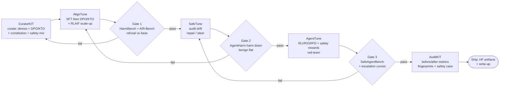

# HSEA Alignment Research (DORA-inspired, no sim)

Holistic research on aligning LLM/VLMs for high-stakes agentic disaster
response: DORA brief, alignment playbook, Lexsi-lib mapping, gaps + next
steps. Researched 2026-11-09 by a 5-agent swarm with adversarial spot-checks;
key claims independently re-verified (DORA repo/paper, HF ids, Lexsi repos,
PyPI). Dataset tables live in [datasets](datasets.md).

Scope: safety-graded finetuning of Cohere open-weights models on HF for
high-stakes agentic disaster response. **No simulator building.**

## 1. Direction statement

**HSEA = a safety-graded finetuning loop for embodied disaster-response agents, DORA-inspired in design, simulator-free in execution.**
Concretely: adopt DORA's protocol-grounded task design, gold-trajectory supervision, and typed deterministic eval;
add the safety axis DORA never built (refusal, abstention/escalation, harm grading, red-teaming); run it as a
Lexsi-lib chain (CuratorKIT → AlignTune → SafeTune → AgentTune → AuditKIT) on a Cohere open-weights base
(`CohereLabs/tiny-aya-global` default) with all artifacts public on Hugging Face.
Embodiment is carried by dataset design (ops grounding, refusal/abstention behavior) and eval design
(safety + groundedness metrics) plus a DORA-style retrieval/ops-agent story (AgentTune RAG + DECIDE) —
not by building simulators, and not by any Lexsi robotics support (none exists).
Non-commercial licenses (CC-BY-NC on base models, LSAL on 5/6 libs, NC terms on most disaster corpora)
constrain reuse: treat DORA and NC datasets as design references, re-derive borrowed content under clean licensing.

## 2. DORA brief + borrow-vs-diverge

**What DORA is.** DORA (**D**isaster **O**perational **R**esponse **A**gent benchmark) is the first *agentic*
benchmark for end-to-end disaster response: 515 expert-authored tasks over 45 real-world events (10 types,
5 continents), solved by composing calls from a 108-tool MCP library over heterogeneous geospatial data,
with expert-verified replayable gold trajectories (~3,500 tool-call steps) and structured JSON answers
(https://github.com/Junjue-Wang/DORA, https://arxiv.org/abs/2605.11633).
NeurIPS 2026 Evaluations & Datasets **oral** (https://arxiv.org/abs/2605.11633).
Best agent (Gemini-3.0-Flash, v1.0) reaches 53.74% vs an 80.48% gold-trajectory ceiling; tool-free VLMs ~18%
(https://github.com/Junjue-Wang/DORA).

**Task tuple.** Each task is `(Q, D, T*, A*)`: natural-language query, heterogeneous data manifest
(georeferenced rasters + OSM/WorldPop GeoJSON), expert gold tool-call trajectory, structured JSON answer
in 7 typed categories (scalar, string, point, line, polygon, set, dict)
(https://arxiv.org/html/2605.11633v2 §3.2).

**Five dimensions** (https://github.com/Junjue-Wang/DORA):

| Dim | Name | #Tasks | Avg steps | Protocol |
|---|---|---|---|---|
| T1 | Perception & Assessment | 132 | 3.35 | UNOSAT Rapid Mapping, Copernicus EMS |
| T2 | Spatial Relational Analysis | 108 | 5.58 | FEMA Hazus |
| T3 | Operational Planning | 100 | 5.62 | FEMA US&R |
| T4 | Temporal Evolution Reasoning | 61 | 9.58 | Copernicus EMS Monitoring |
| T5 | Multi-modal Report Synthesis | 114 | 11.96 | UN OCHA Situation Reports, IFRC |

**108-tool MCP library** (uniform JSON-RPC + typed schemas): Perception 31
(`seg.building_damage`, DINOv3/SegFormer/HRNet/Swin-UPerNet), Raster 18, Vector 31, Logical 15,
Visualization 11, Summarization 2 (https://github.com/Junjue-Wang/DORA).
Perception trained only on public train splits; tasks use held-out test splits (anti-leakage)
(https://arxiv.org/html/2605.11633v2 §3.3).

**Eval (dual-level).** Primary: typed final-answer operators (scalar closeness, string exact-match,
point gate, polygon IoU; dict avg, set F1, line start/end/length). Diagnostic: trajectory metrics
(Tool-Any-Order, In-Order, Exact-Match, Parameter Accuracy, Efficiency)
(https://arxiv.org/html/2605.11633v2 §4).

**Three findings.** (1) Grounding failures: damage-semantic 20.3%, modality mismatch 14.8%,
pipeline composition 56.3%. (2) Doubly bottlenecked: gold tool-order hints gain only +1.08–4.40%;
best scaffold +3.24%. (3) Compositional fragility: agent–gold gap grows ~7% (2–3 steps) to ~56% (≥11 steps)
(https://arxiv.org/html/2605.11633v2 §4.1–4.2).

**10 disaster types (resolved gap).** From the repo/paper distribution figure legend + task-count bars
(https://raw.githubusercontent.com/Junjue-Wang/DORA/master/assets/distribution.png):

| Type | Events | Tasks |
|---|---|---|
| flooding | 6 | 97 |
| hurricane | 5 | 91 |
| fire | 4 | 54 |
| volcano | 4 | 53 |
| tsunami | 1 | 49 |
| landslide | 15 | 47 |
| earthquake | 4 | 45 |
| tornado | 4 | 43 |
| explosion | 1 | 20 |
| heat island | 1 | 16 |
| **Total** | **45** | **515** |

Caveat: the figure miscolors one bar (97-bar and 49-bar share identical flooding-blue fill);
flooding=97/tsunami=49 is by elimination + plausibility, not color. xBD covers 7 of 10 types;
landslide/explosion/heat-island come from other sources (https://arxiv.org/html/2605.11633v2).

**Access/licenses.** Gated HF `Kingdrone-Junjue/DORA`, ~17.5 GB; code Apache-2.0; annotations
CC BY-NC-SA 4.0; overall non-commercial, humanitarian/research + eval only
(https://huggingface.co/datasets/Kingdrone-Junjue/DORA, https://github.com/Junjue-Wang/DORA).

### Borrow (directly applicable)

1. **(Q, D, T*, A*) + gold-trajectory supervision** with symbolic refs + deterministic replay.
2. **Protocol-grounded taxonomy** — ground HSEA scenarios in ICS/FEMA/US&R doctrine.
3. **Typed structured answers + deterministic typed eval** — template for safety grading without LLM-judge circularity.
4. **Primary-answer + diagnostic-trajectory split** — grade outcomes/safety first, plan shape second.
5. **Anti-leakage discipline** — finetune on train scenarios, grade on held-out sites.
6. **Failure-mode taxonomy as alignment targets** — spend capacity on argument grounding + long-horizon composition, not scaffolding (≤3.24%).
7. **Versioned benchmark + frozen prompt protocol** (byte-identical prompts) for comparable safety grades.

### Diverge / leave

1. **No embodiment** — DORA agents are GIS analysts; only the typed-MCP-tool-library pattern transfers.
2. **No safety/alignment grading** — no refusal, harm model, or red-teaming; HSEA must build this axis.
3. **Analyst outputs ≠ agentic consequences** — HSEA needs human-override, abstention gates, red-teaming.
4. **Non-commercial, gated licenses** — design reference + eval comparison, not wholesale ingestion.
5. **Remote-sensing perception stack** — borrow the model-behind-typed-tool wrapping pattern, not the models.
6. **Short trajectories** (3–12 steps) — HSEA's longer missions need hierarchical plans + progress tracking.

## 3. Dataset landscape

See [datasets](datasets.md): 26 footage/vision datasets (§1) and 21 action/agentic datasets (§2), models.md-style tables with HF ids and licenses, plus size-comparison and timeline figures.

## 4. Alignment playbook

**Post-training stack: SFT → preference → RL.**
SFT is the universal first stage (e.g. Tülu 3: SFT → DPO → RLVR, https://arxiv.org/html/2411.15124v3)
but fine-tuning erodes safety alignment — 10 adversarial examples jailbroke GPT-3.5 for <$0.20
(Qi et al. 2023, https://arxiv.org/abs/2310.03693). DPO (https://arxiv.org/abs/2305.18290) is the default
preference step (length-normalized per Tülu 3); KTO (http://arxiv.org/html/2402.01306v4) is the fallback
for unpaired thumbs-up/down trace judgments. Constitutional AI / RLAIF
(https://www.anthropic.com/research/constitutional-ai-harmlessness-from-ai-feedback) scales labels:
encode disaster-ops doctrine as a written constitution, then self-critique + AI-labeled preferences.
RLVR/GRPO (https://arxiv.org/html/2411.15124v3, https://arxiv.org/html/2501.12948v1) trains reasoning
with verifiable rewards — for HSEA, verifiable *safety-procedure* rewards (confirmation before irreversible
action, doctrine citation, escalation triggers), not just task success.

**Safety tuning.** Mix ~100s of safety examples into every fine-tune (SafeInstr-style) to prevent drift,
but not so many as to cause over-refusal (Safety-Tuned LLaMAs, Bianchi et al., ICLR 2024,
https://arxiv.org/abs/2309.07875). Adopt the SafeTune-library taxonomy regardless of tooling reuse:
audit drift → pick repair (weight recovery / constrained re-tune / unlearning / inference-time steering)
→ re-evaluate (https://safetune.lexsi.ai/).

**Calibration / refusal / abstention.** Train an explicit abstain/escalate action with verifiable reward
for correct abstention; calibrate a defer-to-human threshold on held-out scenarios; report risk–coverage
curves and ECE, not point accuracy (survey: https://arxiv.org/html/2407.18418v3; label-free LoRA recipe
for ≤8B models: https://arxiv.org/html/2608.26121). Always evaluate benign compliance alongside refusal
(AgentHarm ships a paired benign set). Calibration-OOD note via secondary summary [UNVERIFIED primary].

**Red-teaming.** Test own checkpoints against GCG + PAIR (success is target-dependent; published numbers
do not transfer), plus prompt-injection-via-retrieval and tool-use jailbreaks (the AgentHarm threat model).

**Eval stack.** (1) HarmBench — refusal regression gate (https://arxiv.org/html/2402.04249v2).
(2) AIR-Bench 2024 — regulation-grounded refusal, 314 risks / 5,694 prompts, CC-BY-4.0 confirmed on the
HF card (https://arxiv.org/html/2407.17436v2, https://huggingface.co/api/datasets/stanford-crfm/air-bench-2024).
(3) AgentHarm — agentic misuse refusal + benign pass rate (https://arxiv.org/html/2410.09024v3).
(4) SafeAgentBench — embodied planning safety (https://arxiv.org/html/2412.13178v5).
(5) HSEA-custom abstention/escalation set (curator-written text/tool-trace scenarios, no sim).

**Oversight + deployment.** Operational subset: human interrupt/stop obeyed mid-plan; confirmation gates
before irreversible actions; escalation on low confidence; audit log of every tool call
(foundations: https://laurent-orseau.com/work, https://pdf.stafforini.com/irving-2018-ai-safety-via.pdf).
Per-release mini safety case (hazards → mitigations → eval evidence → residual risks).
Runtime defense-in-depth: Llama Guard 3 monitor (https://huggingface.co/meta-llama) around the agent.

### Staged recommendations

| Stage | Do | Evidence anchor |
|---|---|---|
| **CuratorKIT** (data) | Doctrine-grounded SFT demos; DPO pairs incl. correct refusals/abstentions; KTO binary judgments; written mini-constitution; custom abstention/escalation eval set; ~100s general safety examples | Bianchi ICLR 2024; Constitutional AI; KTO |
| **AlignTune** (SFT+pref) | SFT, then length-normalized DPO (KTO where only binary labels); RLAIF self-critique vs constitution. Gate: HarmBench + AIR-Bench refusal must not drop vs base | Tülu 3 recipe; Qi et al. drift warning |
| **SafeTune** (repair) | Audit drift pre/post AlignTune; repair via safety-mix re-tune or constrained fine-tune; label-free abstention tuning for small model. Gate: AgentHarm harm-score down, benign flat | SafeTune taxonomy; abstention survey |
| **AgentTune** (agentic RL) | RLVR/GRPO on tool traces with safety-procedure rewards; red-team (GCG/PAIR + injection + misuse). Final gate: SafeAgentBench + escalation curves + mini safety case | RLVR/GRPO; SafeAgentBench; oversight |

Cross-cutting: re-run the full four-benchmark stack after *every* stage (drift can reappear at any stage).

## 5. Lexsi-lib mapping

**Stack at a glance** (stats:
https://api.github.com/orgs/Lexsi-Labs/repos?per_page=100):

| Repo | What it is | PyPI (seen) | License | Maturity |
|---|---|---|---|---|
| AlignTune | 13+ SFT/RL algos, Backend Factory (TRL/Unsloth/ES), `compose` pipelines | `aligntune` 0.1.32, py≥3.11 | MIT own code + bundled AGPL/LGPL | 49★, oldest (Jan 2026), pushed 2026-11-07 |
| CuratorKIT | gated curation + synthetic generation, provenance | `curatorkit` 0.1.23, py 3.11+ | LSAL v1.1 (non-commercial) | 36★, 2 arXiv papers |
| SafeTune | safety audit/repair library (harden/recover/steer/unlearn/interpret/evaluate) | `safetune` 0.1.13, py≥3.12 | LSAL v1.2 | 23★, audit badges, 10 Colabs |
| AgentTune | agentic RL (GRPO/PPO/DPO/RLOO/BCO) + EventLog spine, DECIDE, self-heal | `agenttune` 1.1.3, py 3.12+ | LSAL v1.1 | 12★, 6 open issues, Known Issues page |
| AuditKIT | unified eval via `ak.evaluate()`, fingerprints, stdlib-only core | `auditkit` 1.1.6, py 3.10+ | LSAL v1.2 | 19★, newest (Sep 2026), ~3k tests |
| CircuitKIT | interpretability: discover→evaluate→intervene→export HF | `circuitkit` 0.2.1, py 3.10–3.12 | LSAL v1.2 | 31★, CPU quickstart on GPT-2 |

Details: AlignTune https://raw.githubusercontent.com/Lexsi-Labs/aligntune/main/README.md;
CuratorKIT https://raw.githubusercontent.com/Lexsi-Labs/CuratorKIT/main/README.md;
SafeTune https://raw.githubusercontent.com/Lexsi-Labs/SafeTune/main/README.md;
AgentTune https://raw.githubusercontent.com/Lexsi-Labs/AgentTune/main/README.md;
AuditKIT https://raw.githubusercontent.com/Lexsi-Labs/AuditKIT/main/README.md;
CircuitKIT https://raw.githubusercontent.com/Lexsi-Labs/CircuitKIT/main/README.md.

**Recommended HSEA chain.** Minimum viable (3 repos): CuratorKIT → SafeTune → AuditKIT.
Preferred (4 repos): CuratorKIT → AlignTune → SafeTune → AuditKIT. Add CircuitKIT as stretch
(refusal circuit / abstention probes) and AgentTune only if training tool-calling retrieval agents
(confirm cross-use with the maintainers first).
Concrete steps: (1) Curate grounded QA + preference + adversarial/refusal sets with provenance → public HF
dataset. (2) Baseline plain-SFT (AlignTune, TRL backend — avoids AGPL) vs SafeTune `SafeGradTrainer`
harden on same data. (3) SafeTune `evaluate` both (HarmBench + custom ops eval + over-refusal set);
`recover`/`steer` on drift; check each method's Faithful badge first. (4) AuditKIT before/after on ≥2
metric families with sha256 fingerprints → HF Article write-up.

**Cohere + HF stack.** HSEA builds on Cohere Labs open-weights
LLMs (all CC-BY-NC-4.0, all HF-gated `gated:auto`); verified via
https://huggingface.co/api/models/CohereLabs/&lt;model&gt;:

| HF repo id | Params | Type | Context | License |
|---|---|---|---|---|
| CohereLabs/tiny-aya-base | 3.35B | pretrained, 70+ langs | 8k | CC-BY-NC-4.0, gated |
| CohereLabs/tiny-aya-global | 3.35B | instruction-tuned generalist (**default pick**) | 8k | CC-BY-NC-4.0, gated |
| CohereLabs/tiny-aya-earth | 3.35B | Africa + West Asia langs | 8k | CC-BY-NC-4.0, gated |
| CohereLabs/tiny-aya-fire | 3.35B | South Asian langs | 8k | CC-BY-NC-4.0, gated |
| CohereLabs/tiny-aya-water | 3.35B | Asia-Pacific + Europe langs | 8k | CC-BY-NC-4.0, gated |
| CohereLabs/aya-expanse-8b | ~8B | instruction-tuned, 23 langs | [UNVERIFIED] | CC-BY-NC-4.0, gated |
| CohereLabs/aya-expanse-32b | ~32B | instruction-tuned, 23 langs | [UNVERIFIED] | CC-BY-NC-4.0, gated |

Variant roles/params/context per https://arxiv.org/html/2603.11510 and
https://docs.cohere.com/docs/tiny-aya (HF cards gated, card text [UNVERIFIED]).
Everything created must be public/ungated on HF (models, adapters, logs, datasets + collections),
plus public demo and write-up with >1 before-and-after metric.
Traps: LSAL org-acknowledgement §1A ([UNVERIFIED] whether research teams count — check with Lexsi);
AlignTune `unsloth` backend + CuratorKIT `pdf` extra (MinerU) are AGPL; Python split (SafeTune/AgentTune
need 3.12; CircuitKIT pins transformer-lens 3.8.0 + transformers 5, import-order constrained) — use one
3.12 env, pin exact versions.

## 6. Gaps + ordered next steps

**Gaps (merged; resolved items removed).** DORA 10-type enumeration: RESOLVED (§2). MEDIC HF id:
RESOLVED as `QCRI/MEDIC`. AIR-Bench CC-BY-4.0: RESOLVED on HF card itself. Bianchi citation id:
FIXED to arXiv:2309.07875. Remaining:

- No disaster-grounded embodied action dataset (rubble/floodwater/fire-line with safety grades).
- No dispatch/triage-decision trajectories with outcomes; no open field START-triage set
  (MIETIC/MIMIC-IV-ED are hospital, credentialed, exact license names [UNVERIFIED]).
- Procedures exist as text (FEMA guidelines, DisasterResponseGPT prompts), not graded executions.
- Agent-safety benches are digital, not physical (only SafeAgentBench bridges to embodiment, household only).
- Footage licenses [UNVERIFIED]: VIDI, Sen1Floods11, DAD, DMD, SARD precise terms, HERIDAL access,
  LADI v1 images, FLAME 3; xBD damage-grade schema not re-checked; FloodNet QA total (4,511 vs ~10.5k);
  AIDERv2 16,723 (Zenodo authoritative) vs 167,723 typo in one 2025 paper.
- Action gaps: TREC-IS exact license + official HF id; CrisisHelpOffer license + HF id;
  CrisisTransformers-corpus HF id; ALFRED/BEHAVIOR-1K canonical HF ids; OXE/Bridge/DROID canonical
  HF ids; Agent-SafetyBench dataset HF id + LICENSE; R-Judge/ToolEmu HF ids; HarmBench beyond gated
  `walledai/HarmBench`; GAIA/WorkArena licenses; WebArena harness-license split detail.
- Methods gaps: Kadavath-2022 calibration via secondary summary (primary not re-checked);
  DPO/KTO OOD ranking via secondary review (primary not checked); corrigibility survey is a
  non-peer-reviewed preprint; DPO/KTO-vs-PPO/ORPO claim [UNVERIFIED].
- Lexsi gaps: LSAL §1A applicability to research teams [UNVERIFIED];
  Aya Expanse context lengths [UNVERIFIED]; Tiny Aya card text (gated);
  SafeTune EMNLP-2026 proceedings listing not checked.
- DORA residue: v1.1-vs-v1.0 field-for-field JSON match [UNVERIFIED] (gated, not downloaded);
  "Top 0.4%" selectivity only on author page (oral itself verified); leaderboard checkpoint
  existence reproduced as stated, not independently checked.

**Ordered next steps.**

1. Resolve license/ack blockers today: LSAL §1A (email support@lexsi.ai / ask organizers),
   gated HF access for every teammate + `HF_TOKEN`, confirm AgentTune cross-track use.
2. Pin the environment: one Python 3.12 env, exact PyPI versions, TRL backend, non-PDF ingest;
   verify cross-lib install + read AgentTune Known Issues.
3. Curate (CuratorKIT): SOPs → grounded QA + DPO pairs (incl. refusals/abstentions) + adversarial
   variants + mini-constitution + custom abstention/escalation eval; export SFT/DPO splits with provenance.
4. Convert existing labels to preference data: FloodNet-VQA + LADI v2/AIDERv2/FLAME 2 → QA pairs;
   TREC-IS criticality + HumAID/CrisisMMD → dispatch-priority pairs; CrisiText for notify-head.
5. Train with gates: AlignTune SFT→DPO/KTO (RLAIF scale-up) with HarmBench/AIR-Bench gate;
   SafeTune audit+repair with AgentHarm gate; AgentTune RLVR/GRPO safety-procedure rewards with
   SafeAgentBench + escalation-curve gate; re-run full stack after every stage.
6. Red-team own checkpoints (GCG/PAIR + retrieval-injection + tool-use misuse) and write the mini
   safety case; publish HF artifacts + multi-metric write-up.

## 7. Sources

- DORA repo https://github.com/Junjue-Wang/DORA · paper https://arxiv.org/abs/2605.11633 ·
  HTML https://arxiv.org/html/2605.11633v2 · dataset https://huggingface.co/datasets/Kingdrone-Junjue/DORA ·
  prompts https://raw.githubusercontent.com/Junjue-Wang/DORA/master/dora/agent/prompts.py ·
  tree https://api.github.com/repos/Junjue-Wang/DORA/git/trees/master?recursive=1 ·
  distribution fig https://raw.githubusercontent.com/Junjue-Wang/DORA/master/assets/distribution.png ·
  predecessor https://github.com/Junjue-Wang/DisasterM3
- Methods: DPO https://arxiv.org/abs/2305.18290 · Tülu 3 https://arxiv.org/html/2411.15124v3 ·
  Constitutional AI https://www.anthropic.com/research/constitutional-ai-harmlessness-from-ai-feedback ·
  R1 https://arxiv.org/html/2501.12948v1 · Qi https://arxiv.org/abs/2310.03693 ·
  Bianchi https://arxiv.org/abs/2309.07875 · KTO http://arxiv.org/html/2402.01306v4 ·
  HarmBench https://arxiv.org/html/2402.04249v2 · AIR-Bench https://arxiv.org/html/2407.17436v2 ·
  AgentHarm https://arxiv.org/html/2410.09024v3 · SafeAgentBench https://arxiv.org/html/2412.13178v5 ·
  abstention https://arxiv.org/html/2407.18418v3 · debate https://pdf.stafforini.com/irving-2018-ai-safety-via.pdf ·
  interruptibility https://laurent-orseau.com/work · SafeTune lib https://safetune.lexsi.ai/
- Lexsi libs (READMEs):
  AlignTune https://raw.githubusercontent.com/Lexsi-Labs/aligntune/main/README.md ·
  CuratorKIT https://raw.githubusercontent.com/Lexsi-Labs/CuratorKIT/main/README.md ·
  SafeTune https://raw.githubusercontent.com/Lexsi-Labs/SafeTune/main/README.md ·
  AgentTune https://raw.githubusercontent.com/Lexsi-Labs/AgentTune/main/README.md ·
  AuditKIT https://raw.githubusercontent.com/Lexsi-Labs/AuditKIT/main/README.md ·
  CircuitKIT https://raw.githubusercontent.com/Lexsi-Labs/CircuitKIT/main/README.md ·
  LSAL https://raw.githubusercontent.com/Lexsi-Labs/SafeTune/main/LICENSE.md ·
  Tiny Aya https://arxiv.org/html/2603.11510 · Cohere docs https://docs.cohere.com/docs/tiny-aya
