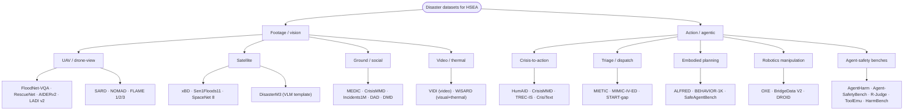
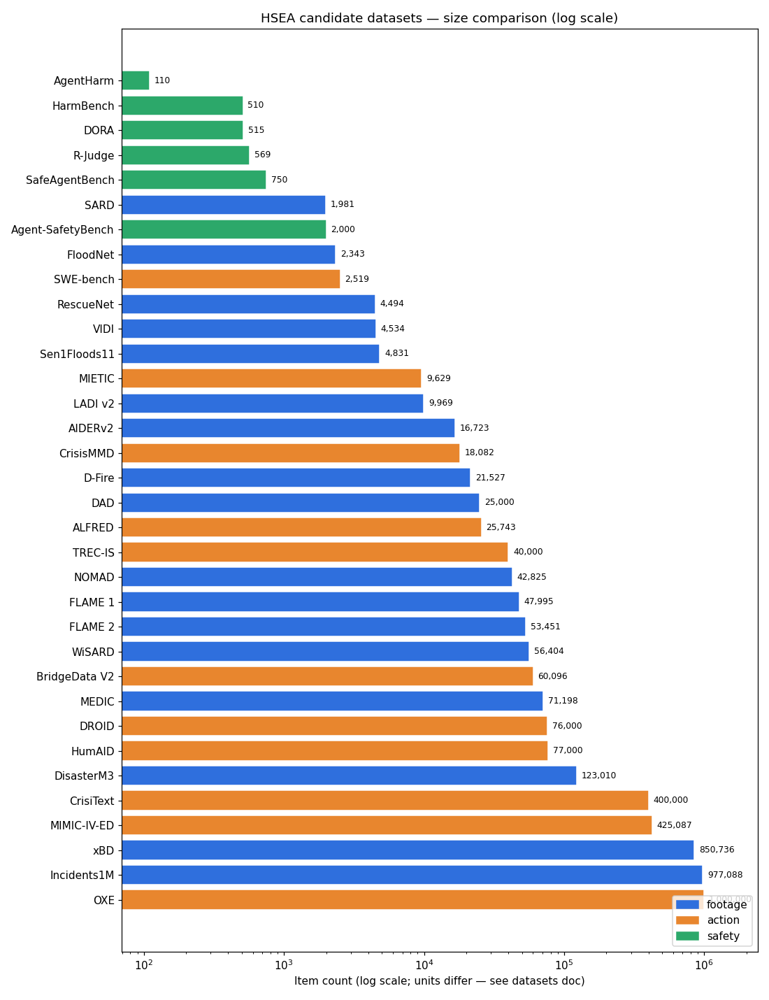
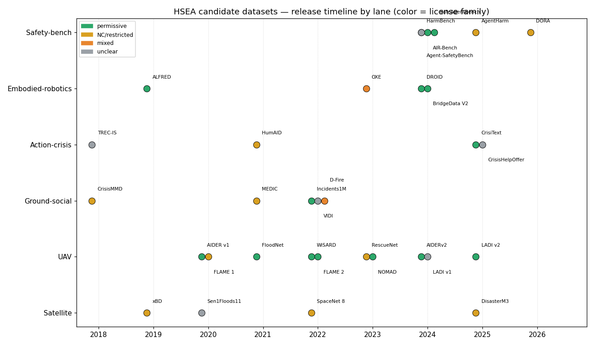

# HSEA Dataset Bench — Disaster Footage + Action Datasets (Nov 2026)

Datasets to curate from, finetune on, and evaluate with for the High-stakes
Embodied Agents (HSEA) project: DORA-inspired alignment of Cohere open-weights
models for high-stakes agentic disaster response — no simulator building.
Researched 2026-11-09 by a 5-agent swarm with adversarial spot-checks; key HF
ids, licenses, Lexsi repos, and PyPI versions independently re-verified via
Hub/GitHub/PyPI APIs. Anything unverified is marked **[UNVERIFIED]**.

Companion: [alignment-research](alignment-research.md) (direction, DORA brief,
alignment playbook, Lexsi mapping, gaps).

## 1. Footage / vision datasets (drone-navigator VLM alignment)

| Dataset | Modality | Size | Labels / tasks | License | HF id (verified) |
|---|---|---|---|---|---|
| xBD | satellite RGB 1024px | 850,736 bldgs, 45,362 km² | polygons + damage grades [UNVERIFIED schema] | CC BY-NC-SA 4.0 | community mirrors only (e.g. `kshitijrajsharma/xview2-xbd`) |
| FloodNet | UAV RGB 3000×4000 | 2,343 images | 10-class seg + VQA (4,511 pairs std; ~10.5k [UNVERIFIED]) | CDLA-Permissive-1.0 | `torchgeo/floodnet`, community VQA mirrors |
| RescueNet | UAV RGB 3000×4000 | 4,494 images | 11-class seg (damage grades) | CC BY-NC-ND 4.0 (no derivatives!) | community mirrors (e.g. `USF-IAE/RescueNet_BDA`) |
| AIDER v1 | aerial RGB (web) | ~6k images | 5-class classification | CC-BY-4.0 | none (Hub search: no match) |
| AIDERv2 | aerial RGB (web+YouTube) | 16,723 images | 4-class classification | CC-BY-4.0 | none verified |
| MEDIC | ground/social RGB | 71,198 images | 4 tasks: type/info/hum/severity | CC-BY-NC-SA-4.0 | `QCRI/MEDIC` (official) |
| CrisisMMD | ground/social RGB+text | 18,082 imgs + 16,058 tweets | info/humanitarian/severity | CC-BY-NC-SA-4.0 | `QCRI/CrisisMMD` v2.0 (official) |
| Incidents1M | ground/web RGB | 977k positive of 1.79M | 43 incidents + 49 places | MIT (repo; form-gated; image rights [UNVERIFIED]) | none |
| LADI v1 | low-altitude aerial (CAP) | 40k+ labeled (638k pool) | hierarchical multi-label (crowd) | repo MIT; image terms [UNVERIFIED] | via `MITLL/LADI-v2-dataset` script configs |
| LADI v2 | low-altitude aerial (CAP) | ~10k (9,969) | FEMA-scale multi-label (expert) | CC-BY-4.0 | `MITLL/LADI-v2-dataset` (official) |
| VIDI | video (YouTube) | 4,534 clips, ~10 s avg | 43 incident categories | [UNVERIFIED] (none stated) | none verified |
| Sen1Floods11 | satellite SAR+optical 512px | 4,831 chips, 120,406 km² | water masks (446 hand) | [UNVERIFIED] | community: `blumenstiel/Sen1Floods11` + 2 |
| SpaceNet 8 | satellite RGB 0.3–0.8 m | 850 km², ~32k bldgs, 1,300 km roads | flooded/non-flooded masks | CC 4.0 Non-Commercial | none verified |
| DisasterM3 | satellite optical+SAR bi-temporal | 26,988 imgs + 123k instr. pairs | 6 VLM tasks incl. referring seg | CC-BY-NC-SA-4.0 | `Kingdrone-Junjue/DisasterM3` (official) |
| DAD | ground/social RGB | ~25k images | 3 severity levels | [UNVERIFIED] | none verified |
| DMD | ground/social RGB+text | 5,878 captioned images | 6 damage classes | [UNVERIFIED] | none verified |
| SARD | UAV RGB (video frames) | 1,981 imgs, 6,532 persons | person bboxes (SAR actors) | [UNVERIFIED] (DataPort open access) | none verified |
| HERIDAL | UAV RGB 4000×3000 | ~500 labeled + 68,750 patches | person patches/bboxes | [UNVERIFIED] (on-request) | none verified |
| NOMAD | UAV RGB frames | 42,825 frames, 100 actors | person bbox + 10 visibility levels | CC BY 4.0 | none verified |
| WiSARD | UAV visual + LWIR thermal | 26,862 vis + 29,989 thm + 15,453 pairs | person bboxes, multimodal | MIT-style (site) | none verified |
| D-Fire | mixed RGB | 21,527 images | fire/smoke YOLO bboxes | mixed (no single license) | none verified |
| FLAME 1 | UAV RGB+thermal | 39,375 train + 8,617 test + 2,003 seg | fire cls + segmentation | academic/non-commercial | derived only (`alarmod/forest_fire`) |
| FLAME 2 | UAV RGB+IR pairs | 53,451 pairs (+39,751 full RGB) | fire/smoke frame labels | CC BY 4.0 | none verified |
| FLAME 3 | UAV radiometric thermal | 622 fire + 116 no-fire quartets | fire CV subset | [UNVERIFIED] | none verified |

Key sources: xBD https://arxiv.org/abs/1911.09296; FloodNet https://arxiv.org/abs/2012.02951;
RescueNet https://www.nature.com/articles/s41597-023-02799-4; AIDER https://zenodo.org/api/records/3888300;
AIDERv2 https://zenodo.org/api/records/10891054; LADI v2 https://huggingface.co/api/datasets/MITLL/LADI-v2-dataset;
DisasterM3 http://arxiv.org/abs/2505.21089; NOMAD https://api.github.com/repos/ArtRuss/NOMAD/license;
WiSARD https://sites.google.com/uw.edu/wisard/; FLAME 2 https://ieee-dataport.org/open-access/flame-2-fire-detection-and-modeling-aerial-multi-spectral-image-dataset.

**Footage picks.** (1) Instruction-tuning seeds: FloodNet-VQA first (only native UAV VQA);
DisasterM3 as format template; LADI v2 + AIDERv2 + FLAME 2 labels → QA pairs (all permissive).
(2) Victim detection: NOMAD + WiSARD + SARD + referring-expression overlays.
(3) Incident semantics (ground-view, perspective-shift caution): MEDIC / CrisisMMD (official QCRI HF), Incidents1M, VIDI.
(4) License caution: NC/SA on xBD, DisasterM3, MEDIC/CrisisMMD; ND (no derivatives) on RescueNet;
unclear/mixed on D-Fire, Sen1Floods11, VIDI, SARD, HERIDAL — clear each before deployment finetuning.

## 2. Action / agentic datasets

| Dataset | Agentic behavior grounded | Size | License | HF availability |
|---|---|---|---|---|
| HumAID | perception→decision routing (humanitarian categories) | ~77K tweets / 19 events | CC-BY-NC-SA-4.0 (HF mirror; primary gated by CrisisNLP+Twitter ToS) | `QCRI/HumAID-all` open |
| CrisisMMD | informativeness + humanitarian + severity (dispatch priority) | 18,082 samples / 7 disasters | CC-BY-NC-SA-4.0 | `QCRI/CrisisMMD` open |
| TREC-IS | 25 info types + criticality (prioritize/dispatch/escalate) | 19,784 (2018) → ~40K | [UNVERIFIED exact text; NIST/Twitter constraints] | none official [UNVERIFIED] |
| CrisisHelpOffer | request-vs-offer dispatch matching | 101K tweets | [UNVERIFIED] | [UNVERIFIED] |
| CrisiText | warning-message generation + FEMA guidelines JSON | 400K+ warnings / 18K situations | CC-BY-4.0 | `LanD-FBK/crisitext` open |
| MEDIC | multitask image classification (damage→dispatch perception) | 71,198 images | CC BY-NC-SA 4.0 | `QCRI/MEDIC` open (official) |
| MIETIC | ESI acuity prediction (triage decisions) | 9,629 cases | PhysioNet gated [UNVERIFIED exact name] | none verified |
| MIMIC-IV-ED | triage/deterioration substrate | 425,087 ED visits | credentialed [UNVERIFIED exact terms] | none (credentialed) |
| ALFRED | long-horizon instruction following | 25,743 directives / 8,055 demos | MIT | no official id [UNVERIFIED] |
| BEHAVIOR-1K | mobile-manipulation activities | 1,000 activities / 10K trajectories | custom Data Bundle License | none verified |
| SafeAgentBench | safe vs unsafe embodied plans (10 hazards) | 750 tasks | CC-BY-4.0 | `safeagentbench/SafeAgentBench` open |
| OXE | vision→low-level-action priors | 1M+ episodes / 22 embodiments / 527 skills | mixed per-component | slices only; canonical [UNVERIFIED] |
| BridgeData V2 | pick/place behavior-cloning priors | 60,096 trajs / 24 envs | CC BY 4.0 (secondary) | conversions exist; canonical [UNVERIFIED] |
| DROID | scene-diverse real-world manipulation | 76K trajs / 350h / 564 scenes | CC-BY-4.0 (primary) | community copies; canonical [UNVERIFIED] |
| AgentHarm | refusal on malicious multi-step tool tasks (11 harms) | 110 base / 440 aug | MIT + safety-use-only clause | `ai-safety-institute/AgentHarm` open |
| Agent-SafetyBench | behavioral safety over tool trajectories | 349 envs / 2,000 cases | LICENSE content [UNVERIFIED] | dataset id [UNVERIFIED] |
| R-Judge | trajectory risk-awareness labels | 569 records | CC-BY-4.0 | [UNVERIFIED] |
| ToolEmu | emulated tool-use risk scenarios | 144 cases / 36 toolkits | Apache-2.0 | [UNVERIFIED] |
| HarmBench | refusal robustness (single-turn) | 510 behaviors | MIT (card) | `walledai/HarmBench` gated |
| OSWorld | desktop computer-use | 369 tasks | Apache-2.0 | `xlangai/windows_osworld` |
| WebArena | long-horizon web tasks | 812 tasks | Apache-2.0 (env; harness MIT in some docs) | third-party mirrors only |
| GAIA | multimodal assistant QA w/ tools | 450+ questions | [UNVERIFIED] | `gaia-benchmark/GAIA` gated |
| SWE-bench | resolve GitHub issues via code+tests | 2,294 test + 225 dev | MIT (harness+Verified) | `SWE-bench/SWE-bench` open |

Key sources: HumAID https://arxiv.org/abs/2104.03090v1; TREC-IS http://transpire.ucd.ie/pubs/Wang2021b.pdf;
CrisiText https://huggingface.co/api/datasets/LanD-FBK/crisitext; ALFRED https://arxiv.org/pdf/1912.01734;
OXE/DROID/Bridge https://robot-wiki.com/data-hardware/datasets/ + https://arxiv.org/html/2403.12945v2;
AgentHarm https://huggingface.co/api/datasets/ai-safety-institute/AgentHarm;
SafeAgentBench https://huggingface.co/api/datasets/safeagentbench/SafeAgentBench;
Agent-SafetyBench https://arxiv.org/abs/2412.14470?context=cs.

**Action picks.** HF-ready + action-relevant overlap set is thin: `safeagentbench/SafeAgentBench`
(CC-BY-4.0), `LanD-FBK/crisitext` (CC-BY-4.0), `ai-safety-institute/AgentHarm` (restricted-MIT),
QCRI crisis sets (NC), robotics slices (off-domain). Strategy without sim-building:
(a) safety-grade existing traces (SafeAgentBench method on ALFRED/BEHAVIOR-style trajectories re-skinned
to disaster vignettes via text); (b) TREC-IS criticality + HumAID/CrisisMMD → dispatch-priority preference pairs;
(c) CrisiText + FEMA guidelines for the notify/communicate head; (d) AgentHarm + Agent-SafetyBench as
refusal/risk eval harness extended with physical-harm categories from after-action reports.

## 3. Figures

Counts and years per §§1–2 tables above; units differ by dataset (images,
episodes, tweets, tasks) so cross-row comparison is order-of-magnitude only.
Rendered from this doc's own tables (`render_figs.py` data snapshot, 2026-11-09).

## Sources (datasets)

- Footage: xBD https://arxiv.org/abs/1911.09296 · FloodNet https://arxiv.org/abs/2012.02951 ·
  RescueNet https://www.nature.com/articles/s41597-023-02799-4 ·
  AIDER https://zenodo.org/api/records/3888300 · AIDERv2 https://zenodo.org/api/records/10891054 ·
  MEDIC https://huggingface.co/api/datasets/QCRI/MEDIC · CrisisMMD https://arxiv.org/abs/1805.00713 ·
  Incidents1M https://raw.githubusercontent.com/ethanweber/IncidentsDataset/master/README.md ·
  LADI https://raw.githubusercontent.com/LADI-Dataset/ladi-overview/master/README.md ·
  LADI v2 https://huggingface.co/api/datasets/MITLL/LADI-v2-dataset ·
  VIDI https://raw.githubusercontent.com/vididataset/VIDI/main/README.md ·
  Sen1Floods11 https://raw.githubusercontent.com/cloudtostreet/Sen1Floods11/master/README.md ·
  DisasterM3 http://arxiv.org/abs/2505.21089 ·
  NOMAD https://api.github.com/repos/ArtRuss/NOMAD/license ·
  WiSARD https://sites.google.com/uw.edu/wisard/ ·
  D-Fire https://raw.githubusercontent.com/gaia-solutions-on-demand/DFireDataset/master/README.md ·
  FLAME 2 https://ieee-dataport.org/open-access/flame-2-fire-detection-and-modeling-aerial-multi-spectral-image-dataset
- Action: HumAID https://arxiv.org/abs/2104.03090v1 · TREC-IS http://transpire.ucd.ie/pubs/Wang2021b.pdf ·
  CrisiText https://huggingface.co/api/datasets/LanD-FBK/crisitext ·
  MIETIC https://physionet.org/content/mietic/1.0.0/ · ALFRED https://arxiv.org/pdf/1912.01734 ·
  BEHAVIOR-1K https://github.com/iminolee/behavior-1k/blob/HEAD/README.md ·
  robotics https://robot-wiki.com/data-hardware/datasets/ · DROID https://arxiv.org/html/2403.12945v2 ·
  AgentHarm https://huggingface.co/api/datasets/ai-safety-institute/AgentHarm ·
  SafeAgentBench https://huggingface.co/api/datasets/safeagentbench/SafeAgentBench ·
  Agent-SafetyBench https://arxiv.org/abs/2412.14470?context=cs ·
  OSWorld https://systems-analysis.info/eng/OSWorld ·
  SWE-bench https://huggingface.co/api/datasets/SWE-bench/SWE-bench
