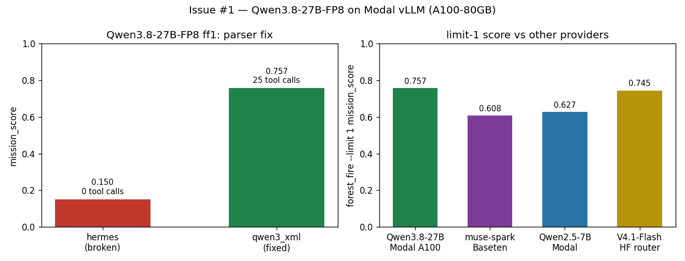

# Issue #1 — Serve Qwen3.8-27B-FP8 on Modal vLLM + route in hsea.models

Branch: `issue-1`. Date: 2026-11-10. Continued parked work (rebased onto
`origin/main` cleanly, no conflicts) instead of restarting.

## What

New server file `infra/modal/vllm_qwen38.py` (pattern:
`vllm_qwen14b.py`) serving Qwen3.8-27B official FP8 (~31 GB, ungated,
Apache-2.0) on one A100-80GB with native 262K context
(`--max-model-len 262144`, `--gpu-memory-utilization 0.90`), plus the
`MODAL_QWEN38_FP8` routing constant in `hsea/models.py`
(`modal_model_id(...)` → `openai-api/modal/Qwen/Qwen3.8-27B-FP8`).

Key fix found during verification: Qwen3-family models emit XML tool
calls (`<tool_call><function=name>...`), so the server needs
`--tool-call-parser qwen3_xml` (vLLM >= 0.20.2; we pin 0.21.0). The
parked `hermes` config failed silently — the model emitted valid calls
but they came back as plain text (0 ToolEvents, mission 0.150). After
the one-line parser redeploy: 25 tool calls, 4 image blocks, mission
0.757.

## Evals

Model for all: `openai-api/modal/Qwen/Qwen3.8-27B-FP8` via
`MODAL_BASE_URL=https://sanggusti--dmb-vllm-qwen38-serve.us-east.modal.run/v1`.
Sampling: inspect defaults; server `generation_config.json` overrides
to top_k=20 / top_p=0.95 (vLLM warns at startup).

| run_id | task | eval id (log) | score | tokens |
|---|---|---|---|---|
| qwen38-smoke | smoke (pre-fix) | `logs/2026-11-10T03-14-19-00-00_smoke_E4vv6vz2Hnpte2eAJoDtPk.eval` | includes 1.000 | 108 (I:68, O:40) |
| qwen38-ff1-hermes | forest_fire --limit 1 (pre-fix) | `logs/2026-11-10T03-26-39-00-00_forest-fire_gWudgqFb3QQHNAdr5xm9DQ.eval` | mission 0.150 (recall 0.00, 0 tool calls) | 128,503 (I:118,841, O:9,662) |
| qwen38-smoke2 | smoke (post-fix) | `logs/2026-11-10T03-59-38-00-00_smoke_Zrus455gF3dtzGu7nvnh7G.eval` | includes 1.000 | 102 (I:68, O:34) |
| qwen38-ff1 | forest_fire --limit 1 (post-fix) | `logs/2026-11-10T04-05-05-00-00_forest-fire_2r2xAQVDSAbBFXGjxar9Zq.eval` | mission 0.757 (recall 1.00, 25 tool calls, 4 image blocks) | 387,373 (I:358,366, O:29,007) |

All recorded via `python -m hsea.aggregate record`
(`runs/qwen38-smoke/`, `runs/qwen38-ff1-hermes/`,
`runs/qwen38-smoke2/`, `runs/qwen38-ff1/`; gitignored local artifacts).

Duration: smoke1 8:25 (cold start), ff1-hermes 12:00, smoke2 5:26
(cold start after idle scaledown), ff1 12:43. Cold start ≈ 3–4 min
(207 s engine init). Text+image verified live; `--limit-mm-per-prompt
'{"image": 8, "video": 2}'` is configured but no video eval exists in
the repo, so video is configured-not-verified.

Left: same limit-1 sample before/after the parser fix. Right:
Qwen3.8 limit-1 0.757 vs published limit-1 numbers — muse-spark
(Baseten) 0.608, Qwen2.5-7B (Modal) 0.627, DeepSeek-V4.1-Flash (HF)
0.745.

## Cost

- Rate: A100-80GB $0.000694/s on-demand (modal.com/pricing,
  2026-11-10) ≈ $0.0416/min.
- Estimate (pre-run): ~22 min (cold start + smoke + ff1) ≈ $0.92.
  Pre-run ledger TOTAL was $0.50, so $0.50 + $0.92 < $50 cap → GO.
  The parser redeploy added a second cold start + rerun; revised
  estimate stayed <$2.50 → still GO.
- Actual (GPU-active wall clock × rate): probes 12.1 min $0.50,
  smoke1 8.4 min $0.35, ff1-hermes 12.0 min $0.50, smoke2 5.4 min
  $0.23, ff1 12.7 min $0.53 → **$2.11** this issue.
- Running TOTAL after this issue: **$2.61**.

## Artifacts

- `infra/modal/vllm_qwen38.py`: server file (qwen3_xml parser,
  262K ctx, revision-pinned).
- `hsea/models.py`: `MODAL_QWEN38_FP8` constant.
- `tests/test_models.py`: routing unit test for the new slug.
- `docs/inference.md`: Modal section (server file, endpoint, status,
  qwen3_xml + generation-config + 303/cold-start gotchas).
- `docs/reports/modal-spend.md`: spend ledger (this issue's rows).
- `docs/reports/issue-1-qwen38-serve.png`: plot above.

## Shutdown

App `dmb-vllm-qwen38` (ap-CEQI4eFPMwP2KWYinUUCOI) stopped after evals;
`modal app list` shows state `stopped`, 0 tasks. No app left running.
