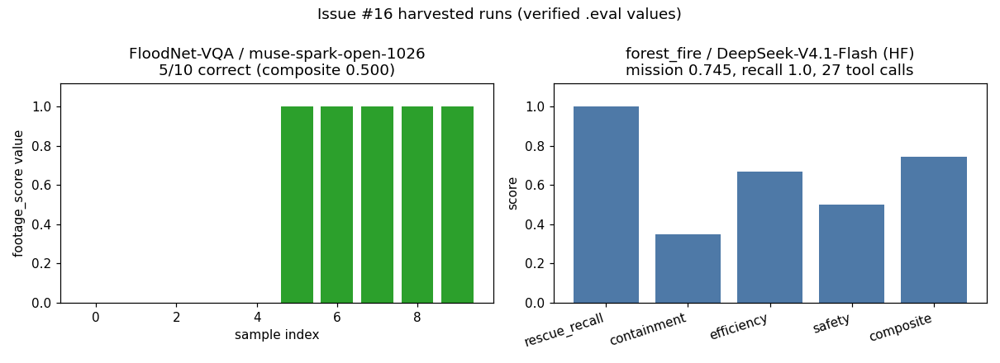

# Issue #16 — HF Space refresh: harvest concluded runs + update findings

Branch: `issue-16`. Date: 2026-11-10. Space: `sanggusti/high-stakes-embodied-agents`
(private, Gradio, `cpu-basic`). Space commit: `050f93d` (pushed; see `/config`
check below).

## What

Harvested 2 concluded `main`-branch experiments into Space samples with REAL
scores/excerpts (verified against `.eval` logs, never hand-copied), refreshed
`findings.json` with footage + serving tracks, verified the live Space, kept
inference viewer-billed, and fixed the workflow docs (one was missing).

## Harvested samples (both `media_status: real`)

| slug | source run | scenario | model | score | excerpt | media |
|---|---|---|---|---|---|---|
| `footage-floodnet-musespark` | `runs/footage-floodnet-baseten-01` | floodnet-vqa | baseten muse-spark-open-1026 | composite 0.500, 5/10 | 11 JSONL lines (1/sample) | frame `final.jpg` (SHA-verified rebuild) + `scores.png` |
| `hf-forestfire-v41flash` | `runs/hf-ff1-v41flash` | forest_fire seed 1 | hf DeepSeek-V4.1-Flash | mission 0.745, 6/6 rescue, 27 tool calls | 22 JSONL lines (truncation noted) | `scores.png` chart (no frames exist for grid runs) |

Eval logs: `.../2026-11-09T12-54-34-00-00_floodnet-vqa_VJtwMHzZkg3cgsksqiyhsN.eval`
and `.../2026-11-09T15-17-03-00-00_forest-fire_9V4WeMzVWrE7Eb8sqwpVVt.eval`.
Both recorded via `python -m hsea.aggregate record` (runs/ is gitignored local
state); rendered tables reproduce the bench docs exactly:

| model | scenario | n | composite | vqa | count | severity | ground |
|---|---|---|---|---|---|---|---|
| muse-spark-open-1026 | floodnet-vqa | 10 | 0.500±0.527 | 0.500±0.535 | 0.500±0.707 | n/a | n/a |

| model | scenario | n | composite | recall | contain | effic | safety |
|---|---|---|---|---|---|---|---|
| DeepSeek-V4.1-Flash | forest_fire | 1 | 0.745 | 1.000 | 0.350 | 0.667 | 0.500 |

Frame honesty: the FloodNet frame was rebuilt from pinned corpus
`ljx620/FloodNet-VQA@ec9277af` (image `10169.JPG`) via `hsea.data.footage`
and SHA-verified (`683717e4…`) against the log metadata. The Space
pre-receive hook rejects binaries ~100 KB+ without XET (the 116 KB PNG was
refused), so the bundled media is a downscaled JPEG render (19.9 KB) —
recorded as such in `renders_source`.

## findings.json refresh

- Added `footage` track (4 live-VLM rows: musespark 0.500/0.875,
  Qwen3-VL-8B 0.300/0.917 on FloodNet-VQA/LADI v2) and `serving` track
  (HF-routed forest_fire 0.745); `findings_updated` → 2026-11-10.
- Sim `batches` kept as frozen legacy (mock-sim retired, #13); `app.py`
  Findings tab renders the new tracks (footage table + serving note).

## Live verification

Authenticated `/config` check after push (rebuild `RUNNING`, sha `050f93d`):

- HTTP 200, Gradio 6.31.0, 4 tabs: `Overview`, `Findings`,
  `Interactive examples`, `Inference demo` — confirmed on the new build
  (`/config` grew 60,852 → 66,086 bytes with the new Findings content).
- Runtime: `cpu-basic` requested = current; `hf_oauth: true` +
  `inference-api` scope live.

## Billing / hardware

- Inference stays viewer-billed: `resolve_viewer_token` accepts only the
  OAuth session token or a viewer-pasted token and never reads ambient
  credentials (`grep` verified; no `HF_TOKEN` secret on the Space).
- ZeroGPU flip rejected again (no `@spaces.GPU` function exists; flipping
  would burn viewer quota for CPU work). Space stays `cpu-basic`.

## Docs fixed (the workflow doc was wrong)

- `UPDATE_WORKFLOW.md` did not exist (dangling refs from README,
  `findings.json`, `app.py`) → created from the real procedure.
- README "Settings → Hardware → ZeroGPU" unconditional → cpu-basic-until-workload.
- `app.py` docstring claimed ZeroGPU hardware → corrected.
- `SAMPLE_FORMAT.md` assumed sim-only runs → corpus mapping section added.
- New finding: Space binary policy (<50 KB media, no XET) documented.

## Cost

- Estimate (pre-run): $0 — no model calls; only corpus streaming (free),
  Space git/API (free). Pre-run ledger TOTAL $0.50 → $0.50 + $0 < $50 → GO.
- Actual: $0.00. Ledger row: `16 space-refresh cpu 0.2 $0.00`.
- Running TOTAL after this issue: **$0.50**.

## Artifacts

- Space repo (`050f93d`): `harvest_sample.py`, `UPDATE_WORKFLOW.md`,
  `samples/{footage-floodnet-musespark,hf-forestfire-v41flash}/`,
  `findings.json`, `app.py`, `README.md`, `samples/SAMPLE_FORMAT.md`.
- Bench branch `issue-16`: this report + `issue-16-space-refresh.png`,
  `docs/reports/modal-spend.md` ledger union.

## Shutdown

No Modal apps started — nothing to stop. No GPU spend.
