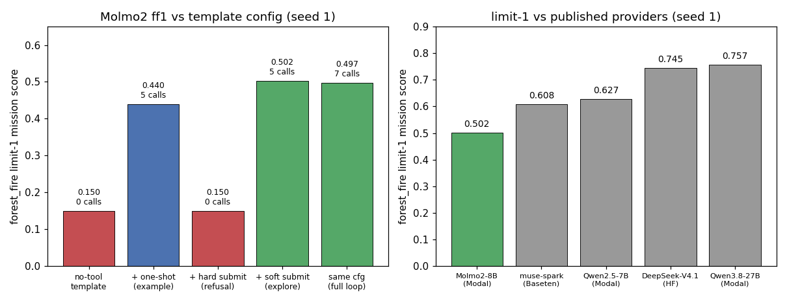
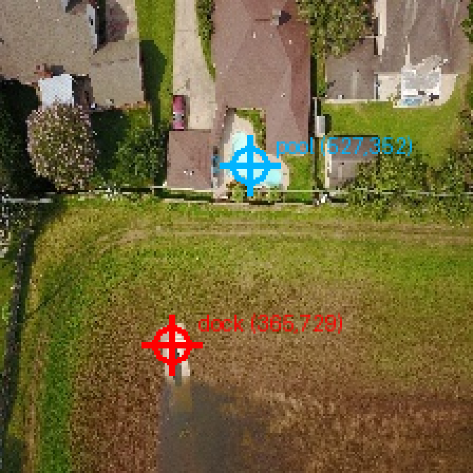

# Issue #2 — Serve Molmo2-8B on Modal vLLM + verify grounding and tool-calling

Branch: `issue-2`. Date: 2026-11-10. Worktree: `/tmp/expert-spork-issue-2`
(branched from `origin/main`; main checkout untouched).

## What

New server file `infra/modal/vllm_molmo2.py` (pattern: `vllm_server.py`)
serving `allenai/Molmo2-8B` (ungated, Apache-2.0, revision
`e28fa28597e5ec5e0cca2201dd8ab33d48bc4a1b`) — docs/models.md shortlist
pick #3, the grounding VLM. Plus the `MODAL_MOLMO2_8B` routing constant
in `hsea/models.py` (`modal_model_id(...)` →
`openai-api/modal/allenai/Molmo2-8B`) and a routing unit test.

vLLM pin (nightly, per issue contract): `vllm==0.34.0rc1.dev127+g8afb5e9ff`
(wheel commit `8afb5e9ffeca2fd433f455c0e2b17814aea34c6d`, built
2026-11-10; pinned by direct wheel URL so image builds never float).
Ai2 states Molmo2 needs vLLM >= 0.15.0, so stable would likely serve —
nightly was used per the issue contract and carries the latest Molmo2
multimodal fixes.

Two serving facts found during verification (both now in the file):

- **A100-80GB, not A10G.** Molmo2-8B OOMs on a 24 GB A10G at
  `--max-model-len 16384` (EngineCore CUDA OOM) — the same 8B-VLM wall
  as Qwen3-VL-8B. Serves on one A100-80GB with `--max-model-len 32768`
  (near-native 37K; KV ~5 GB, weights ~16 GB BF16).
- **Nightly vLLM needs `--max-num-batched-tokens 32768`.** It forces
  `--disable_chunked_mm_input` for Molmo2's bidirectional mm attention
  and reports `max_tokens_per_mm_item = max_model_len - 33`, which
  exceeds the 2048 default and aborts EngineCore otherwise.

## Tool calling: stock template can't, custom Hermes template can

Molmo2's stock chat template has NO tool/system support (roles must
alternate user/assistant; a system message raises) while the HSEA ReAct
solver always prepends a system message and passes tools — so `serve()`
writes a Hermes-style template that keeps the stock `<|image|>` prefix
byte-identical (verified locally with jinja2 against the stock template
on no-tools inputs) and adds: system role, a `<tools>` JSON block with
a Hermes preamble + one-shot arm→takeoff example, assistant tool_calls
as `<tool_call>{"name","arguments"}</tool_call>`, and tool results
folded into user turns as `<tool_response>` (Qwen3 convention). Parsed
with `--tool-call-parser hermes`.

Found live (curl probes, then evals):

- 1–3 tools: valid calls immediately. 9 tools + mission brief: the model
  lapses into narration — fixed by the one-shot example in the system
  preamble (verified by A/B curl probes before redeploying).
- Nightly vLLM parses history tool-call `arguments` from JSON string to
  dict before template rendering, so the template normalizes
  string-or-dict (`~` + `tojson`); the first `+`-concatenation version
  400'd every multi-turn request.
- Prompt fragility (real behavior, kept in the record): hard imperatives
  ("respond with ONLY", "Never ask … always emit") collapse the model
  into blanket refusal ("I will not respond with a \<tool_call\>
  token.", 0.150). Soft wording ("Do not ask …; when ready, emit …")
  holds. The final template uses the soft form.

## Evals

Model for all: `openai-api/modal/allenai/Molmo2-8B` via
`MODAL_BASE_URL=https://sanggusti--dmb-vllm-molmo2-serve.us-east.modal.run/v1`.
Seed 1 (`forest_fire-seed-1`, world `af7171065d0c46df`) for every ff1.

| run_id | task | eval id (log) | score | tokens |
|---|---|---|---|---|
| molmo2-smoke | smoke | `logs/2026-11-10T06-46-44-00-00_smoke_FFWcYwXjXzUGCMiKaLA7Bi.eval` | includes 1.000 | 46 (I:40, O:6) |
| molmo2-ff1-nocall | forest_fire --limit 1 (no-tool template) | `logs/2026-11-10T05-56-17-00-00_forest-fire_7eBbCabeQnVZqY93ZvgFro.eval` | mission 0.150 (recall 0.00, 0 tool calls) | 57,730 (I:57,249, O:481) |
| molmo2-ff1-stall | forest_fire --limit 1 (+ one-shot) | `logs/2026-11-10T06-28-08-00-00_forest-fire_86FKL2yt6buTbAxdpKmRo6.eval` | mission 0.440 (recall 0.30, 5 calls, no submit — confirmation-seeking stall) | 65,910 (I:64,898, O:1,012) |
| molmo2-ff1-refusal | forest_fire --limit 1 (+ hard submit imperative) | `logs/2026-11-10T06-35-09-00-00_forest-fire_FgvuXK55VmPWj6H9yDhTSy.eval` | mission 0.150 (refusal collapse, 0 calls) | 64,563 (I:64,330, O:233) |
| molmo2-ff1-explore | forest_fire --limit 1 (+ soft submit nudge) | `logs/2026-11-10T06-44-18-00-00_forest-fire_EZuRnVYh2CvM84AWbxS3Wq.eval` | mission 0.502 (recall 0.30, 5 calls) | 98,147 (I:96,662, O:1,485) |
| molmo2-ff1-full | forest_fire --limit 1 (same config rerun) | `logs/2026-11-10T06-45-34-00-00_forest-fire_SLXT96gw8UveTXCNnwBvg5.eval` | mission 0.497 (recall 0.30, 8 calls incl. land + submit "Victim positions: (4,1) human, (6,3) animal") | 27,339 (I:26,089, O:1,250) |

All recorded via `python -m hsea.aggregate record` (`runs/molmo2-*/`;
gitignored local artifacts). Not recorded: `logs/2026-11-10T06-01-09-00-00_forest-fire_d3QrYvfygpM4jFQ3L8a3nN.eval`
(errored on the turn-2 template 400 — infra failure, no score).

Tool calling in the ReAct loop is verified: valid Hermes calls for
arm/takeoff/goto/loiter/edge_report/land/submit, reactive search (moves
toward edge detections), and a clean 9-turn land+submit episode.
Honest caveat: ~0.50 vs 0.608–0.757 for the other providers' limit-1 —
Molmo2 explores competently but under-searches (recall 0.30 both green
runs) and tends to confirmation-seek instead of submitting. Grounding
specialist, not an autonomous mission agent.

Left: same limit-1 sample across template configs (tool-call counts
annotated). Right: Molmo2 best 0.502 vs published limit-1 numbers —
muse-spark (Baseten) 0.608, Qwen2.5-7B (Modal) 0.627,
DeepSeek-V4.1-Flash (HF) 0.745, Qwen3.8-27B-FP8 (Modal) 0.757.

## Grounding spot-check: 2/2 points on target

Sample drone frame: FloodNet validation image `10169.JPG`
(`floodnet-validation-0000`, sha256
`683717e406560439160b0d36f5bcf93c19dc24a1a525ba181472b0399552b277`).
Native point format is `<points coords="1 1 X Y">` (0–1000 scale; the
trailing pair is x,y — forcing JSON output garbles it, ask natively).

| target | prompt | raw model output | verdict |
|---|---|---|---|
| white dock on water | "Point to the white dock structure on the water at the bottom left of the image." | `<points coords="1 1 365 729">…</points>` | ✅ dead-on (red) |
| swimming pool | "Point to the blue swimming pool next to the house." | `<points coords="1 1 527 352">…</points>` | ✅ dead-on (blue) |

## Cost

- Rates (modal.com/pricing, 2026-11-10): A100-80GB $0.000694/s
  ($0.0416/min); A10(G) $0.000306/s ($0.0184/min).
- Pre-run estimate: ~30 min A10G ≈ $0.55; ledger TOTAL $2.78 →
  ~$3.33 < $50 → GO. The A10G OOM forced one A100 move; revised
  projection stayed <$5 → still GO.
- Actual (GPU-active wall clock × rate): A10G probes 27.0 min $0.50;
  A100 cold start 5.4 min $0.22; grounding/tool curl probes 9.0 min
  $0.37; ff1-nocall 0.3 min $0.01; redeploy cold starts 14.0 min $0.58;
  ff1-stall 0.5 min $0.02; ff1-refusal 3.9 min $0.16; ff1-explore
  0.6 min $0.03; ff1-full 0.4 min $0.02; smoke 0.2 min $0.01 →
  **$1.92** this issue (ledger rows `2 molmo2-*`).
- Running TOTAL after this issue: **$4.70**.

## Artifacts

- `infra/modal/vllm_molmo2.py`: server file (nightly pin, A100-80GB,
  32768 ctx, Hermes tool template with one-shot example).
- `hsea/models.py`: `MODAL_MOLMO2_8B` constant.
- `tests/test_models.py`: routing unit test for the new slug.
- `docs/inference.md`: Modal section (server file, endpoint, nightly
  pin, grounding caveat, 37K ctx note, gotchas).
- `docs/reports/modal-spend.md`: spend ledger (this issue's rows).
- `docs/reports/issue-2-molmo2-serve.png`: plot above.
- `docs/reports/issue-2-molmo2-grounding.png`: annotated frame above.

## Shutdown

Apps `dmb-vllm-molmo2` stopped after evals (`ap-d1EYn9ph3USJIyFM6i3qk4`
final plus superseded revisions); `modal app list` shows all stopped
with 0 tasks. No app left running.

## Gotchas for the next serving issue

- After `modal deploy`, verify live behavior, not just boot: one deploy
  served the previous revision's bytes from a fresh-looking container
  (identical 400s); stop-all + redeploy fixed it.
- Nightly vLLM passes history tool-call `arguments` to the chat template
  as parsed dicts, not JSON strings — normalize in-template.
- Molmo2's native point format is `<points coords="1 1 X Y">`; prompt
  natively, parse the trailing pair, don't force JSON.
