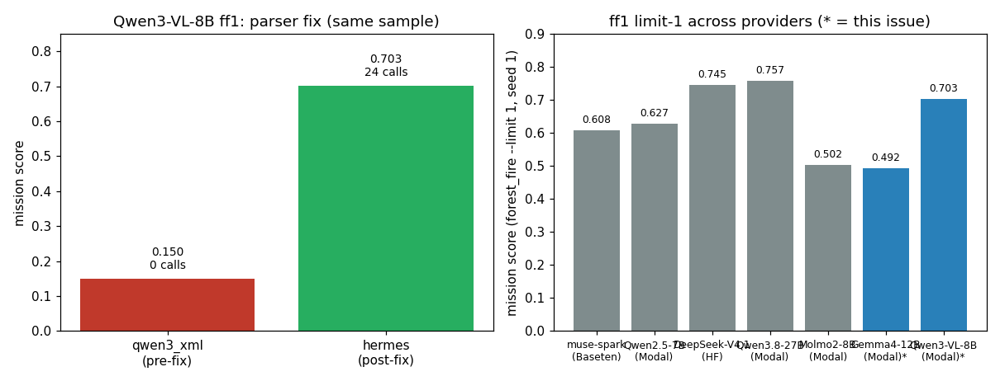

# Issue #3 — Serve Gemma4-12B + Qwen3-VL-8B VLM workhorses on Modal

Branch: `feat/3-vlm-workhorses`. Date: 2026-11-10. Worktree:
`/tmp/expert-spork-issue-3` (branched from `origin/main`; main checkout
untouched).

## What

Two cheap Apache-2.0 VLM baselines served on Modal vLLM (one server file
per model, pattern: `vllm_server.py`):

- **New `infra/modal/vllm_gemma4.py`** serving `google/gemma-4-12B-it`
  (ungated, Apache-2.0, revision `43c9d014b231474fa7212dbb48a762566c2b255d`)
  — docs/models.md shortlist pick #4, the permissive multimodal
  baseline. Stable vLLM 0.21.0 predates the `gemma4_unified`
  architecture, so this uses the issue-2 nightly pin
  (`vllm==0.34.0rc1.dev127+g8afb5e9ff`, direct wheel URL — verified to
  contain `gemma4.py` and the `gemma4` tool parser at that commit).
  One A100-80GB, `--max-model-len 65536`, `--tool-call-parser gemma4`
  (native `<|tool_call>` syntax; stock Canonical template renders
  tools — no custom template needed, unlike Molmo2).
- **Mission upgrade of `infra/modal/vllm_qwen3vl.py`** (Qwen3-VL-8B was
  deployed generate-only under #31: A10G, no tool parser, 4096 ctx —
  that app is gone from the account). Now one A100-80GB,
  `--max-model-len 65536` (revision-pinned:
  `0c351dd01ed87e9c1b53cbc748cba10e6187ff3b`), stable vLLM 0.21.0
  (verified vision path), `--tool-call-parser hermes`.
- Routing constants `MODAL_GEMMA4_12B` / `MODAL_QWEN3VL_8B` in
  `hsea/models.py` + unit tests.

Key fix found during verification: Qwen3-VL-8B-Instruct emits
**Hermes-style** `<tool_call>{"name", "arguments"}</tool_call>` — the
OPPOSITE of Qwen3.8's Qwen-XML (issue #1). The first deploy used
`qwen3_xml` and scored 0.150 with 0 ToolEvents (valid-looking calls as
plain text). A forced (named) `tool_choice` curl probe had passed and
masked the mismatch — vLLM constrains forced output to a valid call
either way. The one-line `hermes` redeploy fixed it: 24 tool calls,
mission 0.702. Lesson recorded in the file + `docs/inference.md`:
verify parser choice with a `tool_choice="auto"` multi-tool probe.

## VRAM + context (headers and startup logs)

| slug | GPU | weights | ctx (header `max_model_len`) | KV / notes |
|---|---|---|---|---|
| `google/gemma-4-12B-it` | 1× A100-80GB | ~24 GB BF16 (12B) | 65536 (`/v1/models`) | 47.29 GiB free KV @ util 0.90 |
| `Qwen/Qwen3-VL-8B-Instruct` | 1× A100-80GB | ~16 GB BF16 (8B) | 65536 (`/v1/models`) | exact KV line not captured before stop; 64K served with headroom, no OOM |

Both: dtype bfloat16, TP=1, `--gpu-memory-utilization 0.90`,
`--limit-mm-per-prompt {"image": 8}`. 64K is 2× the proven 8B-VLM ff1
size — headroom for multi-image episodes without full-256K prefill cost.
An A10G (24 GB) cannot serve either (hence A100 for both).

## Evals

Seed 1 (`forest_fire-seed-1`) for every ff1. Sampling: inspect
defaults (temp/tool-parser notes: no temperature override anywhere —
both models follow tools at defaults; parsers `gemma4` / `hermes`).

Model Gemma4: `openai-api/modal/google/gemma-4-12B-it` via
`MODAL_BASE_URL=https://sanggusti--dmb-vllm-gemma4-serve.us-east.modal.run/v1`.
Model Qwen3-VL: `openai-api/modal/Qwen/Qwen3-VL-8B-Instruct` via
`MODAL_BASE_URL=https://sanggusti--dmb-vllm-qwen3vl-serve.us-east.modal.run/v1`.

| run_id | task | eval id (log) | score | tokens |
|---|---|---|---|---|
| gemma4-smoke | smoke | `logs/2026-11-10T07-25-00-00-00_smoke_mR2H2EJkfeyXVpCFVuutqq.eval` | includes 1.000 | 38 (I:33, O:5) |
| gemma4-ff1 | forest_fire --limit 1 | `logs/2026-11-10T07-33-09-00-00_forest-fire_52xNjXX3phpGuPAjiwSqvA.eval` | mission 0.492 (recall 0.30, cont 0.30, eff 0.88, safe 1.00; 10 calls, 1 image block, land+submit) | 12,637 (I:12,416, O:221) |
| qwen3vl-smoke | smoke | `logs/2026-11-10T07-38-13-00-00_smoke_kxm8JouThnkrkrLJ42CUdC.eval` | includes 1.000 | 34 (I:28, O:6) |
| qwen3vl-ff1-xml | forest_fire --limit 1 (pre-fix) | `logs/2026-11-10T07-42-30-00-00_forest-fire_LZDwHtvTsjkTEvzPf8cWny.eval` | mission 0.150 (recall 0.00, 0 tool calls — parser mismatch) | 56,287 (I:55,102, O:1,185) |
| qwen3vl-ff1 | forest_fire --limit 1 (post-fix) | `logs/2026-11-10T07-53-26-00-00_forest-fire_85X7MG7U5MGfEfQwKokKYk.eval` | mission 0.702 (recall 0.90, cont 0.30, eff 0.78, safe 0.50; 24 calls, 8 image blocks; hit 50-msg cap before submit) | 109,071 (I:105,825, O:3,246) |

All recorded via `python -m hsea.aggregate record`
(`runs/gemma4-smoke/`, `runs/gemma4-ff1/`, `runs/qwen3vl-smoke/`,
`runs/qwen3vl-ff1-xml/`, `runs/qwen3vl-ff1/`; gitignored local
artifacts).

Direct curl probes (pre-eval, per `docs/inference.md` gotchas): both
slugs returned SMOKE-OK text, a valid forced `arm({"drone_idx": 0})`
call, and correctly named a red test rectangle ("Red").

Tool calling in the ReAct loop is verified for both: Gemma4 ran a clean
10-call arm→takeoff→goto→loiter→edge_report→goto×3→land→submit episode
(reactive search toward edge detections); Qwen3-VL ran 24 calls with
thorough corner-to-corner search (recall 0.90, best mission recall
outside the frontier slugs). Honest caveats: Gemma4 under-searches
(recall 0.30, same profile as Molmo2's 0.50); Qwen3-VL searches hard
but hit the 50-message cap without land/submit (efficiency/safety dings
from 2 hazard-zone entries).

Left: same limit-1 sample before/after the Qwen3-VL parser fix
(tool-call counts annotated). Right: both new slugs vs published
limit-1 numbers — muse-spark (Baseten) 0.608, Qwen2.5-7B (Modal)
0.627, DeepSeek-V4.1-Flash (HF) 0.745, Qwen3.8-27B-FP8 (Modal) 0.757,
Molmo2-8B (Modal) 0.502.

## Cost

- Rates (modal.com/pricing, verified 2026-11-10): A100-80GB
  $0.000694/s ($0.0416/min).
- Pre-run estimate: 2 apps × ~20 min ≈ 40 min ≈ $1.67 (buffered to
  $2.50). Ledger TOTAL $4.70 → ~$7.20 < $50 → GO.
- Actual (GPU-active wall clock × rate): gemma4 cold start 6.9 min
  $0.29, probes 5.2 min $0.22, smoke 4.8 min $0.20, ff1 4.4 min $0.18;
  qwen3vl cold start 4.5 min $0.19, probes 3.5 min $0.15, smoke 4.2 min
  $0.17, ff1-xml 0.4 min $0.02, hermes cold start 3.2 min $0.13, ff1
  0.9 min $0.04 → **$1.59** this issue.
- Running TOTAL after this issue: **$6.29**.

## Artifacts

- `infra/modal/vllm_gemma4.py`: new server file (nightly vLLM,
  gemma4 parser, 64K ctx, revision-pinned).
- `infra/modal/vllm_qwen3vl.py`: mission upgrade (A100, 64K ctx,
  hermes parser, revision-pinned).
- `hsea/models.py`: `MODAL_GEMMA4_12B`, `MODAL_QWEN3VL_8B` constants.
- `tests/test_models.py`: routing unit tests for both slugs.
- `docs/inference.md`: Modal section (server files, endpoints, status,
  hermes-vs-qwen3_xml + auto-probe + redeploy-routing gotchas).
- `docs/reports/modal-spend.md`: spend ledger (this issue's rows).
- `docs/reports/issue-3-vlm-workhorses.png`: plot above.

## Shutdown

Apps `dmb-vllm-gemma4` (ap-43FFWkdVXuqQ8NfhEs9Hgr),
`dmb-vllm-qwen3vl` first deploy (ap-0CE7tmCv8zrcn50ZHgDLzy) and hermes
redeploy (ap-q0pENMwdYVanT3JuYR8cU8) all stopped after evals; `modal app
list` shows state `stopped`, 0 tasks on all three. No app left running.
(Redeploy-routing note: after `modal deploy`, requests briefly kept
hitting the previous revision's warm container — verified the hermes
fix on a clean container after `modal app stop` + redeploy.)
