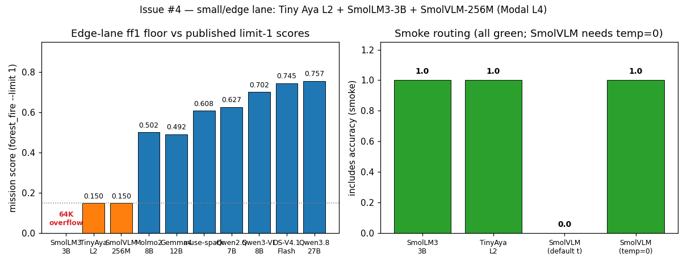

# Issue #4 — Serve small/edge lane: Tiny Aya L2 + SmolLM3-3B + SmolVLM-256M

Branch: `feat/4-edge-lane`. Date: 2026-11-10. Worktree: `/tmp/issue-4`
(branched from `origin/main`; main checkout untouched).

## What

Three cheap edge-lane servers on Modal vLLM (one server file per model,
pattern: `vllm_server.py`), all on one L4 — the smallest GPU class used
in this repo so far:

- **New `infra/modal/vllm_smollm3.py`** serving
  `HuggingFaceTB/SmolLM3-3B` (ungated, Apache-2.0, revision
  `a07cc9a04f16550a088caea529712d1d335b0ac1`) — small text baseline.
  `--max-model-len 65536` (64K trained ctx),
  `--tool-call-parser hermes` (the repo's `chat_template.jinja`
  renders Hermes-style `<tool_call>{"name", "arguments"}</tool_call>`
  XML; verified with a `tool_choice="auto"` probe → valid
  `arm(drone_idx=0)` call, `finish_reason tool_calls`).
- **New `infra/modal/vllm_tinyaya.py`** serving
  `CohereLabs/tiny-aya-l2-thinker` (3.35B, 32K ctx, **CC-BY-NC-4.0 —
  research-only**, gated click-through; revision
  `a692a7bff493f7a0f2e0c821b4a795234c31d10e`) — small Cohere pick
  (docs/models.md shortlist pick #5). Carries the `hsea-hf` Modal
  secret (`HF_TOKEN`) for the gated weight download; first gated
  model served in this repo (Llama 401s; this token has access).
- **New `infra/modal/vllm_smolvlm.py`** serving
  `HuggingFaceTB/SmolVLM-256M-Instruct` (ungated, Apache-2.0, idefics3
  arch; revision `7e3e67edbbed1bf9888184d9df282b700a323964`) —
  extreme-edge VLM floor (shortlist pick #6). `--max-model-len 8192`
  (native 8K), `--limit-mm-per-prompt {"image": 8}`.
- Routing constants `MODAL_SMOLLM3_3B` / `MODAL_TINYAYA_L2` /
  `MODAL_SMOLVLM_256M` in `hsea/models.py` + unit tests.

Key fix found during verification: Tiny Aya's and SmolVLM's chat
templates render **no tools**, so the first deploy omitted the tool
flags — but vLLM then **rejects** inspect's `tool_choice="auto"`
requests with 400 (`"auto" tool choice requires
--enable-auto-tool-choice and --tool-call-parser`) instead of running
a no-call episode. The one-line-per-file redeploy sets the flags
anyway (parser `hermes`, arbitrary — nothing to parse): tools are
silently dropped by the template, the model answers in plain text,
and ff1 measures the honest no-call floor (0.150 both slugs).

## Card verification (license + ctx)

Verified live 2026-11-10 against each HF repo (API metadata + README
frontmatter/body + config.json); posted to the issue. This clears the
`[UNVERIFIED]` license+ctx marks for SmolVLM/SmolLM3 in
`docs/models.md` (both confirmed Apache-2.0).

| slug | license | context | gating | rev |
|---|---|---|---|---|
| `CohereLabs/tiny-aya-l2-thinker` | CC-BY-NC-4.0 (+ Cohere Labs AUP) | 32K in+out (card-stated) | gated:auto (our token: HTTP 200 on weights) | `a692a7bf` |
| `HuggingFaceTB/SmolVLM-256M-Instruct` | Apache-2.0 | 8K (`text_config.max_position_embeddings`) | ungated | `7e3e67ed` |
| `HuggingFaceTB/SmolLM3-3B` | Apache-2.0 | 64K trained (card: →128K YARN) | ungated | `a07cc9a0` |

## Evals

Seed 1 (`forest_fire-seed-1`) for every ff1. Text models run with
`HSEA_VISION=text`; SmolVLM with default vision. Sampling: inspect
defaults, except SmolVLM smoke rerun at `temperature=0`
(`--model-spec`, needed — see below).

| run_id | task | eval id (log) | score | tokens |
|---|---|---|---|---|
| smollm3-smoke | smoke | `logs/2026-11-10T10-07-19-00-00_smoke_2Cu52F3VE7m2cNpEBc6ZZD.eval` | includes 1.000 | 250 (I:60, O:190, thinking trace) |
| smollm3-ff1 | forest_fire --limit 1 | `logs/2026-11-10T10-30-47-00-00_forest-fire_ZRQcut3vDsPuvkSHq8ewaR.eval` | **ERROR: 64K overflow** (turn-1 thinking ran away to 64,223 out-tokens over ~40 min; turn-2 prompt 65,537 > 65,536; 0 tool calls) | 65,536 (I:1,313, O:64,223) |
| tinyaya-smoke | smoke | `logs/2026-11-10T11-30-42-00-00_smoke_LGoDapmRWnk5BjxuRiCtHC.eval` | includes 1.000 | 479 (I:424, O:55) |
| tinyaya-ff1-noparser | ff1 (pre-fix) | `logs/2026-11-10T11-30-47-00-00_forest-fire_gMXfHzaQXJKVBNquMsAM5j.eval` | ERROR: vLLM 400 auto-tool-choice-requires-flags | 0 |
| tinyaya-smoke2 | smoke (post-fix) | `logs/2026-11-10T11-45-27-00-00_smoke_NDBZUViPdGgiY6BhgwikhV.eval` | includes 1.000 | 479 (I:424, O:55) |
| tinyaya-ff1 | forest_fire --limit 1 | `logs/2026-11-10T12-14-44-00-00_forest-fire_3fRcWPVse6U3yL2jxHkh2j.eval` | mission 0.150 (recall 0.00, 0 tool calls, message cap; 7:21) | 191,214 (I:177,766, O:13,448) |
| smolvlm-smoke | smoke (defaults) | `logs/2026-11-10T12-46-17-00-00_smoke_GF6Y59pxDBt9ZT5nzYEKCu.eval` | includes **0.000** (paraphrased: "Smoke is OK.") | 33 (I:28, O:5) |
| smolvlm-smoke2 | smoke (`temperature=0`) | `logs/2026-11-10T12-48-21-00-00_smoke_csSPYiBsnQWNwGfkqp52YQ.eval` | includes 1.000 ("SMOKE-OK") | 34 (I:28, O:6) |
| smolvlm-ff1 | forest_fire --limit 1 | `logs/2026-11-10T12-46-21-00-00_forest-fire_GZx2gxCrmwEwVwD6SQYvbA.eval` | mission 0.150 (recall 0.00, 0 tool calls, message cap; 0:20) | 54,041 (I:50,695, O:3,346) |

All recorded via `python -m hsea.aggregate record` (`runs/<run_id>/`;
gitignored local artifacts).

Direct curl probes (pre-eval): all three slugs returned 200 with
sensible text; SmolVLM processed an image probe (1,135 prompt tokens)
but misnamed a red square ("Saturn") — weak vision, working pipe.

Honest caveats: SmolLM3's ff1 is an ERROR, not a score — stock
thinking mode (repo default ON) does not stop to emit its first tool
call before filling 64K. A `/no_think` rerun might complete but is a
different condition from every other matrix cell, so it stays
out of scope (possible #12 follow-up). SmolVLM smoke is flaky at
default temperature (1/2 across probe+eval) and deterministic-green
at temp=0 — same temp=0 note as Mistral-7B in `docs/inference.md`.

Left: edge-lane ff1 (SmolLM3 overflow; Tiny Aya / SmolVLM 0.150
no-call floor) vs published limit-1 numbers — Molmo2-8B 0.502,
Gemma4-12B 0.492 (`origin/feat/3-vlm-workhorses`), muse-spark
(Baseten) 0.608, Qwen2.5-7B (Modal) 0.627, Qwen3-VL-8B 0.702,
DeepSeek-V4.1-Flash (HF) 0.745, Qwen3.8-27B-FP8 (Modal) 0.757
(`origin/issue-1`). Right: smoke routing — all green (SmolVLM at
temp=0; default-temp 0.0 shown for honesty).

## Edge-floor baselines for #12

| slug | smoke | ff1 mission | recall | cont | eff | safe | calls | ff1 tokens | condition |
|---|---|---|---|---|---|---|---|---|---|
| SmolLM3-3B | 1.000 | **overflow (error)** | — | — | — | — | 0 | 65,536 | text, 64K, thinking ON (stock) |
| Tiny Aya L2 | 1.000 | 0.150 | 0.00 | 0.00 | 0.00 | 1.00 | 0 | 191,214 | text, 32K, no tool template |
| SmolVLM-256M | 1.000 @ t=0 (0.0 @ default) | 0.150 | 0.00 | 0.00 | 0.00 | 1.00 | 0 | 54,041 | vision, 8K, no tool template |

## Cost

- Rate: L4 $0.000222/s on-demand (modal.com/pricing, 2026-11-10) ≈
  $0.0133/min.
- Estimate (pre-run): 3 models × ~20 min ≈ 60 min ≈ $0.80.
  Pre-run ledger TOTAL was $6.29, so $6.29 + $0.80 < $50 cap → GO.
- Actual (wall clock × rate, conservative: cold-start waits counted
  as GPU-active): smollm3 coldstart 16.4 min $0.22, probes 26.9 min
  $0.36, smoke 23.5 min $0.31, ff1 40.1 min $0.53; tinyaya coldstart
  11.7 min $0.16, smoke $0.00, ff1-noparser $0.00, rewarm 5.9 min
  $0.08, smoke2 29.3 min $0.39, ff1 7.4 min $0.10; smolvlm coldstart
  8.1 min $0.11, warm 20.7 min $0.28, smokes $0.00, ff1 0.4 min $0.01
  → **$2.55** this issue.
- Running TOTAL after this issue: **$8.84**.
- Why over estimate: L4 cold (re)starts took 6–29 min each (vs 3–4
  min A100 in prior issues) and the apps scale to zero after ~2 idle
  minutes, so every gap re-pays a full start; SmolLM3's ff1 also ran
  40 min (runaway thinking trace). Lesson recorded in
  `docs/inference.md`: chain warm→smoke→ff1 in ONE command (zero gap).

## Artifacts

- `infra/modal/vllm_smollm3.py`, `vllm_tinyaya.py`, `vllm_smolvlm.py`:
  server files (L4, revision-pinned; hermes parser everywhere —
  functional for SmolLM3, accept-flag for the other two).
- `hsea/models.py`: `MODAL_SMOLLM3_3B`, `MODAL_TINYAYA_L2`,
  `MODAL_SMOLVLM_256M` constants.
- `tests/test_models.py`: routing unit test for the three slugs.
- `docs/inference.md`: Modal section (server files, endpoints,
  CC-BY-NC flag, auto-tool-choice gotcha, L4 cold-start lesson).
- `docs/models.md`: Smol license+ctx `[UNVERIFIED]` marks cleared.
- `docs/reports/modal-spend.md`: spend ledger (this issue's rows).
- `docs/reports/issue-4-edge-lane.png`: plot above.

## Shutdown

Apps `dmb-vllm-smollm3` (ap-tHt3qP0GzSRccNy1rL4Tq2),
`dmb-vllm-tinyaya` (ap-Z2YdlGySrmP9KhbbTyadO4), `dmb-vllm-smolvlm`
(ap-Skoibgx8UQkpr0iNBOMSIW) stopped after evals; `modal app list`
shows all `stopped`, 0 tasks. No app left running.
