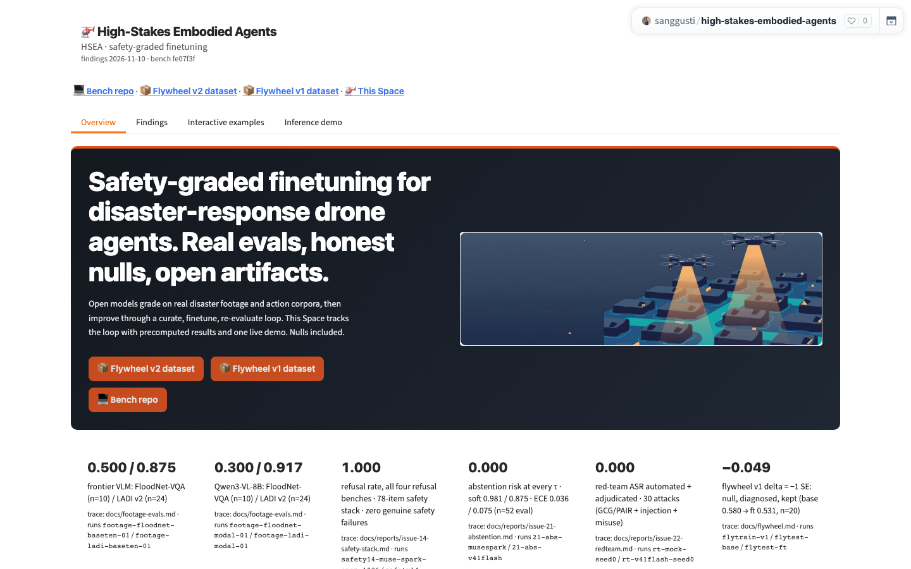
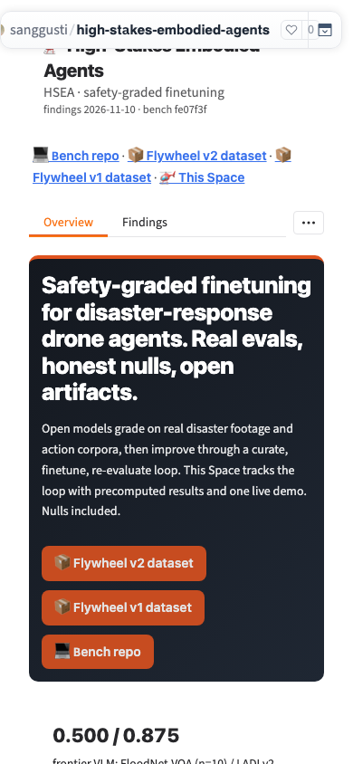
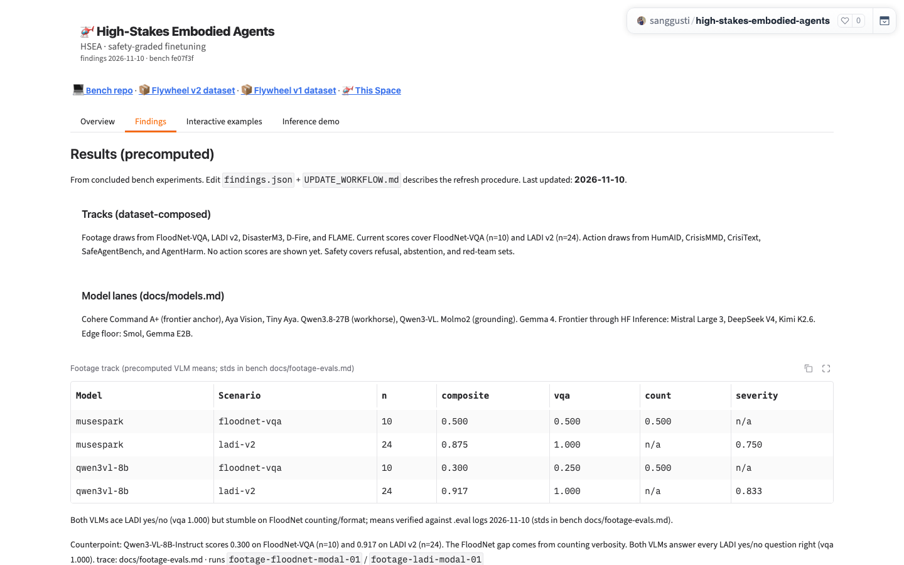
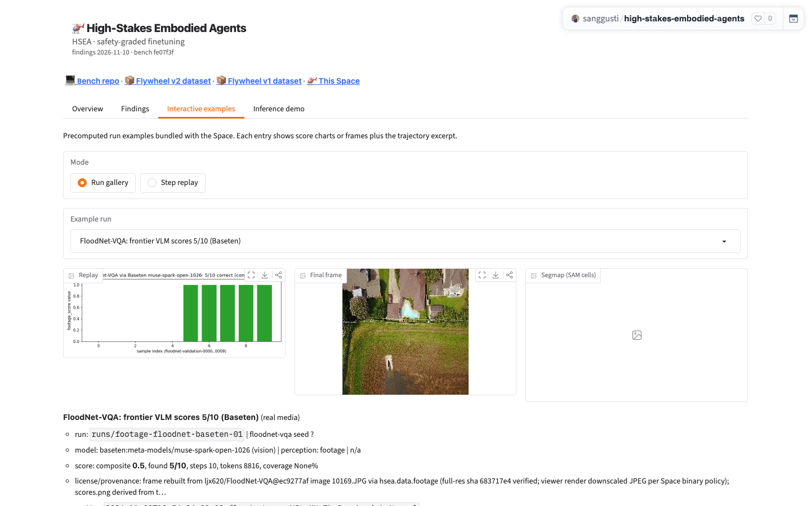
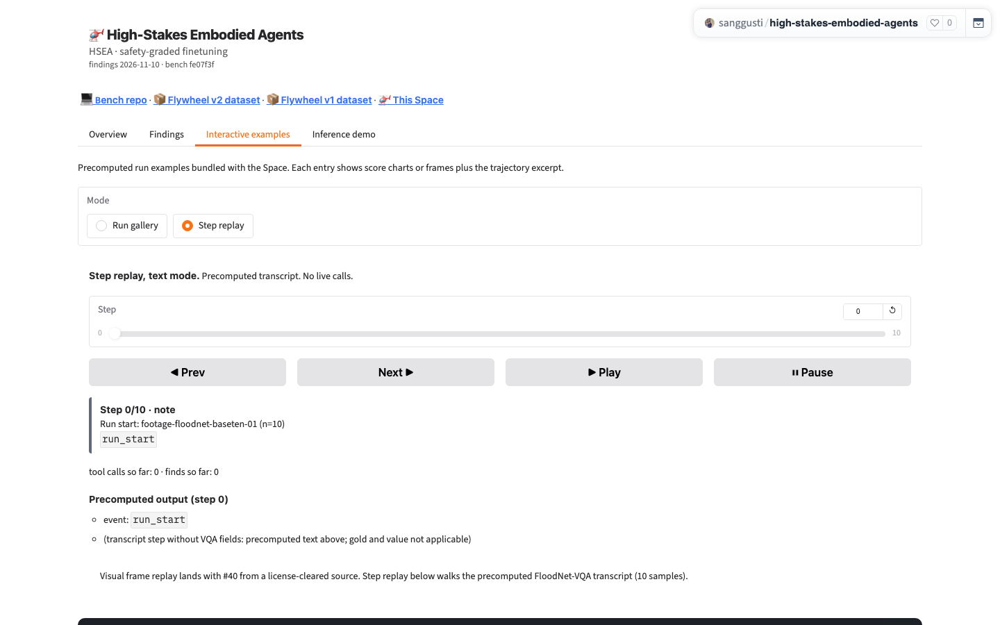
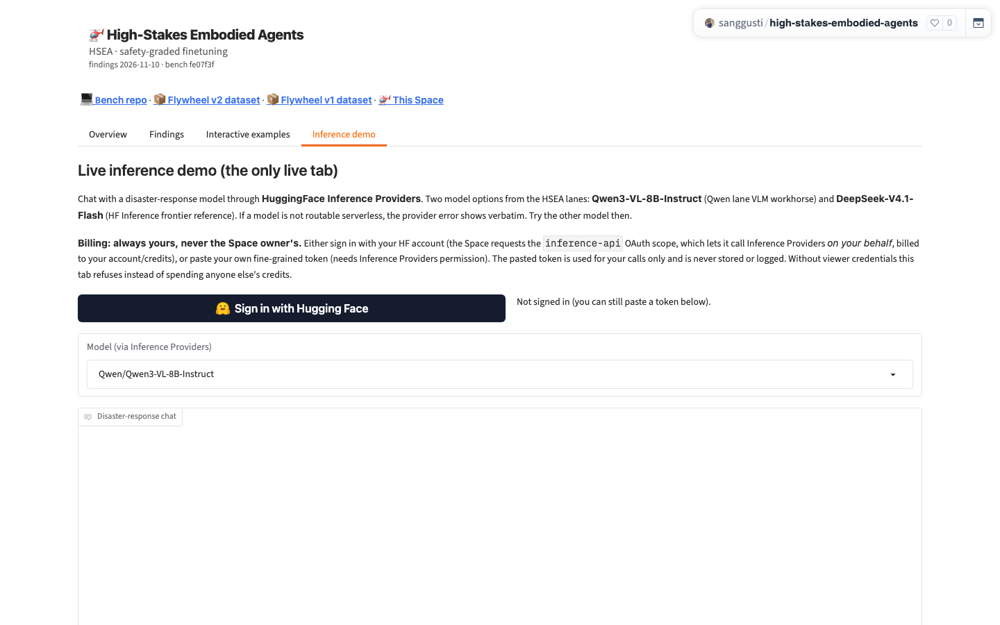

# Issue #41 feedback — owner-correction recompose of the Space showcase

Branch: `issue-41-feedback`. Date: 2026-11-10. Scope: the 6 binding
corrections in the [owner-feedback comment on #41](https://github.com/sanggusti/expert-spork/issues/41#issuecomment-6760338597)
("Owner feedback (2026-11-10)"), applied on top of the merged #41 work.
Plan/sources: `WORKFLOW.md`, `docs/models.md` (lanes),
`docs/datasets.md` (composed tracks), `docs/research-track.md`,
`docs/process.md`, all on `origin/main` (`fe07f3f`).

## Space commits

- `86ed7f8` (merged #41 showcase) → **`2be0b8a`** (this pass, pushed).
- Live state (`2be0b8a` RUNNING): `/config` HTTP 200, 111,905 bytes,
  Gradio 6.31.0, tabs exactly `Overview` / `Findings` /
  `Interactive examples` / `Inference demo`; theme hooks present;
  Timer ×1, Radio `Mode` (Run gallery / Step replay), Slider `Step`
  0..10 (footage replay). Hardware `cpu-basic`.
- Diff shape: 21 files changed, +146/−268. No new binaries (3 sample
  dirs deleted, ~9 media files removed).

## Correction-by-correction table (before → after excerpts)

### (i) No em-dashes in Space copy

Swept `app.py` (11 literal + 2 `\u2014` escapes), `video_replay.py`
(3 escapes), `assets/loop.svg` (1), `assets/PROVENANCE.md` (8).
En-dashes (`–`), minus signs (`−`), and arrows (`→`) are untouched.

| Location | Before | After |
|---|---|---|
| Hero mission | `…drone agents — real evals, honest nulls…` | `…drone agents. Real evals, honest nulls…` |
| Hero sub | `…one live demo — nulls included.` | `…one live demo. Nulls included.` |
| How-it-works | `1. **Grade** — Concluded…` (×3) | `1. **Grade.** Concluded…` (×3) |
| Honesty box | `…bench experiments — every number…` | `…bench experiments. Every number…` |
| Safety cards | `…benches** — 78-item…` (×3) | `…benches.** 78-item…` (×3) |
| Counterpoint | `…(n=24) — counting verbosity…` | `…(n=24). The FloodNet gap…` |
| Flywheel callout | `…seeds) — delta −0.049…` | one-line lesson (see iv/vi) |
| Replay header | `"**Step replay \u2014 text mode.**…"` | `"**Step replay, text mode.**…"` |
| Gallery/detail + VQA value | `"\u2014"` fallbacks (×2) | `"n/a"` |
| Precomputed panel | `"- (grid transcript \u2014 …)"` | `"- (transcript step without VQA fields: …)"` |
| Empty-state | `…source only \u2014 VIDI is blocked…` | rewritten (see vi) |
| loop.svg | `nulls included — v1 kept and diagnosed` | `nulls included: v1 kept as a lesson` |
| PROVENANCE.md | `…LFS-covered — see…` (×8) | `;`/`:` separators |

Verify: `grep -rn "—" .` → 0; `grep -rn 'u2014' .` → 0
(repo-wide, excluding `.git`); live `/config` em-dash count 0.

### (ii) No AI-tell phrasing

| Location | Before | After |
|---|---|---|
| Counterpoint | `counting verbosity, not perception, costs FloodNet points` | `The FloodNet gap comes from counting verbosity. Both VLMs answer every LADI yes/no question right (vqa 1.000).` |
| New copy (hero, honesty, how-it-works, tracks, lanes, inference, empty-state, prompts) | — | plain concrete sentences; no `not X but Y`, `not just`, `more than just`, `in today's`, `delve`, or `landscape` |

Verify: `grep -rniE "not [a-z, ]+ but \|not just|more than just|in today|delve|landscape" .`
→ 0 hits. (Plain `no`/`never`/`not` without `but` remain, e.g.
`never the Space owner's`, `No action scores are shown yet`.)

### (iii) Model references recomposed from `docs/models.md` lanes only

| Location | Before | After |
|---|---|---|
| Inference choices | `Qwen/Qwen2.5-7B-Instruct` + `sanggusti/dmb-qwen2.5-7b-flywheel-v1` | `Qwen/Qwen3-VL-8B-Instruct` (Qwen lane VLM workhorse) + `deepseek-ai/DeepSeek-V4.1-Flash` (HFInf frontier reference) |
| Inference copy | `the **base** Qwen2.5-7B-Instruct … and the **flywheel-v1 finetune**…` | `Two model options from the HSEA lanes: **Qwen3-VL-8B-Instruct** … and **DeepSeek-V4.1-Flash**…` |
| System/example prompt | ReAct grid-sim pilot (`simulated disaster zone`, `goto_location`, telemetry) | disaster-response triage assistant + River Road triage example |
| Findings (new) | — | `### Model lanes (docs/models.md)`: Cohere Command A+ (frontier anchor), Aya Vision, Tiny Aya. Qwen3.8-27B (workhorse), Qwen3-VL. Molmo2 (grounding). Gemma 4. Frontier through HF Inference: Mistral Large 3, DeepSeek V4, Kimi K2.6. Edge floor: Smol, Gemma E2B. (No numbers.) |
| README frontmatter `models:` | Qwen2.5 + v1 weights | Qwen3-VL-8B-Instruct + DeepSeek-V4.1-Flash |
| Deleted sample | `fl-flash-qwen14b-single-sam` (`modal:Qwen2.5-14B-AWQ`) | deleted (see vi) |

Kept as run provenance (trace honesty, not showcased models): footage
table `musespark`/`qwen3vl-8b` shorts and run ids (`footage-*-baseten-01`,
`footage-*-modal-01`, `safety14-*`, `21-abs-*`, `rt-*`) — the Baseten
scope-locked serving path per `docs/research-track.md` §3.

Verify: `Qwen2.5|Mistral-7B` (any case) → 0 hits in all
user-visible strings (`app.py`, `video_replay.py`, `samples/*/meta.json`,
`README.md`, `loop.svg`, live `/config`). The 3 remaining repo hits are
frozen `findings.json` fields (`flywheel_v1.teacher`, `headline.totals_note`,
one `key_points` line) that are **not rendered** anywhere in the UI.

### (iv) Flywheel v1 weights unlinked everywhere

Removed all 7 hits of `sanggusti/dmb-qwen2.5-7b-flywheel-v1`: `MODEL_CHOICES`,
header links row, hero CTAs, V2 strip, inference copy, README frontmatter,
`findings.json` `flywheel_v1.artifacts.weights`.

| Location | Before | After |
|---|---|---|
| Links row + hero CTAs | `[⚖️ Flywheel v1 weights](…dmb-qwen2.5-7b-flywheel-v1)` | `[📦 Flywheel v1 dataset](…/datasets/sanggusti/dmb-flywheel-v1)` |
| V2 strip | `V1 artifacts: [dataset] · [weights]` | `V1 dataset example: [dmb-flywheel-v1]` |
| Findings callout | 5-line null callout (`0.580 vs 0.531`, `6/20 @ 0.300`, six-scenario prescription, `dataset + weights linked below`) | one-line lesson: `**Flywheel v1 lesson.** Success-filtered cloning at small scale is insufficient evidence of a working data loop. The v1 dataset example stays linked below.` (per `docs/research-track.md` §6; no numbers) |
| Stat card 6 | kept as the one-line numeric lesson | unchanged: `−0.049 … (base 0.580 → ft 0.531, n=20)` (V1) |

Verify: `grep -rn "dmb-qwen2.5-7b-flywheel-v1" .` → 0 hits
repo-wide (excluding `.git`); live `/config` count 0.

### (v) Title is "High-Stakes Embodied Agents" (HSEA)

| Location | Before | After |
|---|---|---|
| Wordmark | `🚁 expert-spork` | `🚁 High-Stakes Embodied Agents` |
| Footer | `expert-spork (HSEA) · Bench…` | `High-Stakes Embodied Agents (HSEA) · Bench…` |
| Browser title | `expert-spork: safety-graded finetuning demo` | `High-Stakes Embodied Agents: safety-graded finetuning demo` |
| README H1 + bench line | `# expert-spork demo` / `Inspect-ai + Gazebo sim + Modal serving` | `# High-Stakes Embodied Agents` / `Inspect-ai + Modal + Hugging Face` |
| Module docstring, theme.css comment | `expert-spork …` | HSEA wording |

Verify: `grep -rn "expert-spork" .` → only the kept repo URL
`https://github.com/sanggusti/expert-spork` (×3: header links, hero
CTAs, overview links) plus `/path/to/expert-spork` example paths in dev
docs (`UPDATE_WORKFLOW.md`, `harvest_sample.py` docstring). Live
`/config`: 3 hits, all the repo URL. Zero in prose.

### (vi) No sims / FIRMS / forest_fire as showcased evidence

| Location | Before | After |
|---|---|---|
| Stat card 1 | `6/6 forest_fire rescue · mission 0.745 · 27 tool calls · HF-routed…` (S1) | `0.300 / 0.917 Qwen3-VL-8B: FloodNet-VQA (n=10) / LADI v2 (n=24)` (F3/F4); frontier card first |
| Findings headline/charts/key-points | sim headline (`6/93`, `10/12`), `bar_chart_html` sim charts, 7 key-points lines | removed from display (`bar_chart_html` deleted; data stays in `findings.json`) |
| Serving section | `## Serving track (HF Inference routing)` forest_fire block (S1) | removed from display (data stays in `findings.json`) |
| Samples | 4 dirs (2 sim placeholders + footage + `hf-forestfire-v41flash`) | 1 dir: `footage-floodnet-musespark` |
| Step replay | `hf-forestfire-v41flash` transcript (22 lines, Slider 0..21) | `footage-floodnet-musespark` transcript (11 lines: run start + 10 VQA samples, Slider 0..10); logic untouched |
| Empty-state | `…VIDI is blocked). Meanwhile, Step replay walks the real forest_fire transcript below: 27 tool calls, first find at step 3, full 6/6 rescue.` | `Visual frame replay lands with #40 from a license-cleared source. Step replay below walks the precomputed FloodNet-VQA transcript (10 samples).` |
| Findings (new) | — | `### Tracks (dataset-composed)`: footage (FloodNet-VQA, LADI v2, DisasterM3, D-Fire, FLAME; scores cover FloodNet-VQA n=10 + LADI v2 n=24), action (HumAID, CrisisMMD, CrisiText, SafeAgentBench, AgentHarm; no scores shown yet), safety (refusal, abstention, red-team) |
| How-it-works | `real footage + grid worlds`, `mission, footage, safety…`, `publish dataset + weights` | `footage VQA, safety, abstention, red-team. Action corpora define the next track.` … `publish the dataset and the eval report. V1 null kept as a lesson.` |
| Honesty box | `…serving track (HF Inference routing)… and the flywheel loop` | `Current tracks compose from open datasets only: footage, action, and the safety stack. Sim scoreboard rows are retired legacy.` |
| Retired framing | accordion + `tracks_note` + footer `Sim retired (#13)` | kept; `tracks_note` reframed to footage/action/safety; accordion still shows the frozen batch scoreboard (FIRMS/Quake/Flood names) as retired lineage |
| `findings.json` | — | ONLY `tracks_note` reframed + `artifacts.weights` unlinked; all eval data byte-identical (see diff below) |

Verify: remaining `FIRMS|forest_fire|forest-fire|simulat|grid world|Gazebo`
hits are `harvest_sample.py` (dev harvester, unrendered), unrendered
`findings.json` fields (`batches.*` coverage/evals_report, `teacher`,
unrendered `key_points`/`serving`), one `app.py` code comment, and the
retired-framed accordion scoreboard. Live `/config` `forest_fire` count 0.

## Number-trace table (extends #41 §B4; every displayed number)

Unchanged rows F1–F4, T1–T3, V1, V2, L1, D1 (context only), C1 carry over
from `docs/reports/issue-41-showcase.md` §B4. S1 numbers (6/6, 0.745, 27,
187,192, 1:59) are **no longer displayed**; the S1 data stays in
`findings.json` `serving` (unrendered) and the #6 report.

| ID | Number as shown | Source |
|---|---|---|
| F3/F4-card | 0.300 / 0.917 + n=10 / n=24 (new stat card 2) | #41 §B4 rows F3–F4 (`footage-floodnet-modal-01`, `footage-ladi-modal-01`) |
| R1′ | 11 steps, Slider 0..10, Step i/10, cumulative 0·0 throughout, running correct/total ending 5/10 | Space `samples/footage-floodnet-musespark/trajectory_excerpt.jsonl` (11 lines); excerpt of F1 run `footage-floodnet-baseten-01` (5/10 = F1 composite) |
| R2′ | gallery meta: composite 0.5, 5/10, steps 10, tokens 8816; `detail`: `metric=footage_score value per sample (vqa/counting routed)` | Space `samples/footage-floodnet-musespark/meta.json`, harvested from the F1 eval log |
| R3′ | empty-state `(10 samples)` | excerpt VQA line count = F1 n=10 |
| TRK | tracks strip n=10 / n=24 | #41 §B4 F1–F4 |
| MOD | lanes strip: no numbers | `docs/models.md` + `docs/research-track.md` §3 (names only) |
| V1-card | −0.049, 0.580 → 0.531, n=20 (kept card 6) | #41 §B4 row V1 (`docs/flywheel.md`) |
| FLY-1L | one-line lesson: no numbers | `docs/research-track.md` §6 |
| L1-acc | accordion scoreboard (`0/16`, `1/32`, `5/45`, `0/2`, `4/4`, `6/6`) | #41 §B4 row L1 (frozen batches, retired framing) |

Discipline (holds): no LADI counts (21/24, 22/24) and no Qwen 3/10 printed
anywhere; `findings.json` `0.58` still displays as `0.580` via `fmt3()`.

`findings.json` diff (complete — nothing else changed):

```diff
-   "weights": "https://huggingface.co/sanggusti/dmb-qwen2.5-7b-flywheel-v1"
- "tracks_note": "Sim batches below are legacy: …serving track (HF Inference routing).",
+ "tracks_note": "Sim batches below are retired legacy (mock sim retired, #13). Current results are the footage track (real aerial corpora), the action track (dispatch and planning corpora), and the safety stack (refusal, abstention, red team).",
```

## Screenshots (live Space `2be0b8a`, authenticated, Gradio 6.31.0, `?__theme=light`)

Before: the #41 after-shots at `86ed7f8` in
`docs/reports/issue-41-showcase.md` serve as before (every region below
changed copy, so all afters are fresh; no region reuses pixels). Figure
binaries themselves are unchanged (same 4 gallery images).

| File | Viewport | Tab / mode | Notes |
|---|---|---|---|
| `issue-41-feedback-overview-1440.png` | 1440px | Overview | New wordmark, hero, CTAs (v1 dataset), footage-pair strip |
| `issue-41-feedback-overview-390.png` | 390px | Overview | Copy-first, strip stacked, no overflow |
| `issue-41-feedback-findings-1440.png` | 1440px | Findings | Tracks + lanes strips, footage table, counterpoint; no headline/charts/serving |
| `issue-41-feedback-gallery-1440.png` | 1440px | Interactive / Run gallery | Single footage sample, new intro copy |
| `issue-41-feedback-replay-1440.png` | 1440px | Interactive / Step replay | Slider 0..10, Step 0/10 card, new empty-state |
| `issue-41-feedback-inference-1440.png` | 1440px | Inference demo | Lane models, triage copy, new dropdown default |








Render notes: hero legible; strip 6-across → stacked on narrow with art
hidden (copy-first); tab-bar overflow on narrow is the pre-existing
Gradio behavior noted in #41, not a regression. Tooling: `playwright`
1.65.0 + checked-in Chromium (`PLAYWRIGHT_BROWSERS_PATH=/tmp/ms-playwright`)
in a `/tmp` venv; Chromium launch needed one-time unsandboxed approval;
live auth via `Authorization: Bearer` header (token from bench `.env`,
never printed). Tab clicks needed forced clicks (overlay interception in
headless); radio via label click.

## Verification log

- [x] `python -m py_compile app.py video_replay.py` green (Space root, `2be0b8a`).
- [x] JSON validity: `findings.json` + the 1 remaining `samples/*/meta.json` load; gallery lists 1 title.
- [x] Media: every binary <50,000 bytes (8 files, total 263,227 B — down from 384 KB; zero new binaries); `PIL.Image.verify()` on each image.
- [x] `grep -n "@spaces"` → docstring-only (3 hits); hardware `cpu-basic`; `requirements.txt` deps unchanged (2 lines; one stale comment updated after `bar_chart_html` removal).
- [x] Billing: token-path grep → docstring + code-comment hits only; `resolve_viewer_token`/`run_live_chat` logic untouched (2 copy strings + model default only); no Space secrets added.
- [x] Keeps: 4 tab labels byte-frozen; theme hook ids/classes intact (`showcase-header/links/hero`, `honesty-box`, `showcase-footer`, `.section-card`, `.hero-art`, `.safety-emblem`, `.loop-diagram`, `.replay-slot`, `.empty-slot`); replay functions + wiring untouched (only `REPLAY_SLUG` repointed + copy).
- [x] Authenticated `/config`: HTTP 200, 111,905 bytes, Gradio 6.31.0, exact 4 labels; Timer ×1, Radio `Mode`, Slider `Step` 0..10; HSEA wordmark present; em-dash 0, `Qwen2.5`/`Mistral-7B` 0, weights 0, `forest_fire` 0; `expert-spork` 3 hits, all the repo URL.
- [x] Links: v2 dataset 200 + v1 dataset 200 signed-out; bench repo 404 signed-out (PRIVATE — expected, same as #41); Space 401 signed-out / authed 200 via `/config` (private — expected). No weights/collection/VIDI links.
- [x] Numbers audit: every displayed numeral ↔ §B4 or R1′/R2′/R3′/TRK/MOD above; `0.580` formatting holds; LADI-count rule holds; S1 fully undisplayed.
- [x] Replay determinism PASS (re-ran on `2be0b8a` tree): `11 steps, clamp edges -1/N+1 OK`; VQA running ends 5/10 (= F1 composite); cumulative 0·0 by construction (no tool-call kinds in a VQA transcript).
- [x] Screenshots: 6 fresh live shots committed next to this report (table above).
- [x] `README.md` + `UPDATE_WORKFLOW.md` updated (title, lanes, footage replay slug/count, track names, determinism snippet); `assets/PROVENANCE.md` em-dash sweep; vintage pin `fe07f3f`.
- [x] Full pytest: 244 passed, 7 skipped (main-repo `.venv` python, this worktree).

## Spend

$0.00 for #41-feedback (no Modal/GPU, no HF Inference calls, no deploys).
Ledger row `41 feedback cpu 0.5 $0.00`; `docs/reports/modal-spend.md` union
TOTAL $2.78 (includes parallel issue-1 GPU spend, not feedback spend).
