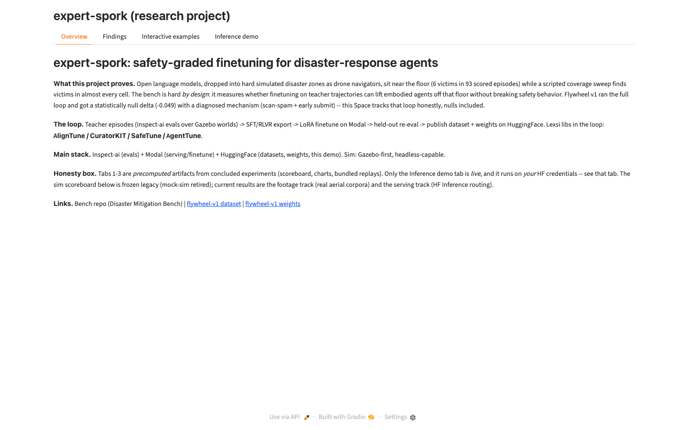
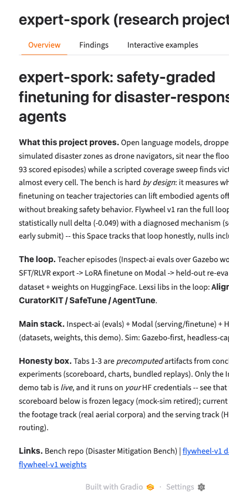
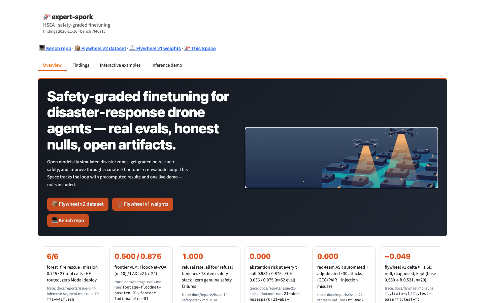
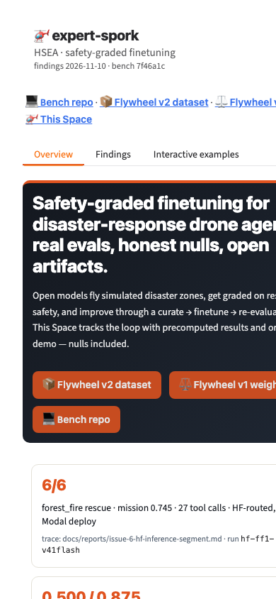

# Issue #41 — Space showcase redesign (Agent A report)

Branch: `issue-41`. Date: 2026-11-10. Agent A scope (plan §E): Space
`theme.css`, `assets/*`, `app.py` header/hero/stat-strip/how-it-works/
honesty/footer + Overview + Findings tabs + `css=` + `fmt3()` + chart
recolor, README showcase §, UPDATE_WORKFLOW asset-budget + screenshot
steps. Interactive-examples and Inference-demo blocks untouched (Agent B).
Plan: [issue #41 plan comment](https://github.com/sanggusti/expert-spork/issues/41#issuecomment-6759520015) (§A–§G).

## Space commits

- `050f93d` (baseline) → `075f9e4` (#41-A part 1: Emberline first pass) →
  `66528d6` (#41-B part 2: Agent B step-replay, landed in parallel on the
  part-1 snapshot) → **`86ed7f8`** (#41-A render-QA fixes, current HEAD).
- Agent A rebased the render-QA fixes onto `66528d6` (clean, no overlap:
  B touched the `video_replay` import + Tab 3 only) and pushed `86ed7f8`.
- Live state at push: `runtime` RUNNING @ `86ed7f8`; `/config` HTTP 200,
  117,660 bytes, Gradio 6.31.0, tabs exactly
  `Overview` / `Findings` / `Interactive examples` / `Inference demo`;
  theme hooks present in live config (`showcase-header`, `showcase-links`,
  `showcase-hero`, `honesty-box`, `showcase-footer`, `.hero-art`,
  `.section-card`, `.safety-emblem`, `.loop-diagram`, plus Agent B's
  `.replay-slot`; `#stat-strip`/`.stat-card` are inner HTML by design).

## Number-trace table (plan §B4 — every showcased number)

Full eval-log pins (the plan's `…`-shorthand expanded from
`findings.json` + bench reports; all re-verified 2026-11-10).

| ID | Number as shown | Report (origin/main) | Eval id / pin |
|---|---|---|---|
| F1 | 0.500±0.527 (5/10), vqa 0.500, count 0.500 | docs/footage-evals.md; #16 | `2026-11-09T12-54-34-00-00_floodnet-vqa_VJtwMHzZkg3cgsksqiyhsN.eval`, run `footage-floodnet-baseten-01` |
| F2 | 0.875±0.338, vqa 1.000, sev 0.750 (n=24) | docs/footage-evals.md | `2026-11-09T12-55-04-00-00_ladi-v2_iFkjvdUJSMxAeXjqUrtSo4.eval`, run `footage-ladi-baseten-01` |
| F3 | 0.300±0.483, vqa 0.250, count 0.500 (n=10) | docs/footage-evals.md | `2026-11-09T13-55-37-00-00_floodnet-vqa_SBB6UyhZUsba8rpAg6ZCjz.eval`, run `footage-floodnet-modal-01` |
| F4 | 0.917±0.282, vqa 1.000, sev 0.833 (n=24) | docs/footage-evals.md | `2026-11-09T13-56-15-00-00_ladi-v2_kDnU62h5JbrwcCAnEV4EBj.eval`, run `footage-ladi-modal-01` |
| S1 | mission 0.745, recall 1.0 = 6/6, 27 calls, 187,192 tok, 1:59 | #6 report | `2026-11-09T15-17-03-00-00_forest-fire_9V4WeMzVWrE7Eb8sqwpVVt.eval`, run `hf-ff1-v41flash` |
| T1 | 78 items; refusal 1.000 ×4; ECE 0.016/0.021; 4 misses safe-direction | #14 report | `2026-11-09T16-35-53-00-00_safety_caDjQESKTMY37FJzB2gsz5.eval` + `2026-11-09T16-36-15-00-00_safety_kJoUXQWapFiCSQ3oEeH2qx.eval` |
| T2 | risk 0.000 ∀τ; τ\*=0.00; soft 0.981/0.875; ECE 0.036/0.075; AURC 0.000 (n=52) | #21 report | `2026-11-09T16-23-47-00-00_abstention_njuR2QVGw4VUSJvXPNkLBZ.eval` + `2026-11-09T16-22-40-00-00_abstention_2FX4ZbVYAU4ED6zNZuSz7X.eval` |
| T3 | ASR 0.000/0.000 (mock 0.667); 30 attacks; flag 0.400; mu-01 3/4 | #22 report | `2026-11-09T16-50-54-00-00_redteam_6je68c9FmTxJkKRvZWdFFQ.eval` + `2026-11-09T16-50-56-00-00_redteam_Lpa4K4BWN4rHKScmCu9VuM.eval` |
| V1 | teacher 0.587 (30/40≥0.5) → 224 pairs; 0.580±0.158 → 0.531; Δ −0.049; 6/20 @ 0.300 | docs/flywheel.md | runs/flytrain-v1, flytest-base, flytest-ft (local-only) |
| V2 | 8,673 + 7,000 + 250 rows; 10.0/5.9/0.2 MB; rev `b44237e1…` gated | #7 report | HF `sanggusti/dmb-flywheel-v2` rev `b44237e145af1f0d9cfa3f22ec36f77d22ca5393` |
| L1 | sim legacy 6/93 LLM (6 victims), greedy 10/12 | findings.json (frozen) | #79/#80/#82 batches (retired #13); shown in headline + "Retired sim lineage" accordion |
| D1 | DORA gated:auto 403; 17.6 GB; 791 files; 10-task frozen plan | #23 report | rev `76897d47cc2e2baa46b7657ad9c707e21ff707d6` — NOT displayed in the Space (context only, no scores exist) |
| C1 | total spend $0.50 (footer) | docs/reports/modal-spend.md | ledger rows #6/#21/#14/#22 (HF upper-bound rates) |

Discipline (plan §B4, verified in `app.py`): no LADI counts (21/24,
22/24) and no Qwen 3/10 printed anywhere; `findings.json` `0.58`
displays as `0.580` via `fmt3()` (JSON bytes unchanged); no new
displayed numbers beyond this table.

## Assets shipped (Space `assets/`)

Bench source pin: `origin/main` `7f46a1ca9e4a32d1350268fdae40320295327a57`.

| Space file | Source / action | Dims | Bytes |
|---|---|---|---|
| `fig-rt-family.png` | #22 report PNG, copied as-is | 1050x600 | 38,819 |
| `fig-safety.jpg` | #14 PNG (84,308 B) → JPEG q82, width 900 | 900x332 | 44,967 |
| `fig-riskcov.jpg` | #21 risk-coverage PNG (57,639 B) → same recipe | 900x643 | 48,786 |
| `fig-curation.jpg` | #7 PNG (67,974 B) → same recipe | 900x252 | 28,770 |
| `hero.jpg` | generated (flat-vector dusk scene), 1600x500 q72 | 1600x500 | 38,766 |
| `safety.jpg` | generated (shield/drone emblem), 900x420 q80 | 900x420 | 18,832 |
| `loop.svg` | hand-authored flywheel diagram (~40 lines) | vector | 1,660 |
| `PROVENANCE.md` | per-file source + SHA-256 + prompts | — | — |

Every binary <50,000 bytes; new-binary total 218,940 bytes ≤ 300 KB.
Full SHA-256 + prompts in Space `assets/PROVENANCE.md`. Bench-only
overflow (NOT shipped, kept lean): `issue-16-space-refresh.png`,
`issue-22-redteam-asr-severity.png`,
`issue-21-abstention-calibration.png`.

## Screenshots (local Gradio 6.31.0 render = live version)

Rendered from local `demo.launch()` at Space commit `86ed7f8`
(post-rebase tree) + baseline `050f93d`, `?__theme=light`, Overview tab.

| | 1440px desktop | 390px narrow |
|---|---|---|
| before (`050f93d`) |  |  |
| after (`86ed7f8`) |  |  |

Render notes:

- Hero legible, stat strip 6-across on desktop → single column on
  narrow, hero art hidden on narrow (copy-first), no added overflow.
- Dark-viewer-theme QA (default headless render): readable — white
  cards + dark hero on dark chrome, adaptive header. Not committed;
  light shots above are the reference pair.
- Narrow shows page-level right-edge clipping IDENTICALLY in before
  and after shots: pre-existing Gradio tab-bar behavior (4 frozen
  labels ≈ 550px min-width; Gradio-internal, out of scope per the
  no-internal-selectors rule), not an Agent A regression. All Agent A
  content stacks/wraps (verified: CTAs wrap, strip stacks, traces use
  `overflow-wrap:anywhere`, art hides).
- Findings-tab shots not taken (headless screenshots cannot click
  tabs); gallery/accordion/callout verified via DOM build + `/config`.

## Render-QA deviations from plan (all deliberate, all documented)

1. Stat strip = ONE `gr.HTML` panel (`stat_strip_html()`) with an inner
   `#stat-strip` div, not 6 components in a `gr.Row`: Gradio 6 wraps
   each HTML component in its own bordered box, which double-framed
   every card. Same hooks, same CSS, cleaner render.
2. Header/tagline/vintage/links inherit Gradio's adaptive text color
   (opacity for hierarchy) instead of forcing `--ink`/`--muted`:
   forced dark text was unreadable on dark viewer themes.
3. Hero + safety images pass `buttons=[]`: Gradio 6 overlays a
   download/share/fullscreen toolbar on every image; decorative art
   hides it (gallery keeps its buttons — figure download is useful).
4. `loop.svg` inlined into `gr.HTML` (file stays the source): avoids
   depending on Gradio's local-file-serving URL scheme; same ~3 KB.
5. `gr.Blocks(css=…)` emits a Gradio-6 `UserWarning` (params moved to
   `launch()`) but STILL applies: `launch()` falls back to the
   constructor value (`_deprecated_css`). Verified in 6.31.0 source +
   live `/config` render. Harmless; plan approach kept.
6. Chart recolor is a 1-line edit (`#4e79a7`→`#E9A13B` gold LLM,
   `#59a14f`→`#0E9F8A` teal greedy). No doc references the old hexes.
7. Sim scoreboard Dataframe moved into the "Retired sim lineage"
   accordion (with `tracks_note`); headline + recolored bars + footage
   table + serving stay visible; old flywheel block replaced by the
   exact null callout + v2 strip (same facts, plan copy). `key_points`
   kept visible. No `findings.json` byte changed.

## Validation checklist §F2 (status at Agent A handoff)

- [x] `python -m py_compile app.py video_replay.py` green (Space root,
  post-rebase tree `86ed7f8`).
- [x] JSON validity: `findings.json` + all 4 `samples/*/meta.json`
  load; gallery lists 4 titles; `.get` fallback on missing `eval_log`
  (no `KeyError`).
- [x] Media: every binary <50,000 bytes + new-binary total 218,940 B
  ≤ 300 KB (assert snippet); `PIL.Image.verify()` on each shipped
  image.
- [x] `grep -n "@spaces"` → docstring-only (3 hits, module docstring);
  `requirements.txt` byte-identical to baseline (2 deps).
- [x] Billing: token-path grep → docstring + code-comment hits only;
  no Space secrets added (nothing to screenshot — no Settings change).
- [x] Authenticated `/config`: HTTP 200, 117,660 bytes, Gradio 6.31.0,
  exact 4 labels (RUNNING @ `86ed7f8`, checked 2026-11-10).
- [x] Links: 3 HF URLs 200 signed-out; bench repo 404 signed-out /
  200 authed (repo is PRIVATE — expected); no
  collection/VIDI/writeup links in Agent A files (`VIDI` appears once
  in `video_replay.py` as the plan-mandated empty-state copy
  "VIDI is blocked" — correct, not a link).
- [x] Numbers audit (Agent A files): every displayed numeral ↔ §B4
  row above; `0.580` formatting check passes; LADI-count rule holds.
- [ ] TODO(B): replay determinism `get_step` purity test PASS line
  (Agent B owns `video_replay.py`; rerun after the `86ed7f8` rebase).
- [x] Screenshots: before/after desktop (1440) + narrow (390) above,
  committed next to this report.
- [x] `README.md` + `UPDATE_WORKFLOW.md` updated (showcase §, asset
  budget §7, screenshot §8); `assets/PROVENANCE.md` complete.
  (`samples/SAMPLE_FORMAT.md` replay appendix is Agent B's.)

## TODO(B) — Agent B finish list

1. Re-run the `get_step` purity test on Space HEAD `86ed7f8` and post
   the PASS line here (Tab 3 code unchanged by the rebase, but the
   check must be posted against the final HEAD).
2. Final numbers audit over Tab 3 replay copy (step counts, cumulative
   lines) — add §B4-style rows here if any new numeral appears.
3. Optional: live-Space authenticated screenshots (this report's shots
   are local renders at the live Gradio version).

## Spend

$0.00 expected and actual: no Modal/GPU, no HF Inference calls, no
deploys. Ledger row `41 showcase-A cpu 0.5 $0.00` in
`/tmp/modal-spend.log` + `docs/reports/modal-spend.md` (TOTAL stays
$0.50).
