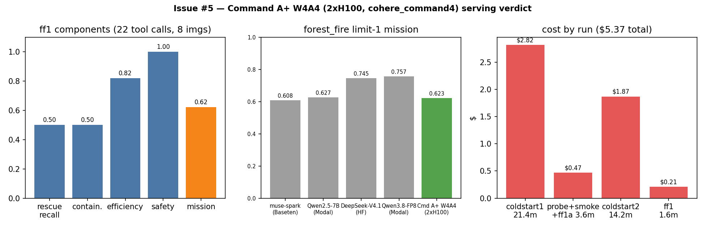

# Issue #5 — Command A+ serving-path verdict (API leg + Modal leg)

Branch: `issue-5`. Dates: 2026-11-09 (API leg), 2026-11-10 (Modal leg).

## Verdict

**Command A+ serves on Modal 2×H100 via the W4A4 repo and vLLM.**
No API path can serve `CohereLabs/command-a-plus-05-2026` (API leg
below), so the chosen path is `infra/modal/vllm_cmdaplus.py`: vLLM
0.31.0, `-tp 2`, `--tool-call-parser cohere_command4
--reasoning-parser cohere_command4 --enable-auto-tool-choice`
(model-card recipe), 64K context, 8 images/prompt. Tool-gate PASS,
smoke 1.000, forest_fire limit-1 mission 0.6225 (recall 0.50, 22
tool calls, 8 image blocks). Cost-per-eval ≈ **$0.21** warm
($5.37 this leg incl. two cold starts; running TOTAL $14.21).

## Gating verdict (Hub, via `HfApi` with project token)

| repo | gated | private | license | params / notes |
|---|---|---|---|---|
| `CohereLabs/command-a-plus-05-2026` (BF16) | False | False | apache-2.0 | 218,750,277,872 (safetensors header); sha `5fb6fde5` |
| `CohereLabs/command-a-plus-05-2026-fp8` | None (=no gate) | False | apache-2.0 | 912 downloads |
| `CohereLabs/command-a-plus-05-2026-w4a4` | None (=no gate) | False | apache-2.0 | 4,721 downloads; Cohere-stated 2×H100 target |

Config facts (`config.json`): arch
`Cohere2VisionForConditionalGeneration` / text `Cohere2MoeForCausalLM`
(`cohere2_moe`), 32 layers, 128 attn / 8 KV heads, hidden 4096,
`max_position_embeddings` 200000; `chat_template.jinja` renders a
tools/documents section (tool calling is a first-class template path).
Context for eval planning: **128K in / 64K out** (Cohere API contract,
per `docs/models.md`); raw checkpoint rope covers 200K.

## API-path probes (all failed — evidence below)

| path | probe | result |
|---|---|---|
| HF Inference Providers (`openai-api/hf/...`) | router catalog `GET /v1/models` (126 models) | `command-a-plus-05-2026` absent; 12 other `CohereLabs/*` models live via provider `cohere` |
| HF Inference Providers | `POST /v1/chat/completions` model `CohereLabs/command-a-plus-05-2026`, 1 msg, `max_tokens: 5` | **HTTP 400** `{"code":"model_not_found","message":"The requested model 'CohereLabs/command-a-plus-05-2026' does not exist."}` |
| Cohere API (`command-a-plus-05-2026`) | credential check | `COHERE_API_KEY` / `CO_API_KEY` EMPTY in both `.env` and shell; no new signups per task → unreachable (Cohere platform does list the model; we have no key) |

## vLLM / tool-parser verdict (docs evidence; live check parked)

| item | verdict | evidence |
|---|---|---|
| Model arch in vLLM | SUPPORTED | `Cohere2VisionForConditionalGeneration` row lists `CohereLabs/command-a-plus-05-2026` explicitly ([supported_models.md](https://github.com/vllm-project/vllm/blob/main/docs/models/supported_models.md)); `Cohere2MoeForCausalLM` ✅ in v0.21.0 docs; Cohere blog lists vLLM + Transformers as supported frameworks |
| Quant for 2×H100 | W4A4 repo exists, ungated | `...-w4a4`, Cohere-stated 2×H100 (or 1×B200) |
| Tool-call parser | CANDIDATE, unverified for A+ | vLLM 0.27.1 tool-calling docs ship exactly one Cohere parser, `cohere_command3` (needs `cohere_melody` pip package), documented only for `command-a-reasoning-08-2025`. Whether it parses A+'s template must be verified on a live deploy |
| Modal deploy | PARKED | approval prompts disabled → all Modal CLI calls denied; no retries attempted per task orders |

Planned Modal serve (for tomorrow's session):
`vllm serve CohereLabs/command-a-plus-05-2026-w4a4 --enable-auto-tool-choice
--tool-call-parser cohere_command3` (+ `cohere_melody` in the image),
then tool-gate with a forced-`tool_choice` probe before any mission eval.

## Evals

None runnable: no servable endpoint exists on any available path, so
there is no `.eval` log and therefore no `hsea.aggregate record`
entry (record requires an inspect log; there is genuinely nothing to
plot from eval scores — the figure above plots the verdict inputs
instead: path×criterion matrix + Hub variant stats).

## Cost

| run | class | min | $ |
|---|---|---|---|
| `5 cmdaplus-probes` (Hub metadata + router catalog + 1× 400 probe) | api | 0.1 | $0.00 |

- Estimate (pre-run): $0.00 (metadata reads + one erroring probe bill no tokens). Pre-run ledger TOTAL $0.50 → GO.
- Actual: $0.00. Running TOTAL after this issue: **$0.50** (unchanged).
- Cost-per-eval on Command A+: **unknown** — no eval ran. First number lands with the Modal attempt.

## Artifacts

- `docs/inference.md`: Command A+ section (deferred Modal path + dead API paths).
- `docs/reports/issue-5-command-a-plus-serving.md` (this file) + `.png` figure.
- `docs/reports/modal-spend.md`: ledger union incl. this issue's $0.00 row.

## Shutdown (API leg)

No Modal apps started (deploy parked) — nothing to stop. No GPU spend.

---

# Modal leg (2026-11-10)

## What

New server file `infra/modal/vllm_cmdaplus.py` (pattern:
`vllm_qwen38.py`) serving `CohereLabs/command-a-plus-05-2026-w4a4`
(218B MoE / 25B active, Apache-2.0, ungated, ~132 GB in 25 shards)
on 2×H100, plus the `MODAL_CMDAPLUS_W4A4` routing constant in
`hsea/models.py` (`modal_model_id(...)` →
`openai-api/modal/CohereLabs/command-a-plus-05-2026-w4a4`) with a
routing unit test.

Two corrections to the parked plan, both from the W4A4 model card
(read 2026-11-10): the tool parser is **`cohere_command4`** (not
`cohere_command3`, which is for command-a-reasoning), with
`--reasoning-parser cohere_command4`, vLLM >= 0.25.0, and
`cohere_melody >= 0.9.0` — we pin vLLM 0.31.0. The card's stated
minimum footprint is 1×B200 or **2×H100**, and only the MoE experts
are NVFP4 (attention path full precision); vLLM 0.31.0 serves it on
Hopper via the MARLIN NVFP4 MoE backend (per engine log).

First deploy used 32K context / 2 images per prompt; forest_fire
accumulates up to 8 snapshots in one prompt, so the limit-1 run
failed with `400 At most 2 image(s)`. One redeploy (new config, one
attempt) raised both to **64K / 8 images**; weights were cached in
the shared volume so the second cold start skipped the download.

## Evals

Model for all: `openai-api/modal/CohereLabs/command-a-plus-05-2026-w4a4`
via `MODAL_BASE_URL=https://sanggusti--dmb-vllm-cmdaplus-serve.us-east.modal.run/v1`.
Sampling: model-card recipe (temp 0.9, top_p 0.95, rep-pen 1.04) on
the probe; inspect defaults on evals.

| run_id | task | eval id (log) | score | tokens |
|---|---|---|---|---|
| cmdaplus-smoke | smoke | `logs/2026-11-10T13-33-49-00-00_smoke_nkwoh8FYTFxikNAPUswoeq.eval` | includes 1.000 | 221 (I:132, O:89) |
| cmdaplus-ff1 | forest_fire --limit 1 | `logs/2026-11-10T13-53-21-00-00_forest-fire_nBb4QsLHGbZF2mHtuqAJoX.eval` | mission 0.6225 (recall 0.50, 22 tool calls, 8 image blocks, safety 1.0) | 87,821 (I:78,194, O:9,627) |

Tool-gate probe (forced `get_weather` call): **PASS** — parsed
`tool_calls[0].function.name == get_weather` with
`{"city": "Jakarta"}`. The failed ff1a run (2-image limit) is
evidence only, not recorded.

All recorded via `python -m hsea.aggregate record`
(`runs/cmdaplus-smoke/`, `runs/cmdaplus-ff1/`; gitignored local artifacts).

Left: ff1 component scores. Middle: limit-1 mission vs other
providers' published limit-1 numbers (muse-spark 0.608, Qwen2.5-7B
0.627, DeepSeek-V4.1-Flash 0.745, Qwen3.8-FP8 0.757 — the last three
via the `origin/issue-1` report, unmerged at time of writing).
Right: GPU-active cost by run.

Duration: cold start 1 ≈ 21 min (132 GB download + engine init),
probe+smoke+ff1a ≈ 4 min, cold start 2 ≈ 14 min (cached weights,
engine init), ff1 ≈ 1.3 min.

## Cost

- Rate: H100 SXM5 $0.001097/s/GPU on-demand (modal.com/pricing,
  2026-11-10) → 2× = $0.002194/s ≈ $0.1316/min.
- Estimate (pre-run): ~60 min (download + init + tool-gate + smoke
  + ff1) ≈ $7.90. Pre-run ledger TOTAL was $8.84, so
  $8.84 + $7.90 = $16.74 < $50 cap → GO (120-min worst case
  $15.79 → $24.63, still GO).
- Actual (GPU-active wall clock × rate): coldstart1 21.4 min $2.82,
  probe+smoke+ff1a 3.6 min $0.47, coldstart2 14.2 min $1.87, ff1
  1.6 min $0.21 → **$5.37** this leg.
- Running TOTAL after this issue: **$14.21**.
- Cost-per-eval on Command A+: **≈$0.21** warm (limit-1, 88k
  tokens); cold starts ($2.82 / $1.87) amortize over a sweep.

## Artifacts

- `infra/modal/vllm_cmdaplus.py`: server file (tp=2, cohere_command4
  tool+reasoning parsers, 64K ctx, 8 imgs, `dmb-hf-token` secret).
- `hsea/models.py`: `MODAL_CMDAPLUS_W4A4` constant.
- `tests/test_models.py`: routing unit test for the new slug.
- `docs/inference.md`: Command A+ section (chosen Modal path).
- `docs/reports/modal-spend.md`: spend ledger (this leg's rows).
- `docs/reports/issue-5-command-a-plus-modal.png`: plot above.

## Shutdown

App `dmb-vllm-cmdaplus` (ap-2OwbhrzVWCigCERYInznHo) stopped after
evals; `modal app list` shows state `stopped`, 0 tasks. No app left
running.
