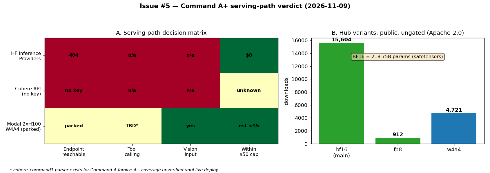

# Issue #5 — Command A+ serving-path verdict (API leg)

Branch: `issue-5`. Date: 2026-11-09.

## Verdict

**No API path can serve `CohereLabs/command-a-plus-05-2026` today.**
The Modal 2×H100 W4A4 attempt REMAINS and is PARKED until approvals
return (Modal CLI calls are denied while approval prompts are
disabled). Weights are public/ungated (Apache-2.0) and the vLLM
architecture is supported, so the Modal path is viable — it is just
not executable in this session.

## Gating verdict (Hub, via `HfApi` with project token)

| repo | gated | private | license | params / notes |
|---|---|---|---|---|
| `CohereLabs/command-a-plus-05-2026` (BF16) | False | False | apache-2.0 | 218,750,277,872 (safetensors header); sha `5fb6fde5` |
| `CohereLabs/command-a-plus-05-2026-fp8` | None (=no gate) | False | apache-2.0 | 912 downloads |
| `CohereLabs/command-a-plus-05-2026-w4a4` | None (=no gate) | False | apache-2.0 | 4,721 downloads; Cohere-stated 2×H100 target |

Config facts (`config.json`): arch
`Cohere2VisionForConditionalGeneration` / text `Cohere2MoeForCausalLM`
(`cohere2_moe`), 32 layers, 128 attn / 8 KV heads, hidden 4096,
`max_position_embeddings` 200000; `chat_template.jinja` renders a
tools/documents section (tool calling is a first-class template path).
Context for eval planning: **128K in / 64K out** (Cohere API contract,
per `docs/models.md`); raw checkpoint rope covers 200K.

## API-path probes (all failed — evidence below)

| path | probe | result |
|---|---|---|
| HF Inference Providers (`openai-api/hf/...`) | router catalog `GET /v1/models` (126 models) | `command-a-plus-05-2026` absent; 12 other `CohereLabs/*` models live via provider `cohere` |
| HF Inference Providers | `POST /v1/chat/completions` model `CohereLabs/command-a-plus-05-2026`, 1 msg, `max_tokens: 5` | **HTTP 400** `{"code":"model_not_found","message":"The requested model 'CohereLabs/command-a-plus-05-2026' does not exist."}` |
| Cohere API (`command-a-plus-05-2026`) | credential check | `COHERE_API_KEY` / `CO_API_KEY` EMPTY in both `.env` and shell; no new signups per task → unreachable (Cohere platform does list the model; we have no key) |

## vLLM / tool-parser verdict (docs evidence; live check parked)

| item | verdict | evidence |
|---|---|---|
| Model arch in vLLM | SUPPORTED | `Cohere2VisionForConditionalGeneration` row lists `CohereLabs/command-a-plus-05-2026` explicitly ([supported_models.md](https://github.com/vllm-project/vllm/blob/main/docs/models/supported_models.md)); `Cohere2MoeForCausalLM` ✅ in v0.21.0 docs; Cohere blog lists vLLM + Transformers as supported frameworks |
| Quant for 2×H100 | W4A4 repo exists, ungated | `...-w4a4`, Cohere-stated 2×H100 (or 1×B200) |
| Tool-call parser | CANDIDATE, unverified for A+ | vLLM 0.27.1 tool-calling docs ship exactly one Cohere parser, `cohere_command3` (needs `cohere_melody` pip package), documented only for `command-a-reasoning-08-2025`. Whether it parses A+'s template must be verified on a live deploy |
| Modal deploy | PARKED | approval prompts disabled → all Modal CLI calls denied; no retries attempted per task orders |

Planned Modal serve (for tomorrow's session):
`vllm serve CohereLabs/command-a-plus-05-2026-w4a4 --enable-auto-tool-choice
--tool-call-parser cohere_command3` (+ `cohere_melody` in the image),
then tool-gate with a forced-`tool_choice` probe before any mission eval.

## Evals

None runnable: no servable endpoint exists on any available path, so
there is no `.eval` log and therefore no `hsea.aggregate record`
entry (record requires an inspect log; there is genuinely nothing to
plot from eval scores — the figure above plots the verdict inputs
instead: path×criterion matrix + Hub variant stats).

## Cost

| run | class | min | $ |
|---|---|---|---|
| `5 cmdaplus-probes` (Hub metadata + router catalog + 1× 400 probe) | api | 0.1 | $0.00 |

- Estimate (pre-run): $0.00 (metadata reads + one erroring probe bill no tokens). Pre-run ledger TOTAL $0.50 → GO.
- Actual: $0.00. Running TOTAL after this issue: **$0.50** (unchanged).
- Cost-per-eval on Command A+: **unknown** — no eval ran. First number lands with the Modal attempt.

## Artifacts

- `docs/inference.md`: Command A+ section (deferred Modal path + dead API paths).
- `docs/reports/issue-5-command-a-plus-serving.md` (this file) + `.png` figure.
- `docs/reports/modal-spend.md`: ledger union incl. this issue's $0.00 row.

## Shutdown

No Modal apps started (deploy parked) — nothing to stop. No GPU spend.
