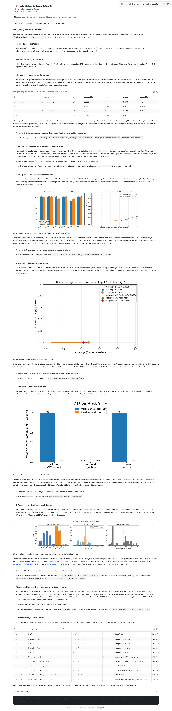
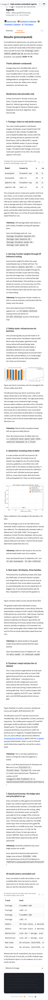

# Issue #57 — Space Findings narrative restructure + results explanations

Branch: `issue-57`. Date: 2026-11-10. Scope: restructure the HF Space
Findings tab from stacked figures into a readable narrative, per
[issue #57](https://github.com/sanggusti/expert-spork/issues/57)
(follow-up to #41/#45). Owner copy rules from the
[owner-feedback comment on #41](https://github.com/sanggusti/expert-spork/issues/41#issuecomment-6760338597)
are binding and hold (audit below). Bench vintage: `origin/main`
`fc5cd56`. No Modal/GPU. No PR opened, no merge, #57 left open.

Sources read: `WORKFLOW.md`, issue #57 (full body), the #41 feedback
comment, `docs/research-track.md`, `docs/models.md`, `docs/datasets.md`,
`docs/footage-evals.md`, and every `docs/reports/issue-*.md` on
`origin/main`.

## Space commits

- `60e6eb6` (all-results table) → `9500d4a` (narrative restructure) →
  **`2bb730f`** (this pass, pushed: figure captions below images).
- Live state (`2bb730f` RUNNING): `/config` HTTP 200, 136,758
  bytes, Gradio 6.31.0, tabs exactly `Overview` / `Findings` /
  `Interactive examples` / `Inference demo`. Hardware `cpu-basic`.
- Diff shape (`60e6eb6..2bb730f`): 3 files changed, +244/−56 (`app.py`,
  `README.md`, `UPDATE_WORKFLOW.md`). Zero new binaries. Token path,
  replay logic, `requirements.txt`, `findings.json`, `theme.css`,
  samples untouched.

## Section map (before → after)

Before: intro → tracks strip → lanes strip → footage table + JSON note
+ counterpoint → safety emblem image → safety/abstention/red-team
summary cards → 4-figure Gallery (stacked 2-col grid) → flywheel
one-line callout + v2 strip → all-results table + retired note →
accordion.

After (narrative, each section with explanation + interleaved figure +
takeaway + trace):

| # | Section | Prose | Visual | Takeaway + trace |
|---|---|---|---|---|
| — | Results intro + Tracks + Model lanes | kept (intro reframed) | — | TRK/MOD (unchanged) |
| 1 | Footage: vision on real aerial corpora | what ran (2 VLMs, pins), what composite means, FloodNet vs LADI | footage Dataframe (4 rows, kept) | rows 1–4 pointer + footage trace |
| 2 | Serving: frontier weights through HF Inference routing | why the segment exists, path confirmed, retired-run pointer, demo billing | — (no figure exists; no filler added) | #6 trace (scores stay in the report) |
| 3 | Safety stack: refusal across six benches | 78 items, 6 benches named, deterministic grading | fig-safety.jpg + caption | rows 5–6 pointer + #14 trace |
| 4 | Abstention: knowing when to defer | 60+20 set, cal/eval split, rubric, second pass | fig-riskcov.jpg + caption | rows 7–8 pointer + #21 trace |
| 5 | Red-team: 30 attacks, three families | 3 families, automated + adjudicated, weak baseline | fig-rt-family.png + caption | rows 9–10 pointer + #22 trace |
| 6 | Flywheel: a kept null plus the v2 dataset | v1 null numbers + cause, v2 scale + negatives | fig-curation.jpg + caption | rows 11–12 pointer + V1/V2 trace |
| 7 | Spend and honesty: the ledger plus one principled no-go | $50 cap, union math, DORA no-go | — (no figure exists; no filler added) | rows 13–14 pointer + spend/DORA trace |
| — | All results table (scrollable, kept) + retired note (kept) + accordion (kept) | — | all-results Dataframe (14 rows; spend row refreshed) | per-row traces (unchanged except spend) |

Retired from display: the safety emblem image (decorative, not a
result figure; file kept in `assets/`), the 4-figure Gallery grid
(replaced by 4 captioned `gr.Image`, one per section), the footage
JSON note and old counterpoint/summary/callout strips (superseded by
the section prose; same facts, traced).

## Number-trace audit (every displayed numeral)

Carry-over rows F1–F4, T1–T3, V1, V2, L1, D1, C1 from
`docs/reports/issue-41-showcase.md` §B4 (via `issue-41-feedback.md`
R1′/R2′/R3′/TRK/MOD and `space-results-table.md` rows 1–14). S1
numbers stay undisplayed (retired note only). New or moved numerals
in the #57 prose, each with its source:

| ID | Number as shown | Source |
|---|---|---|
| N1 | LADI 12 yes/no per image; 24 samples cover 2 images | footage-evals.md (label rendering; 2 images × 12 questions) |
| N2 | corpus pins ljx620@ec9277af, MITLL@5f2dbfe8 | footage-evals.md pinned-sources table |
| N3 | sev 0.750 frontier, 0.833 Qwen3-VL-8B; composite 0.300 against 0.500 | §B4 F1–F4 (same runs as the kept table) |
| N4 | rows 1–14 pointers ("Rows N to M") | this tab's own all-results table |
| N5 | 6 bench names; confidence saturates 95 to 100; 4 misses split 2/1/1 | #14 report (matrix; risk-coverage note; miss analysis) |
| N6 | 60 risk (20/20/20), 10 categories, 20 benign, cal 28 / eval 52, 20/20 second pass, 80 samples | #21 report (set, split, rater check, run logs) |
| N7 | coverage 0.481/0.423 implied; over-refusal 0.038/0.154; tau* 0.00, AURC 0.000 | #21 report (eval-split table; stated frontier-first) |
| N8 | 30 = 10+10+10; family 1.000/0.000/1.000; flag 0.400; 3 of 4 | #22 report (family table; injection note; mu-01 finding) |
| N9 | v1 base 0.580 → ft 0.531, n=20, delta −0.049 ≈ −1 SE | #41-showcase §B4 row V1 (flytrain-v1, flytest-base, flytest-ft) |
| N10 | DPO 4,000 HumAID + 3,000 CrisisMMD; RLVR 133 + 117 around 0.5 | #7 report (DPO table; RLVR split) |
| N11 | TOTAL $6.29 = eval API $0.50 + serving GPU $5.79 (issues 1/2/3) at bench fc5cd56 | modal-spend.md ledger union (rows #6/#21/#14/#22 = $0.50; issue-1 $2.28 + issue-2 $1.92 + issue-3 $1.59 = $5.79) |
| N12 | $50 cap; $0.00 CPU rows | modal-spend.md header; ledger $0.00 rows |
| N13 | DORA 8 requests, 403, 17.6 GB, 791 files, 10-task plan, rev 76897d47 | #23 report (probe table; dataset facts) |
| N14 | figure captions: 78-item (#14), n=52 (#21) | #14/#22/#21/#7 reports (issue refs are pointers) |

Discipline holds: no LADI counts (21/24, 22/24) and no Qwen 3/10
printed; `findings.json` `0.58` still displays as `0.580` via `fmt3()`;
v1 teacher names (legacy Qwen2.5/Mistral-7B) stay out of the prose;
V1 numbers re-trace to #41-showcase §B4 row V1 (`docs/flywheel.md`
retired in #42; the lesson text now lives in research-track §6).

## Copy-rule audit (Space tree + live `/config`)

- Em-dash: 0 (`—` and `u2014` greps over `app.py`, `video_replay.py`,
  `theme.css`, `README.md`, `UPDATE_WORKFLOW.md`, samples, live config).
  Minus (−), en-dash, and arrows untouched.
- AI-tell phrasing: 0 (`not X but`, `not just`, `more than just`,
  `in today`, `delve`, `landscape` greps). Plain `no`/`never`
  without `but` remain (e.g. `never the owner`).
- Title: HSEA wordmark present; `expert-spork` 3 hits, all the kept
  repo URL (plus `/path/to/expert-spork` example paths in dev docs).
- Models: `Qwen2.5` / `Mistral-7B` 0 in user-visible strings and live
  config; `dmb-qwen2.5-7b-flywheel-v1` 0. Shown names are lanes
  (Qwen3-VL-8B, DeepSeek V4.1-Flash, lane strips) plus run provenance
  (`musespark`, run ids) per the #41-feedback treatment.
- Tracks: dataset-composed names only; `forest_fire` 1 hit, the
  allowed retired note (plus 2 pre-existing unrendered code comments).
- Untouched: token-path grep is docstring plus code-comment hits only;
  `@spaces` docstring only; `requirements.txt`, `findings.json`,
  `theme.css`, replay code byte-identical; Tab 1/3/4 blocks unchanged
  (diff hunks cover the Findings tab + `BENCH_PIN` only).

## Links (signed-out curl)

v2 dataset 200, v1 dataset 200, bench repo 404 (PRIVATE, expected),
Space 401 signed-out with authed `/config` 200 (private, expected).
No weights, collection, or VIDI links.

## Screenshots (live Space `2bb730f`, authenticated, Gradio 6.31.0, `?__theme=light`)

| File | Viewport | Tab | Notes |
|---|---|---|---|
| `issue-57-findings-1440.png` | 1440px | Findings (full page) | 7 sections, interleaved figures + captions, table head, retired note, accordion, footer |
| `issue-57-findings-390.png` | 390px | Findings (full page) | Text wraps, figures scale, no page overflow |

Render notes: no two figures adjacent anywhere (asserted
programmatically, see below); captions sit below images after the
first push showed label chips overlapping wide-figure titles
(`9500d4a` → `2bb730f` fix). All-results table scrolls past row 10
(`max_height=420`); all 14 rows confirmed in `/config` data. Narrow
tab-bar collapse is the pre-existing Gradio behavior noted in #41,
not a regression. Tooling: `playwright` in `/tmp/shot-venv` plus
checked-in Chromium (`PLAYWRIGHT_BROWSERS_PATH=/tmp/ms-playwright`);
Chromium launch needed one-time unsandboxed approval; live auth via
`Authorization: Bearer` header (token from bench `.env`, never
printed). Tab click needed a forced click (overlay interception in
headless).

## Read-through verdict

Coherent: each of the 7 sections states what ran, what the numbers
mean, and why it matters in plain sentences; figures interleave with
prose (footage table → serving prose → safety figure → abstention
figure → red-team figure → curation figure → spend prose →
all-results table); every section ends in a takeaway plus a
report-to-run trace line; row pointers (1–14) connect each section to
the kept table. No stacking, no filler sections: serving and spend
carry no figure because no figure exists for them, and say so by
structure (prose-only sections, not placeholders).

## Verification log

- [x] `python -m py_compile app.py video_replay.py` green (Space root, `2bb730f`).
- [x] JSON validity: `findings.json` + the 1 remaining `samples/*/meta.json` load.
- [x] Media: zero new binaries; every existing binary still <50,000 bytes (untouched).
- [x] `grep -n "@spaces"` docstring-only (3 hits); hardware `cpu-basic`; `requirements.txt` unchanged.
- [x] Billing: token-path grep docstring plus comment only; no Space secrets added.
- [x] Structure check (real `build_demo` via recording stub): 4 frozen tab labels, 4 images + 0 galleries in Findings, no two visuals adjacent, prose on both sides of every visual, 7 headings + 7 takeaways + 7 traces, dataframe rows [3, 4, 14]. PASS.
- [x] Authenticated `/config`: HTTP 200, 136,758 bytes, Gradio 6.31.0, exact 4 labels; 7 takeaways + 7 headings + `TOTAL $6.29` + `bench fc5cd56` present; galleries 0.
- [x] Links: datasets 200 signed-out; bench repo 404 and Space 401 signed-out (both private, expected).
- [x] Numbers audit: every displayed numeral traces to the table above; LADI-count rule holds.
- [x] Copy-rule greps: em-dash 0, AI-tells 0, legacy models 0, repo-URL-only `expert-spork`, `forest_fire` in the retired note only.
- [x] Screenshots: desktop 1440 + narrow 390 committed next to this report; read-through verdict above.
- [x] Full pytest: 244 passed, 7 skipped (main-repo `.venv` python, this worktree).

## Spend

$0.00 for this task (no Modal/GPU, no HF Inference calls, no
deploys). Ledger row `57 findings-narrative cpu 0.5 $0.00` appended
to `/tmp/modal-spend.log` and mirrored by union; branch
`docs/reports/modal-spend.md` TOTAL $6.29 (includes parallel serving
GPU spend on issues 1/2/3, not task spend). The Space spend row pins
the same union at bench `fc5cd56` (TOTAL $6.29).
