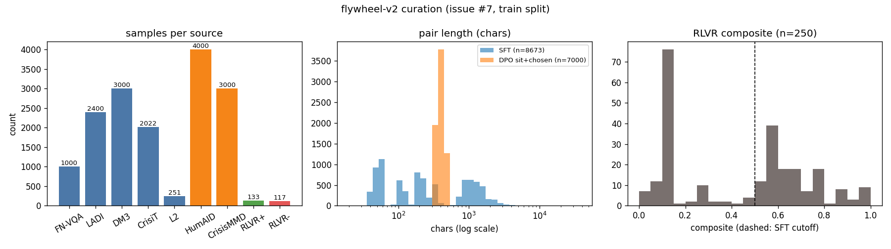

# Issue #7 — flywheel-v2 curation (CuratorKIT export + gated HF dataset)

Branch: `issue-7`. Date: 2026-11-09.

## What

Curation pipeline `hsea/data/curate_v2.py` (+ `hsea/data/clearance.py`
#24 gate): pinned-revision corpora + bench L2 trajectories →
`data/flywheel-v2/` (`sft.jsonl`, `dpo.jsonl`, `rlvr.jsonl`,
`manifest.json`, card `README.md`), pushed gated to
`sanggusti/dmb-flywheel-v2`. `data/flywheel-v1` untouched (v1 example).

Exact export command (repo root; recorded in `manifest.json` too):

```sh
.venv/bin/python -m hsea.data.curate_v2 --out data/flywheel-v2 --split train
```

Repro gate (blind, no network, no writes):

```sh
.venv/bin/python -m hsea.data.curate_v2 --out data/flywheel-v2 \
  --split train --verify-only
```

## Results

| File | Rows | Size | SHA-256 (prefix) |
|---|---|---|---|
| `sft.jsonl` | 8,673 | 10.0 MB | `5b944648ad57…` |
| `dpo.jsonl` | 7,000 | 5.9 MB | `a322461981f8…` |
| `rlvr.jsonl` | 250 | 0.2 MB | `7a9f6ad838e1…` |

Per-source SFT counts:

| Source | Upstream rev | Split | Kept | Filter notes |
|---|---|---|---|---|
| floodnet-vqa | `ljx620/FloodNet-VQA` @ `ec9277af` | train | 1,000 | first-1k stream order; QA text + image refs, no pixels |
| ladi-v2 | `MITLL/LADI-v2-dataset` @ `5f2dbfe8` | train | 2,400 | 200 imgs × 12 yes/no; refs only |
| disasterm3 | `Kingdrone-Junjue/DisasterM3` @ `1da6da73` | train file (92,968 rows) | 3,000 | 375 × 8 text tasks; 37,204 referring-seg rows excluded (mask outputs need vision SFT) |
| crisitext | `LanD-FBK/crisitext` @ `33c5545c` | train | 2,022 msgs / 300 situations | FEMA/GTD only (0 synthetic skipped in cap); guideline names inline, full text via pinned `fema_guidelines.json` |
| l2 | 157 logs + flywheel-v1 | train seeds | 251 (27 fresh + 224 v1) | SFT: composite ≥ 0.5, non-mock (5 mock turns skipped); RLVR: all 210 + 40 v1 |

DPO (dispatch, #20 builder; TREC-IS skipped per #24):

| Source | Pairs | P1 | P2 | P3 |
|---|---|---|---|---|
| humaid (first-4k train, labels-only) | 4,000 | 915 | 2,126 | 959 |
| crisismmd (3-config tweet_id join; 8,409 joined, first-3k) | 3,000 | 313 | 1,209 | 1,478 |

RLVR: 250 episodes (133 ≥ 0.5 / 117 negatives), teachers span
Qwen2.5-7B/14B, muse-spark-open-1026, Mistral-7B, Qwen3-VL-8B,
DeepSeek-V4.1-Flash, mockllm. Negatives include v1's 10 failure
episodes per the flywheel.md v2 prescription.



*Left: samples per source. Middle: SFT vs DPO pair-length histograms
(chars, log x). Right: RLVR composite distribution with the 0.5 SFT
cutoff (dashed). Rendered by `scripts/plot_flywheel_v2.py`.*

## Verification runs

| run_id | task | eval id (log) | score | tokens |
|---|---|---|---|---|
| curate7-verify-floodnet-mock | floodnet_vqa (limit 4) | `logs/2026-11-09T16-09-41-00-00_floodnet-vqa_mYprqA2DkVu6kMPMQhXURb.eval` | footage 0.000 (mockllm fixed output; harness proof) | ~0 |

Recorded via `python -m hsea.aggregate record`
(`runs/curate7-verify-floodnet-mock/`; gitignored). `--verify-only`
on `data/flywheel-v2` passes (hashes + schemas + counts + clearance).
`pytest tests/` green (see below). No tweet-text leak (`tweet_text`
absent from `dpo.jsonl`), no pixel redistribution (`data:image`
absent from `sft.jsonl`).

## License / clearance

Clearance asserted in-code before any streaming
(`hsea/data/clearance.py`, #24 terms); refused sources abort the
export (tested: trec-is/vidi/sen1floods11/crisishelpoffer/rescuenet/
sard/flame-3/heridal/dad + unknown ids). FloodNet-VQA training use is
clarified here: base FloodNet is CDLA-Permissive-1.0, the ljx620
mirror card is untagged, so v2 ships short-factual-QA text + image
refs only (no pixels) in a gated research-only dataset with full
provenance. Overall dataset research-only (NC/SA components).

## Cost

- Estimate (pre-run): $0.00 — CPU-only curation (free HF streaming),
  mockllm verification ($0), free HF dataset push. $0.08 + $0.00 <
  $50 cap → GO. Modal GPU estimate $0 (no deploys; approval-disabled
  run).
- Actual: $0.00. Ledger row `7 curate-v2 cpu 45 $0.00` appended to
  `/tmp/modal-spend.log` and mirrored below.
- Running TOTAL after this issue: **$0.08**.

## Artifacts

- `hsea/data/clearance.py`, `hsea/data/curate_v2.py`,
  `tests/test_curate_v2.py` (13 tests), `scripts/plot_flywheel_v2.py`.
- `data/flywheel-v2/` (sft/dpo/rlvr + manifest + card).
- `pyproject.toml`: `matplotlib>=3.10` in the dev extra (reports infra).
- HF: `sanggusti/dmb-flywheel-v2` (gated, manual), rev `b44237e145af1f0d9cfa3f22ec36f77d22ca5393`.
- Consistency: FloodNet-VQA training clarification back-ported to
  `hsea/data/footage.py`, `docs/footage-evals.md`, `docs/datasets.md`.

## Shutdown

No Modal apps started — nothing to stop. No GPU spend.
