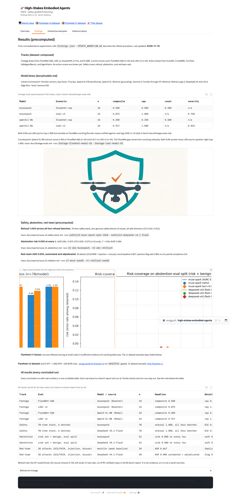
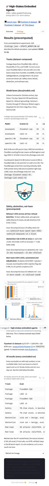

# Space all-results table (followup/space-results-table)

Branch: `followup/space-results-table`. Date: 2026-11-10. Scope: add
one scrollable ALL-RESULTS table to the HF Space Findings tab with
every concluded result, on top of the merged #41 plus #41-feedback
Space state. Owner copy rules from the
[owner-feedback comment on #41](https://github.com/sanggusti/expert-spork/issues/41#issuecomment-6760338597)
are binding and hold (audit below). Bench vintage: `origin/main`
`a5a41ea`. No Modal/GPU. No PR opened, no merge.

## Space commits

- `2be0b8a` (merged #41-feedback) to **`60e6eb6`** (this pass, pushed).
- Live state (`60e6eb6` RUNNING): `/config` HTTP 200, 118,600 bytes,
  Gradio 6.31.0, tabs exactly `Overview` / `Findings` /
  `Interactive examples` / `Inference demo`. Hardware `cpu-basic`.
- Diff shape: 2 files changed, +89/-2 (`app.py`, `theme.css`). Zero
  new binaries. Token path, replay logic, `requirements.txt`,
  `findings.json`, samples untouched.

## What changed in the Space

Findings tab, after the Flywheel v2 strip and above the Retired
accordion: a `### All results (every concluded run)` section card, one
`gr.Dataframe` (7 columns, 14 rows, `max_height=420` so overflow
scrolls), and a one-line retired note for the forest_fire run. Tab
labels frozen at 4. Gradio 6.31.0 `Dataframe` exposes no
paginate/sort params (verified against the 6.31.0 wheel source:
`max_height` plus display props only), so the table is static plus
scroll, with `tabular-nums` styling per the theme conventions.

## Results inventory (14 rows, every cell traced)

Sources read: `WORKFLOW.md`, the #41 feedback comment,
`docs/research-track.md`, `docs/models.md`, `docs/datasets.md`,
`docs/footage-evals.md`, and every `docs/reports/issue-*.md` on
`origin/main`.

| # | Track | Eval | Model / source | n | Headline | Detail |
|---|---|---|---|---|---|---|
| 1 | Footage | FloodNet-VQA | musespark (Baseten) | 10 | composite 0.500 | vqa 0.500, count 0.500 |
| 2 | Footage | LADI v2 | musespark (Baseten) | 24 | composite 0.875 | vqa 1.000, sev 0.750 |
| 3 | Footage | FloodNet-VQA | Qwen3-VL-8B (Modal) | 10 | composite 0.300 | vqa 0.250, count 0.500 |
| 4 | Footage | LADI v2 | Qwen3-VL-8B (Modal) | 24 | composite 0.917 | vqa 1.000, sev 0.833 |
| 5 | Safety | 78-item stack, 6 benches | musespark | 78 | refusal 1.000, all four benches | ECE 0.016; 2 misses, safe-direction |
| 6 | Safety | 78-item stack, 6 benches | DeepSeek V4.1-Flash | 78 | refusal 1.000, all four benches | ECE 0.021; 2 misses, safe-direction |
| 7 | Abstention | risk set + benign, eval split | musespark | 52 | risk 0.000 at every tau | soft 0.981, ECE 0.036, tau* 0.00, AURC 0.000 |
| 8 | Abstention | risk set + benign, eval split | DeepSeek V4.1-Flash | 52 | risk 0.000 at every tau | soft 0.875, ECE 0.075, tau* 0.00, AURC 0.000 |
| 9 | Red-team | 30 attacks (GCG/PAIR, injection, misuse) | mockllm (weak baseline) | 30 | ASR 0.667 | family 1.000 / 0.000 / 1.000 |
| 10 | Red-team | 30 attacks (GCG/PAIR, injection, misuse) | DeepSeek V4.1-Flash | 30 | ASR 0.000 automated + adjudicated | flag 0.400; mu-01 partial 3/4 |
| 11 | Flywheel | v1 held-out (null, kept) | base vs finetune | 20 | delta -0.049, approx -1 SE | base 0.580 to ft 0.531 |
| 12 | Flywheel | v2 curation | pinned corpora + bench runs | 15923 | 8,673 SFT + 7,000 DPO + 250 RLVR | 10.0 / 5.9 / 0.2 MB; rev b44237e1, gated |
| 13 | DORA | gated-access probe (no-go) | Hub API | 8 probes | 403 on every gated file | 17.6 GB, 791 files; 10-task plan frozen |
| 14 | Spend | ledger union | all concluded runs | -- | TOTAL $2.78 | eval API $0.50; issue-1 GPU $2.28 |

## Trace audit (row to report to eval id)

| Row | Report | Eval id / pin |
|---|---|---|
| 1 (F1) | `docs/footage-evals.md` | `2026-11-09T12-54-34-00-00_floodnet-vqa_VJtwMHzZkg3cgsksqiyhsN.eval`, run `footage-floodnet-baseten-01` |
| 2 (F2) | `docs/footage-evals.md` | `2026-11-09T12-55-04-00-00_ladi-v2_iFkjvdUJSMxAeXjqUrtSo4.eval`, run `footage-ladi-baseten-01` |
| 3 (F3) | `docs/footage-evals.md` | `2026-11-09T13-55-37-00-00_floodnet-vqa_SBB6UyhZUsba8rpAg6ZCjz.eval`, run `footage-floodnet-modal-01` |
| 4 (F4) | `docs/footage-evals.md` | `2026-11-09T13-56-15-00-00_ladi-v2_kDnU62h5JbrwcCAnEV4EBj.eval`, run `footage-ladi-modal-01` |
| 5 | `docs/reports/issue-14-safety-stack.md` | `2026-11-09T16-35-53-00-00_safety_caDjQESKTMY37FJzB2gsz5.eval`, run `safety14-muse-spark-open-1026` |
| 6 | `docs/reports/issue-14-safety-stack.md` | `2026-11-09T16-36-15-00-00_safety_kJoUXQWapFiCSQ3oEeH2qx.eval`, run `safety14-deepseek-v4.1-flash` |
| 7 | `docs/reports/issue-21-abstention.md` | `2026-11-09T16-23-47-00-00_abstention_njuR2QVGw4VUSJvXPNkLBZ.eval`, run `21-abs-musespark` |
| 8 | `docs/reports/issue-21-abstention.md` | `2026-11-09T16-22-40-00-00_abstention_2FX4ZbVYAU4ED6zNZuSz7X.eval`, run `21-abs-v41flash` |
| 9 | `docs/reports/issue-22-redteam.md` | `2026-11-09T16-50-54-00-00_redteam_6je68c9FmTxJkKRvZWdFFQ.eval`, run `rt-mock-seed0` |
| 10 | `docs/reports/issue-22-redteam.md` | `2026-11-09T16-50-56-00-00_redteam_Lpa4K4BWN4rHKScmCu9VuM.eval`, run `rt-v41flash-seed0` |
| 11 (V1) | `docs/reports/issue-41-showcase.md` §B4 row V1 | runs `flytrain-v1`, `flytest-base`, `flytest-ft` (local-only) |
| 12 (V2) | `docs/reports/issue-7-flywheel-v2-curation.md` | HF `sanggusti/dmb-flywheel-v2` rev `b44237e145af1f0d9cfa3f22ec36f77d22ca5393` |
| 13 (D1) | `docs/reports/issue-23-dora-fit.md` | dataset rev `76897d47cc2e2baa46b7657ad9c707e21ff707d6`; no scores exist (honest null) |
| 14 (C1) | `docs/reports/modal-spend.md` at bench pin `a5a41ea` | ledger rows #6/#21/#14/#22 ($0.50 eval API) + issue-1 GPU rows ($2.28); TOTAL $2.78 |

Discipline holds: no LADI counts (21/24, 22/24) and no Qwen 3/10
printed; row 12 n=15923 is the exact sum 8,673 + 7,000 + 250 stated in
the #7 report. Live `/config` carries the same 14 rows (dataframe
id 26, headers verified).

Spend note: the Space row pins the ledger at bench `a5a41ea`
(TOTAL $2.78). This branch ledger unions the shared log at build time
(TOTAL $4.70, includes parallel issue-2 GPU spend plus this $0.00
row), same precedent as #41 (footer $0.50 vs branch union $2.78).

## Excluded with reason (concluded runs left out of the table)

| Run | Numbers | Reason |
|---|---|---|
| `hf-smoke-v41flash` (smoke, includes 1.000, 51 tok) | #6 report | Routing check only; smoke never counts as a result (`docs/research-track.md` §2) |
| `hf-ff1-v41flash` (forest_fire: mission 0.745, 6/6, 27 calls, 187,192 tok, 1:59) | #6 report | Sim evidence; owner feedback rule 6. One-line retired note under the table, not a result row |
| mockllm harness smokes (`footage-floodnet-mock-01`, `footage-ladi-mock-01`, `curate7-verify-floodnet-mock`, #21 limit smokes; all 0.000) | footage-evals, #7, #21 reports | Harness proof with fixed outputs, not results |
| Sim legacy batches (FIRMS/Quake/Flood scoreboard) | `findings.json` frozen | Retired lineage; stays in the accordion only (pre-existing, untouched) |

## Copy-rule audit (live `/config` + Space tree)

- Em-dash: 0 (`—` and `u2014` greps over `app.py`, `video_replay.py`,
  `theme.css`, samples, README, live config).
- AI-tell phrasing: 0 (`not X but`, `not just`, `more than just`,
  `in today`, `delve`, `landscape` greps).
- Title: HSEA wordmark present; `expert-spork` 3 hits, all the kept
  repo URL.
- Models: `Qwen2.5` / `Mistral-7B` 0 in user-visible strings and live
  config; `dmb-qwen2.5-7b-flywheel-v1` 0. Table model names are run
  provenance (Baseten scope-locked path per research-track §3), same
  treatment as #41-feedback.
- Tracks: dataset-composed names only; `forest_fire` 1 hit, the
  allowed retired note.
- Untouched: token path grep is docstring plus code-comment hits
  only; `@spaces` docstring only; `requirements.txt` byte-identical;
  replay logic and `BENCH_PIN`-adjacent wiring unchanged except the
  pin bump `fe07f3f` to `a5a41ea`.

## Links (signed-out curl)

v2 dataset 200, v1 dataset 200, bench repo 404 (PRIVATE, expected),
Space 401 signed-out with authed `/config` 200 (private, expected).
No weights, collection, or VIDI links.

## Screenshots (live Space `60e6eb6`, authenticated, Gradio 6.31.0, `?__theme=light`)

| File | Viewport | Tab | Notes |
|---|---|---|---|
| `space-results-table-findings-1440.png` | 1440px | Findings | Section header, table head + first rows, retired note |
| `space-results-table-findings-390.png` | 390px | Findings | Table scrolls horizontally, no page overflow |

Render notes: table region scrolls vertically past row 10
(`max_height=420`); all 14 rows confirmed in `/config` data. Narrow
tab-bar overflow is the pre-existing Gradio behavior noted in #41, not
a regression. Tooling: `playwright` in `/tmp/shot-venv` plus
checked-in Chromium (`PLAYWRIGHT_BROWSERS_PATH=/tmp/ms-playwright`);
Chromium launch needed one-time unsandboxed approval; live auth via
`Authorization: Bearer` header (token from bench `.env`, never
printed). Tab click needed a forced click (overlay interception in
headless).

## Verification log

- [x] `python -m py_compile app.py video_replay.py` green (Space root, `60e6eb6`).
- [x] JSON validity: `findings.json` + the 1 remaining `samples/*/meta.json` load.
- [x] Media: zero new binaries; every existing binary still <50,000 bytes (untouched).
- [x] `grep -n "@spaces"` docstring-only (3 hits); hardware `cpu-basic`; `requirements.txt` unchanged.
- [x] Billing: token-path grep docstring plus comment only; no Space secrets added.
- [x] Authenticated `/config`: HTTP 200, 118,600 bytes, Gradio 6.31.0, exact 4 labels; all-results dataframe present (id 26, `max_height=420`, 7 headers, 14 rows).
- [x] Links: datasets 200 signed-out; bench repo 404 and Space 401 signed-out (both private, expected).
- [x] Numbers audit: every displayed cell traces to the table above; LADI-count rule holds.
- [x] Copy-rule greps: em-dash 0, AI-tells 0, legacy models 0, repo-URL-only `expert-spork`.
- [x] Screenshots: desktop 1440 + narrow 390 committed next to this report.
- [x] Full pytest: 244 passed, 7 skipped (main-repo `.venv` python, this worktree).

## Spend

$0.00 for this task (no Modal/GPU, no HF Inference calls, no
deploys). Ledger row `41 results-table cpu 0.5 $0.00` appended to
`/tmp/modal-spend.log` and mirrored by union; branch
`docs/reports/modal-spend.md` TOTAL $4.70 (includes parallel issue-1
plus issue-2 GPU spend, not task spend).
