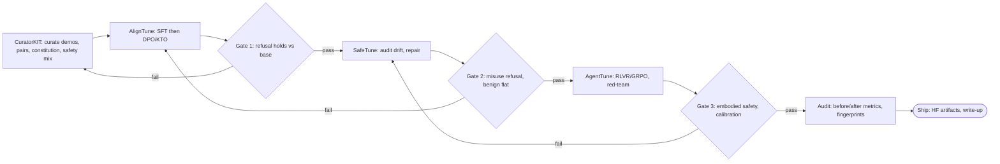

# High-Stakes Embodied Agents (HSEA) Research Track

The big picture for HSEA: what the project builds, what data and
models it uses, how the loop runs, and what retired. For the step by
step operating procedure, see [process](process.md).

## 1. Mission

HSEA builds a safety-graded finetuning loop for embodied
disaster-response agents. The design follows DORA (protocol-grounded
tasks, gold trajectories, typed eval) and adds the safety axis DORA
never built: refusal, abstention and escalation, harm grading, and
red-teaming. Execution uses Lexsi libraries on Cohere open-weights
bases with all artifacts public on Hugging Face. Embodiment comes from
dataset design and eval design, with no simulator building. Full
direction statement: [alignment-research](alignment-research.md) §1.

## 2. Dataset-composed tracks

Every eval and training split composes from the corpora in
[datasets](datasets.md). Three tracks cover vision, action, and safety.

### Footage: drone-navigator vision

Native aerial VQA and damage grading: FloodNet-VQA (the only native
UAV VQA set), LADI v2, AIDERv2, FLAME 2 frame labels, DisasterM3 as
the VLM format template, MEDIC and CrisisMMD for ground-view incident
semantics, NOMAD and WiSARD for victim detection. Live evals run
through `evals/floodnet_vqa.py` and `evals/ladi_v2.py` with the
`footage_score` scorer; pinned revisions and results live in
[footage-evals](footage-evals.md). RescueNet serves as held-out eval
only under its ND terms. VIDI, Sen1Floods11, SARD, FLAME 3, HERIDAL,
TREC-IS, DAD, and CrisisHelpOffer stay out under the clearance sweep
in [license-clearance-24](license-clearance-24.md).

### Action: agentic decisions

Dispatch, triage, planning, and communication: SafeAgentBench (safe
versus unsafe embodied plans), CrisiText with FEMA guidelines (the
warning head), HumAID and CrisisMMD (dispatch-priority pairs), plus
ALFRED and BEHAVIOR-style trajectories re-skinned to disaster
vignettes for safety grading. Robotics corpora (OXE, BridgeData V2,
DROID) supply off-domain priors only.

### Safety: refusal, abstention, and misuse resistance

HarmBench and AIR-Bench refusal gates, AgentHarm misuse refusal with
paired benign tasks, SafeAgentBench embodied safety, plus two
HSEA-curated sets: the abstention and escalation set in
`data/abstention/` (`evals/abstention.py`, `abstention_score`) and the
red-team attack set in `data/redteam/` (`evals/redteam.py`,
`redteam_asr`). The combined stack runs through `evals/safety.py`
(`safety_score`); thresholds live in
[safety-gates](safety-gates.md).

### Scope notes

* The track list above is complete. Retired items from the sim era are
  listed in §5 with reasons.
* `evals/smoke_inference.py` checks provider routing only. A smoke
  pass confirms wiring; it never counts as an eval result.

## 3. Model lanes

Every lane comes from [models](models.md). Current lanes:

| Lane | Models | Role |
|---|---|---|
| Cohere (mandatory) | Command A+, Aya Vision 8B/32B, Tiny Aya | Frontier VLM anchor, Cohere VLM baseline, small multilingual baseline |
| Qwen | Qwen3.8-27B, Qwen3-VL-8B/32B | Main workhorse and finetune base, VLM baseline |
| Grounding | Molmo2-8B/4B | Pointing and tracking specialist, finetune base |
| Gemma | Gemma 4 12B, Gemma 4 E2B | Permissive multimodal baseline, edge baseline |
| HF Inference frontier | DeepSeek V4.1-Flash, Mistral Large 3, Kimi K2.6 | API-only frontier reference points |
| Edge floor | SmolVLM-256M, Tiny Aya, Gemma E2B | Minimum viable vision and text scores |

Legacy lane, cited as legacy and never as current: Qwen2.5-7B,
Qwen2.5-14B-AWQ, and Mistral-7B-v0.3 served the retired sim-era bench.
Current evals and finetunes use the lanes above.

Serving: the Baseten key stays scope-locked to
`meta-models/muse-spark-open-1026`; Modal vLLM self-hosts open
weights; the HF Inference segment (`openai-api/hf/...`) routes
frontier weights. Details: [inference](inference.md).

## 4. Loop

Curate, align, harden, agent-train, eval. Each stage gates on the
safety stack before the next begins.

Stage commands and gate thresholds: [process](process.md) and
[safety-gates](safety-gates.md). Playbook source:
[alignment-research](alignment-research.md) §4.

## 5. What retired and why

Owner feedback on 2026-11-10 found showcase and eval drift from
legacy docs: sim-era pages described tracks that no longer run and
pulled new work toward retired setups. Retired in issue #42:

| Retired | Why |
|---|---|
| `docs/scenarios.md` | Cataloged sim scenario files; HSEA evals compose from datasets (§2) |
| `docs/roadmap.md` | Sim-era workstream list; planning lives in GitHub issues |
| `docs/peatforest-evals.md` | Peat sim eval page; FIRMS-pinned peat scenarios are out of scope |
| `docs/flywheel.md` | Sim-data loop doc; the Lexsi loop in §4 replaces it |
| `docs/action-surface.md` | ArduPilot/GUIDED tool surface; sim flight stacks stayed behind |
| Sim tracks (Gazebo/SITL, Colosseum/Unreal) | Left in the bench repo at seeding; only `mock` ships |
| FIRMS/peatforest pointers | Peat sim scope; the datasets in §2 carry the fire signal |
| Flywheel v1 finetuned weights | Single-teacher cloning null (see §6); weights unlinked |

Historical mentions in `docs/reports/` stay as history. The v1 dataset
example at `data/flywheel-v1/` stays as a format reference.

## 6. Flywheel v1 null note

One note covers the retired v1 loop. A single-teacher
behavior-cloning run at v1 data scale showed a statistically null
held-out delta, so the loop as run did not move held-out scores. The
lesson for v2 scale planning: success-filtered cloning at small scale
is insufficient evidence of a working data loop. The v1 dataset
example stays at `data/flywheel-v1/`; the v1 finetuned weights are
unlinked everywhere.
